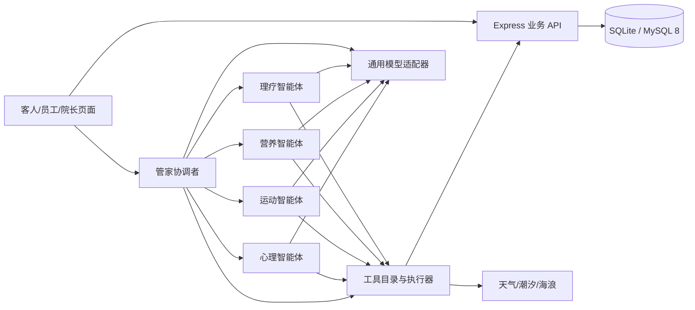

# 海屿康养社区进阶项目全栈落地闯关大纲

## 当前状态：已恢复，仅执行27-R1资源整改（2026-10-10）

用户已明确“继续”。阶段27仍未通过，现由原独立Luna Max任务仅处理退出记录缺口与资源封装；待Sol独验通过再安排剩余回归。大连开发区为用户暂定环境地点，坐标/潮汐站/授权待核实。完整dirty dfa3及旧失败/报告/PNG保留，旧历史例外不扩大、不Git写。详见[恢复分段计划](/Users/wangshanchong/.codex/worktrees/dfa3/haiyu_wellness/docs/阶段27恢复与分段返工计划_20261010.md)。下文旧暂停/执行文字为历史。

---

## 当前状态：阶段27未通过，开发暂停（2026-10-10）

源Sol本次独立范围/原始证据及全资源复核结论FAIL；当前物理残留0、空间采样稳定，但新增1项guardian标准退出记录缺口，旧限定历史例外不扩大。基础逐项证据、真实模型端到端及真实环境仍未验收齐全，网页旅程时段与需求矩阵证据也有不一致。Luna已停止；本次收尾后不派发任务、返工或补验，等待用户明确恢复。完整成果在/Users/wangshanchong/.codex/worktrees/dfa3/haiyu_wellness，未执行Git写操作。详见[阶段27最终复核](/Users/wangshanchong/.codex/worktrees/dfa3/haiyu_wellness/docs/阶段27验收复核_20261010.md)与[第33轮报告](/Users/wangshanchong/.codex/worktrees/dfa3/haiyu_wellness/wangshanchong/第33轮报告.md)。下文此前准备/执行状态为历史，课程描述不表示功能已通过验收。

---

> 版本：2026-09-28 · 接续基础版 `QuestMap.md` 阶段 1–8；本文件从阶段 9 开始。本文是待执行的教案与验收设计，关卡描述不表示功能已经实现。

## 项目需求

以现有 React/Vite + Express + npm + SQLite 应用为起点，完成入住登记、适老化客人端、健康档案核实、十一类海滨项目、真实天气/潮汐/海况、预约与容量、三餐推荐与配餐、健康与心情记录、每日简报、疗程审核、反馈重规划、员工运营，并让管家协调理疗、营养、运动、心理四个能独立调用模型和业务工具的专业智能体。最终以本地 MySQL 8 运行的完整业务旅程验收，SQLite 继续支持隔离测试和开发。

客人可以在页面或同一个管家对话里操作；医护负责高风险疗程审核；教练、理疗师、配餐员及管理员处理各自事务。原始需求矩阵 1–109 全部纳入课程映射，具体取舍见末尾索引。实时外部数据和模型调用需分别留下真实供应商响应与运行轨迹。

当前产品范围只包含网页版。公开页、登录页和各岗位工作区采用一致的页面尺度；桌面浏览器窗口宽度变化时使用流式扩展和内容重排，保留导航、核心信息与操作。验收宽度是抽样值，不是固定页面尺寸或设计上限。原始需求矩阵第 4 项在本课程中只按网页窗口适配验收。

## 现有成果与执行依据

| 资料 | 本大纲采用方式 |
| --- | --- |
| [基础版 QuestMap](<QuestMap.md>)；[第01轮](<wangshanchong/第01轮报告.md>)—[第09轮报告](<wangshanchong/第09轮报告.md>)；[首轮验收记录](<验收记录/首轮开发验收_2026-09-23.md>) | 基础版阶段 1–8 已有验收，进阶从真实现状继续；历史报告的通过结果不自动延伸到本大纲。 |
| [项目工程文档.md](<项目工程文档.md>)；[开发组织.md](<开发组织.md>)；[交接文档_海屿康养社区.md](<交接文档_海屿康养社区.md>)；[README.md](<README.md>) | 确认技术栈、角色、执行节奏、交接约定；历史描述与当前代码矛盾时以当前代码和最新报告为准。 |
| [原始选题说明](<项目依据/基于多智能体的海滨疗养智能康养服务系统.docx>)；[109 条需求矩阵](<项目依据/基于多智能体的海滨疗养智能康养服务系统_需求跟踪矩阵(1).xlsx>)；[概要设计](<概要设计/海屿康养社区概要设计_详细修订版.docx>) | 确定完整业务目标、角色场景、功能和原始验收意图；将旧架构说法转化到现有栈。 |
| [数据库字典](<数据库设计/海屿康养社区数据库设计.xlsx>)；[MySQL 8 参考脚本](<数据库设计/haiyu_wellness_mysql8.sql>)；[API 基线](<docs/API当前基线.md>)；[API 运行契约](<docs/API运行契约.md>)；[模型接入卡](<docs/模型接入卡.md>) | 作为数据迁移和接口对齐依据；旧建库脚本不能覆盖现有数据。 |
| [项目设计](<项目依据/01-project-design.md>)—[差距复核](<项目依据/06-review-gaps.md>)；[开发基线](<docs/开发基线.md>)；[Word 交接](<交接文档_海屿康养社区.docx>) | 交叉检查课程边界、遗留功能与文档冲突。 |
| [原测试计划](<项目依据/04-test-plan.md>)；[原阶段安排](<项目依据/05-schedule-2026.md>)；[实训进度表](<项目依据/大工软院实习实训项目计划-2026_秋季（1-8）.xlsx>)；[概要设计 PDF](<概要设计/海屿康养社区概要设计_详细修订版.pdf>)；[交付清单](<验收记录/交付清单与SHA256.txt>)；[运行说明](<运行脚本/停止开发环境说明.txt>)；[数据目录说明](<项目源码/server/data/README.md>) | 核对原测试思路、交付边界和运行方式；旧日期仅作历史计划，本大纲用阶段依赖安排。 |

编制时的实际基线：`main` 的已验收阶段 1–8、20 条 API 路由、11 张现有表、三类登录账号加公开访客、四类助手提示词、可用的通用模型配置。现有公开/客人/员工/院长助手各只进行一次模型回复；`/agent/status` 是状态展示，尚无专业智能体派发、工具执行、真实预约或医护审核闭环。第09轮模型环境相关改动已提交；后续阶段从实际 Git 状态继承已有成果。

## 关键工程约定

| 决定 | 课程执行口径 |
| --- | --- |
| 技术栈和交付 | React 18/Vite 5、Node.js 22/Express 4、npm workspaces；阶段 10 增加 MySQL 8，SQLite 留给测试。验收止于本地启动、构建和完整业务操作。 |
| 页面范围与尺度 | 只交付网页版；公开、登录、客人及机构工作区保持一致的布局密度和字号。布局随浏览器可用空间扩展或重排，不设置固定整页宽度，并保持同一套网页导航。 |
| 身份与岗位 | 客人、员工、院长沿用现有登录；员工细分医护、教练、理疗师、配餐员。仅医护能批准疗程，院长负责运营和权限配置。匿名访客不是第四种登录账号。 |
| 健康资料 | 客人自述及时保存为“待核实”；医护确认后形成正式版本；待核实过敏和禁忌在推荐时保守生效。入住信息由机构维护，客人只读。 |
| 计划与预约 | 草案不占名额；激活时重新校验禁忌、海况和容量并原子创建订单。确认“停止某项活动”可立即取消该订单；新替代疗程仍需按风险审核。 |
| 环境数据 | 天气、潮汐、海浪是不同数据源。潮位高度不能当浪高；站点、地点、单位、采集时间必须随判定保存。过去/未来缺数据标待确认，不伪装安全。 |
| 时间与可重复性 | 机构时区 `Asia/Shanghai`；测试使用注入时钟；一般单工具超过 15 秒降级，模型请求和整次运行另设可配置上限。通知依靠唯一键，重试不重复。 |
| 智能体定义 | 一个管家协调者 + 四个专业智能体，每个有独立 agentId、模型调用、知识/工具范围、父子 run 记录；业务写入由服务器工具执行，模型只提出动作。 |
| 演示规则 | 高血压温泉、皮肤破损海水/海泥、强紫外线、行动不便游泳、危险潮汐/浪况五类规则先以明确标记的合成参数验证；正式阈值须由机构确定。 |
| 安全投入 | 本轮保留身份边界、岗位权限、密钥不入库及临床禁忌等完成业务所必需的约束；不扩展等保平台、单点登录、复杂风控或云端安全工程。 |

模型适配层读取当前 `LLM_BASE_URL`、`LLM_MODEL`、`LLM_API_KEY` 等配置，业务代码只使用内部消息与工具契约。DeepSeek 当前可作为默认供应商，模型切换应主要修改配置和适配器。继续工具调用时保留供应商要求的上下文字段；轨迹记录工具、输入输出摘要和来源，不展示模型隐藏推理。

推荐成熟轮子与阅读入口：[DeepSeek 工具调用](https://api-docs.deepseek.com/guides/tool_calls/)、[DeepSeek 推理模式](https://api-docs.deepseek.com/guides/thinking_mode/)、[mysql2 Promise API](https://sidorares.github.io/node-mysql2/docs)、[Ajv 参数校验](https://ajv.js.org/guide/getting-started.html)、[node-cron 定时任务](https://www.nodecron.com/scheduling-options.html)、[和风天气潮汐接口](https://dev.qweather.com/en/docs/api/ocean/tide/)、[Open-Meteo 海浪接口](https://open-meteo.com/en/docs/marine-weather-api)、[Recharts 图表](https://recharts.github.io/en-US/guide/)、[浏览器通知权限](https://developer.mozilla.org/en-US/docs/Web/API/Notifications_API/Using_the_Notifications_API)。接入每个外部轮子的协议阅读与最小调用单列成关；凭据、服务条款和站点可用性在执行阶段验证。

## 通关方式与阶段路线

考官从仓库 `项目源码` 目录启动前后端，默认本地页面 `http://localhost:5180`、API `http://localhost:3020`。阶段 9 建立进阶命令：`npm run quest -- Q9.2`、`npm run quest -- --stage 9`、`npm run quest -- Q19.12 --live`。**这些进阶命令是学生的交付物，目前尚不存在，不应现在直接当成已通过命令。** 每个终端关须在隔离测试库执行，退出码为 0 且打印 `PASS Qx.y`、关键实际结果；失败返回非 0。页面关由考官按操作与预期逐项点击并保存截图/业务ID；文档关核对实际文件和映射。真实外部调用单独带 `--live`，无密钥或供应商失败记 `BLOCKED`，不得用录制数据冒充。

每一阶段仅在前一阶段通过后开始。每完成一个阶段，在 `wangshanchong` 下新建下一个未使用编号的 `第xx轮报告.md`，记录改动、关卡证据、实际命令与退出码、数据库/浏览器证据、未运行项、Git 状态和下一阶段交接；规划本身记录为第10轮。执行可继续采用“Sol 规划与验收、Luna Max 串行逐阶段实施”：每次只派发一个独立 Codex App 任务，工作树有未提交改动时从 working-tree 状态建立隔离 worktree；阶段通过后用 App 交接机制保留成果再进入下一阶段。此教案编制轮不启动开发任务，也不暂存、提交、推送或合并。

| 阶段 | 可独立验收的结果 | 前置 | 关卡数 |
| --- | --- | --- | ---: |
| 9 进阶基线与可观察的开发入口 | 基线快照、可重复验收入口、空页面导航、通用交互组件。 | 基础 Q1–Q8；第01–09轮报告；当前 working-tree。 | 6 |
| 10 MySQL 8 与数据库访问契约 | DB_DRIVER 切换、增量迁移、迁移校验报告和可回退说明。 | 阶段9；现有11表、MySQL SQL与Excel字典。 | 10 |
| 11 岗位、账号与入住登记 | 岗位页面、注册/入住接口与界面、可编辑负责关系。 | 阶段10；RTM1、8–12、21、97、102–107。 | 13 |
| 12 健康自述、采集核实与档案历史 | 可编辑自述区、核实队列、正式档案和变更依据。 | 阶段11；health_intakes现状；RTM13–20、98。 | 11 |
| 13 项目、知识与确定性规则 | 项目查询与管理页、可检索知识、统一规则判定结果。 | 阶段12；原始选题表3；RTM20、28、41–44、54、95。 | 10 |
| 14 天气、潮汐与可用时段判定 | 可替换环境适配器、过期状态、带来源的环境卡片和潮汐曲线。 | 阶段13；机构地点与潮汐站配置；官方API文档。 | 7 |
| 15 预约、容量与日程数据 | 统一reservation service、时段网格、预约单和日程查询。 | 阶段14；统一规则service与负责关系。 | 10 |
| 16 膳食推荐与点餐服务 | 菜单和订单service、客人膳食页、配餐工作台。 | 阶段12有效约束；阶段15事务与幂等能力。 | 10 |
| 17 健康指标录入与趋势 | 指标API、录入表单、7/30日趋势和可引用摘要。 | 阶段12档案；现有health_records。 | 7 |
| 18 心情记录与陪伴资源 | 心情API和页面、持久播放器、持续负面关注项。 | 阶段9时钟、阶段13知识条目、阶段17图表组件。 | 8 |
| 19 真实模型调用与可执行工具底座 | agent run与step持久化、受控工具执行器、可见的真实运行轨迹。 | 阶段10数据库、阶段11角色、阶段12有效约束、阶段13–18业务服务；已有模型配置。 | 12 |
| 20 四领域智能体与管家协作 | 五个agentId的独立运行证据、专业工具表和协调者合并结果。 | 阶段19运行底座和阶段13–18领域数据。 | 7 |
| 21 健康初评与疗程草案 | 带证据的疗程候选、待审状态、日历与时间轴。 | 阶段12健康档案、阶段15时段、阶段18反馈、阶段20多智能体。 | 10 |
| 22 医护审核与疗程激活 | 医护审核台、激活服务、抽检与完整历史。 | 阶段21版本化草案；阶段15预约容量；阶段11医护岗位。 | 12 |
| 23 对话业务操作与确认卡 | 可确认的工具操作及和页面一致的数据库结果。 | 阶段19工具运行、阶段15预约、阶段16膳食、阶段17指标、阶段22审核。 | 9 |
| 24 执行反馈与再规划闭环 | 反馈记录、差异卡、新计划版本和原始证据链。 | 阶段17/18记录、阶段22激活、阶段23业务工具。 | 8 |
| 25 每日简报与站内提醒 | 简报、通知中心和可重复验收的定时行为。 | 阶段9时钟、阶段14外部数据、阶段22计划、阶段24反馈。 | 8 |
| 26 机构运营、岗位日程与业务异常 | 机构运营页、岗位日程、异常处理与真实业务统计。 | 阶段11岗位、阶段15订单、阶段22审核、阶段25通知。 | 13 |
| 27 端到端验收与本地交付 | 完整验收索引、交付说明、最终报告与可运行本地版本。 | 阶段9–26全部通过；本地MySQL 8、模型和天气/潮汐凭据。 | 9 |

## 阶段 9：进阶基线与可观察的开发入口

从已经验收的基础版继续，先让新需求、测试数据和页面入口有稳定位置。

- **工作范围**：冻结继承状态、测试夹具、逻辑时钟、客人导航和适老化组件。
- **明确非目标**：不重建已有登录和新闻，不实现疗程或智能体。
- **输入与依赖**：基础 Q1–Q8；第01–09轮报告；当前 working-tree。
- **交付物**：基线快照、可重复验收入口、空页面导航、通用交互组件。
- **阶段验收命令与通过条件**：在隔离测试库执行 `npm run quest -- --stage 9`，退出码 0、所有本阶段终端关打印对应 `PASS`；逐一完成页面/文档检查，业务ID与数据库一致。任一关键结果缺失不得记该阶段通过。
- **轮次交接**：阶段验收通过后写一份 `wangshanchong/第xx轮报告.md`，列出真实证据与工作树状态。

### 🟢 Quest 9.1：记录实际开发起点

- **🎯 关卡目标**：为进阶开发保留一份能复现的代码与配置清单。
- **🛠️ 推荐工具/轮子**：Git、现有 npm scripts。
- **🚫 边界限制 (防超纲)**：不提交、不推送；不将 .env 内容写入报告。
- **✅ 考官验收标准 (PM Checklist)**：
  - [ ] 测试动作 1：打开本轮报告。
  - [ ] 预期结果 1：看到分支、HEAD、未提交文件清单和第09轮成果的继承说明；运行 npm test 与 npm run build 的真实退出码均为0。

### 🟢 Quest 9.2：扩展逐关验收命令

- **🎯 关卡目标**：让考官能指定进阶关卡、阶段和数据库运行黑盒用例。
- **🛠️ 推荐工具/轮子**：现有 scripts/quest.js、node:test。
- **🚫 边界限制 (防超纲)**：本关只实现参数解析和真实失败退出，不提前编写业务假 PASS。
- **✅ 考官验收标准 (PM Checklist)**：
  - [ ] 测试动作 1：在 `项目源码` 执行 `npm run quest -- Q9.2`；使用临时库检查 runner。
  - [ ] 预期结果 1：命令退出码 0 且打印 `PASS Q9.2`；支持 --stage、--db 和单关 ID；无效关卡退出非0；Q1.6 原命令仍通过；--live 未指定时不能访问外部模型。

### 🟢 Quest 9.3：提供三类可重复使用的合成客人

- **🎯 关卡目标**：建立长者、慢病康复和中青年三个场景夹具。
- **🛠️ 推荐工具/轮子**：临时数据库、fixture 数据文件。
- **🚫 边界限制 (防超纲)**：不使用真实客人；此时只填现有字段，后续关卡扩充字段。
- **✅ 考官验收标准 (PM Checklist)**：
  - [ ] 测试动作 1：在 `项目源码` 执行 `npm run quest -- Q9.3`；两次初始化独立测试库。
  - [ ] 预期结果 1：命令退出码 0 且打印 `PASS Q9.3`；每库出现3个标识固定的测试客人；慢病、过敏与行动能力不同；重复种子不重复插入，演示库不变。
- **对应原始需求**：RTM 20、RTM 70、RTM 79。

### 🟢 Quest 9.4：让时间相关验收无需等待

- **🎯 关卡目标**：为预约、提醒和当日修改提供可注入的业务时钟。
- **🛠️ 推荐工具/轮子**：Node、Intl、Asia/Shanghai。
- **🚫 边界限制 (防超纲)**：只允许测试环境推进时间，不改变操作系统时间。
- **✅ 考官验收标准 (PM Checklist)**：
  - [ ] 测试动作 1：在 `项目源码` 执行 `npm run quest -- Q9.4`；推进到测试日23:59和次日00:01。
  - [ ] 预期结果 1：命令退出码 0 且打印 `PASS Q9.4`；输出两个不同的机构日期，记录 UTC 时刻和 Asia/Shanghai；午夜边界可重复验证。
- **对应原始需求**：RTM 21、RTM 59、RTM 62、RTM 64、RTM 77、RTM 83。

### 🟢 Quest 9.5：建立适老化控件样本页

- **🎯 关卡目标**：统一配色、文字、按钮与确认反馈。
- **🛠️ 推荐工具/轮子**：React、CSS variables、浏览器。
- **🚫 边界限制 (防超纲)**：不更换框架，不开发业务表单。
- **✅ 考官验收标准 (PM Checklist)**：
  - [ ] 测试动作 1：启动本地前后端，在浏览器中打开控件样本页并用浏览器检查计算样式。
  - [ ] 预期结果 1：正文≥18px、标题≥24px、行距≥1.5、按钮高≥48px、点击区≥44×44px；海洋蓝等颜色符合 RTM；状态同时有文字。
  - [ ] 测试动作 2：启动本地前后端，在浏览器中触发成功、失败和危险操作示例。
  - [ ] 预期结果 2：顶部提示约2.5秒消失；详细错误可重新查看；危险操作展示影响并要求确认；正文对比度检查≥4.5:1。
- **对应原始需求**：RTM 2、RTM 3、RTM 6。

### 🟢 Quest 9.6：搭建客人网页的五个导航入口

- **🎯 关卡目标**：让管家、日程、项目、膳食、我的各有独立页面位置。
- **🛠️ 推荐工具/轮子**：React 现有侧栏、CSS Grid/Flexbox。
- **🚫 边界限制 (防超纲)**：新页可显示待开发说明，不伪造可预约项目或智能体结果；不另建第二套导航。
- **✅ 考官验收标准 (PM Checklist)**：
  - [ ] 测试动作 1：启动本地前后端，拖动桌面浏览器窗口并抽查约 1024px 和 1440px 时的五个入口。
  - [ ] 预期结果 1：始终显示侧栏导航；有足够空间时对话与结果并排，空间收窄时自然重排且不遮挡操作；“我的”含档案、心情、健康数据入口；切回列表保留浏览位置。公开页、登录页和客人工作区的标题、正文及卡片尺度一致。
- **对应原始需求**：RTM 4、RTM 5、RTM 7。

## 阶段 10：MySQL 8 与数据库访问契约

先把数据库切换落实，后续新业务沿用同一套持久化边界。

- **工作范围**：迁移记录、异步仓储、MySQL适配、旧数据导入与双库回归。
- **明确非目标**：不覆盖现有数据库，不建设集群、缓存中间件或复杂 ORM。
- **输入与依赖**：阶段9；现有11表、MySQL SQL与Excel字典。
- **交付物**：DB_DRIVER 切换、增量迁移、迁移校验报告和可回退说明。
- **阶段验收命令与通过条件**：在隔离测试库执行 `npm run quest -- --stage 10 --db=mysql`，退出码 0、所有本阶段终端关打印对应 `PASS`；逐一完成页面/文档检查，业务ID与数据库一致。任一关键结果缺失不得记该阶段通过。
- **轮次交接**：阶段验收通过后写一份 `wangshanchong/第xx轮报告.md`，列出真实证据与工作树状态。

### 🟢 Quest 10.1：对齐两套数据库字段

- **🎯 关卡目标**：给 SQLite 和 MySQL 的现有11表建立逐字段映射。
- **🛠️ 推荐工具/轮子**：SQL、数据库字典。
- **🚫 边界限制 (防超纲)**：不直接执行旧建库脚本覆盖演示数据。
- **✅ 考官验收标准 (PM Checklist)**：
  - [ ] 测试动作 1：打开数据库映射清单。
  - [ ] 预期结果 1：可找到 check_in/check_in_date、value/value_text、content/raw_content、status/review_status、消息role、会话ID长度等差异和转换规则。

### 🟢 Quest 10.2：分离增量迁移与演示种子

- **🎯 关卡目标**：让建表升级可重复执行且不会重置业务数据。
- **🛠️ 推荐工具/轮子**：SQL migrations、迁移版本表。
- **🚫 边界限制 (防超纲)**：不引入新业务表；演示 seed 必须显式启用。
- **✅ 考官验收标准 (PM Checklist)**：
  - [ ] 测试动作 1：在 `项目源码` 执行 `npm run quest -- Q10.2`；执行迁移两次并重启。
  - [ ] 预期结果 1：命令退出码 0 且打印 `PASS Q10.2`；第二次 applied=0；已修改电话、已撤销分工不被种子恢复；迁移失败时给出版本号。

### 🟢 Quest 10.3：接通独立 MySQL 测试库

- **🎯 关卡目标**：用 mysql2 建立可关闭的连接池和事务入口。
- **🛠️ 推荐工具/轮子**：mysql2/promise、本地 MySQL 8 或 Docker Compose。
- **🚫 边界限制 (防超纲)**：不连接生产库；数据库连接异常不能假装回退后写入另一库。
- **✅ 考官验收标准 (PM Checklist)**：
  - [ ] 测试动作 1：在 `项目源码` 执行 `npm run quest -- Q10.3`；指定 --db mysql 启动测试。
  - [ ] 预期结果 1：命令退出码 0 且打印 `PASS Q10.3`；显示 mysql、服务器版本和 SELECT 1 成功；不可用地址得到明确错误；连接池关闭后进程正常退出。

### 🟢 Quest 10.4：迁移账号数据访问

- **🎯 关卡目标**：让登录、改密和账号状态走异步仓储。
- **🛠️ 推荐工具/轮子**：users repository、现有鉴权测试。
- **🚫 边界限制 (防超纲)**：不改变登录契约或密码算法。
- **✅ 考官验收标准 (PM Checklist)**：
  - [ ] 测试动作 1：在 `项目源码` 执行 `npm run quest -- Q10.4`；分别在 sqlite/mysql 执行账号场景。
  - [ ] 预期结果 1：命令退出码 0 且打印 `PASS Q10.4`；三类现有账号都能登录，改密后旧密码失效，停用账号被拒绝；响应字段与基础版相同。

### 🟢 Quest 10.5：迁移档案与分工数据访问

- **🎯 关卡目标**：让客人概览和有效分工在两种数据库返回一致结果。
- **🛠️ 推荐工具/轮子**：profiles/assignments repository。
- **🚫 边界限制 (防超纲)**：不扩展可编辑字段。
- **✅ 考官验收标准 (PM Checklist)**：
  - [ ] 测试动作 1：在 `项目源码` 执行 `npm run quest -- Q10.5`；双库运行本人资料、分工到期和撤销场景。
  - [ ] 预期结果 1：命令退出码 0 且打印 `PASS Q10.5`；有效员工能读，过期或撤销后不能读；日期边界一致，联系电话修改可持久读取。

### 🟢 Quest 10.6：迁移健康记录与建议数据访问

- **🎯 关卡目标**：让健康列表和人工建议写入使用同一仓储契约。
- **🛠️ 推荐工具/轮子**：care repository、事务。
- **🚫 边界限制 (防超纲)**：不增加指标录入和方案生成。
- **✅ 考官验收标准 (PM Checklist)**：
  - [ ] 测试动作 1：在 `项目源码` 执行 `npm run quest -- Q10.6`；双库发布一条合成建议并读取记录。
  - [ ] 预期结果 1：命令退出码 0 且打印 `PASS Q10.6`；HTTP 201；客人可读相同作者、内容、日期；数据写入失败不留下成功审计。

### 🟢 Quest 10.7：迁移公开内容与管理记录数据访问

- **🎯 关卡目标**：让新闻、工作日志和院长意见使用可切换的数据访问实现。
- **🛠️ 推荐工具/轮子**：content/management repositories。
- **🚫 边界限制 (防超纲)**：不添加新闻编辑后台。
- **✅ 考官验收标准 (PM Checklist)**：
  - [ ] 测试动作 1：在 `项目源码` 执行 `npm run quest -- Q10.7`；双库读取置顶新闻、提交院长意见并检索日志。
  - [ ] 预期结果 1：命令退出码 0 且打印 `PASS Q10.7`；排序和关键字段一致；意见与员工绑定，其他员工的草稿和记录不混入。

### 🟢 Quest 10.8：迁移助手会话数据访问

- **🎯 关卡目标**：让消息、会话和待核实采集在 MySQL 持久保存。
- **🛠️ 推荐工具/轮子**：assistant repository、现有会话测试。
- **🚫 边界限制 (防超纲)**：不新增工具调用；不把模型凭证写数据库。
- **✅ 考官验收标准 (PM Checklist)**：
  - [ ] 测试动作 1：在 `项目源码` 执行 `npm run quest -- Q10.8`；双库对话后重启再查询历史。
  - [ ] 预期结果 1：命令退出码 0 且打印 `PASS Q10.8`；问答各1条且会话仍归属原账号；待核实采集为pending；跨会话读取仍被拒绝。

### 🟢 Quest 10.9：从 SQLite 副本导入 MySQL

- **🎯 关卡目标**：实现一次可核对且可重跑的数据导入。
- **🛠️ 推荐工具/轮子**：只读 SQLite 副本、导入脚本。
- **🚫 边界限制 (防超纲)**：不读取或写入默认演示库；不使用旧SQL中的UPSERT覆盖用户数据。
- **✅ 考官验收标准 (PM Checklist)**：
  - [ ] 测试动作 1：在 `项目源码` 执行 `npm run quest -- Q10.9`；导入含自定义资料和撤销分工的合成副本两次。
  - [ ] 预期结果 1：命令退出码 0 且打印 `PASS Q10.9`；11表行数与外键关联校验通过；第二次不重复数据；ID、密码哈希、消息顺序和时间含义保留。

### 🟢 Quest 10.10：验证切库与回退

- **🎯 关卡目标**：证明应用可显式选择 SQLite 或 MySQL 并保留原库。
- **🛠️ 推荐工具/轮子**：DB_DRIVER、集成测试。
- **🚫 边界限制 (防超纲)**：不自动迁回覆盖源库。
- **✅ 考官验收标准 (PM Checklist)**：
  - [ ] 测试动作 1：在 `项目源码` 执行 `npm run quest -- Q10.10`；在同一数据样本上切换驱动并重启。
  - [ ] 预期结果 1：命令退出码 0 且打印 `PASS Q10.10`；20条现有API契约通过；原SQLite副本内容不变；回退到原副本后三个演示角色可登录。

## 阶段 11：岗位、账号与入住登记

补齐机构人员和客人的真实业务入口，让后续审核与排期知道谁负责什么。

- **工作范围**：岗位分类、管理账号、手机号注册、入住与负责关系管理。
- **明确非目标**：不做短信认证、SSO、收费入住或完整人事系统。
- **输入与依赖**：阶段10；RTM1、8–12、21、97、102–107。
- **交付物**：岗位页面、注册/入住接口与界面、可编辑负责关系。
- **阶段验收命令与通过条件**：在隔离测试库执行 `npm run quest -- --stage 11`，退出码 0、所有本阶段终端关打印对应 `PASS`；逐一完成页面/文档检查，业务ID与数据库一致。任一关键结果缺失不得记该阶段通过。
- **轮次交接**：阶段验收通过后写一份 `wangshanchong/第xx轮报告.md`，列出真实证据与工作树状态。

### 🟢 Quest 11.1：为工作人员添加岗位类型

- **🎯 关卡目标**：在现有 staff 身份下区分医护、管理员和服务人员。
- **🛠️ 推荐工具/轮子**：迁移、演示种子。
- **🚫 边界限制 (防超纲)**：保留guest/staff/dean；院长不自动获得医护审核资格。
- **✅ 考官验收标准 (PM Checklist)**：
  - [ ] 测试动作 1：在 `项目源码` 执行 `npm run quest -- Q11.1`；创建医护、管理员、教练、理疗师和配餐员夹具。
  - [ ] 预期结果 1：命令退出码 0 且打印 `PASS Q11.1`；输出各自岗位；原staff_demo映射为医护，dean_demo仍可管理；已有账号ID不变。
- **对应原始需求**：RTM 1、RTM 102、RTM 107。

### 🟢 Quest 11.2：提供岗位能力清单

- **🎯 关卡目标**：让界面和业务接口读取同一份岗位职责定义。
- **🛠️ 推荐工具/轮子**：Express、简单 capability 表。
- **🚫 边界限制 (防超纲)**：只维护必需岗位边界，不建设通用权限平台。
- **✅ 考官验收标准 (PM Checklist)**：
  - [ ] 测试动作 1：在 `项目源码` 执行 `npm run quest -- Q11.2`；以医护、服务人员和院长读取能力。
  - [ ] 预期结果 1：命令退出码 0 且打印 `PASS Q11.2`；医护有方案审核；服务人员没有；院长可管理账号；直接访问无权接口得到403。
- **对应原始需求**：RTM 1、RTM 103、RTM 107。

### 🟢 Quest 11.3：提供员工创建接口

- **🎯 关卡目标**：让管理员能新增指定岗位的员工账号。
- **🛠️ 推荐工具/轮子**：Express、现有密码哈希。
- **🚫 边界限制 (防超纲)**：不导入外部组织目录。
- **✅ 考官验收标准 (PM Checklist)**：
  - [ ] 测试动作 1：在 `项目源码` 执行 `npm run quest -- Q11.3`；管理员新增一位教练并登录。
  - [ ] 预期结果 1：命令退出码 0 且打印 `PASS Q11.3`；HTTP 201，岗位和姓名可再读；重复账号返回409；客人不能创建员工。
- **对应原始需求**：RTM 102。

### 🟢 Quest 11.4：提供员工状态和岗位更新

- **🎯 关卡目标**：让管理员能停用员工或更改非医护岗位配置。
- **🛠️ 推荐工具/轮子**：员工管理 service。
- **🚫 边界限制 (防超纲)**：停用不删除历史工作记录；不能绕过医护岗位锁定规则。
- **✅ 考官验收标准 (PM Checklist)**：
  - [ ] 测试动作 1：在 `项目源码` 执行 `npm run quest -- Q11.4`；停用新教练后用旧令牌访问。
  - [ ] 预期结果 1：命令退出码 0 且打印 `PASS Q11.4`；访问被拒绝；原工作日志仍可查；更新岗位后能力与岗位一致。
- **对应原始需求**：RTM 102、RTM 107。

### 🟢 Quest 11.5：连接员工账号管理页

- **🎯 关卡目标**：将新增、岗位和停用操作呈现给管理员。
- **🛠️ 推荐工具/轮子**：React、现有院长空间。
- **🚫 边界限制 (防超纲)**：不做员工薪资和绩效自动评定。
- **✅ 考官验收标准 (PM Checklist)**：
  - [ ] 测试动作 1：启动本地前后端，在浏览器中管理员新增员工、刷新列表并停用。
  - [ ] 预期结果 1：列表显示姓名、岗位、角色和状态；停用需确认，刷新后仍停用。
- **对应原始需求**：RTM 102。

### 🟢 Quest 11.6：展示并调整非核心岗位权限

- **🎯 关卡目标**：给管理员一页可查阅的权限矩阵。
- **🛠️ 推荐工具/轮子**：React、capability API。
- **🚫 边界限制 (防超纲)**：医护审核权限固定，仅开放预先列出的非核心开关。
- **✅ 考官验收标准 (PM Checklist)**：
  - [ ] 测试动作 1：启动本地前后端，在浏览器中关闭教练的运营汇总查看权限后重新登录。
  - [ ] 预期结果 1：矩阵开关、菜单和接口结果一致；医护审核格不能通过普通开关授予教练。
- **对应原始需求**：RTM 103、RTM 107。

### 🟢 Quest 11.7：按岗位进入对应首页

- **🎯 关卡目标**：让医护、管理员和服务人员登录后进入正确工作区。
- **🛠️ 推荐工具/轮子**：现有登录流程、角色导航。
- **🚫 边界限制 (防超纲)**：目标页尚未完成时显示标题与待开发提示。
- **✅ 考官验收标准 (PM Checklist)**：
  - [ ] 测试动作 1：启动本地前后端，在浏览器中依次登录医护、管理员、教练、配餐员。
  - [ ] 预期结果 1：分别进入审核台、管理总览、每日安排、备餐单；无权页面显示可返回的提示。
- **对应原始需求**：RTM 106。

### 🟢 Quest 11.8：提供客人手机号注册

- **🎯 关卡目标**：创建可使用手机号登录的客人账号。
- **🛠️ 推荐工具/轮子**：Express、现有users表。
- **🚫 边界限制 (防超纲)**：不发验证码；用户名演示登录继续可用。
- **✅ 考官验收标准 (PM Checklist)**：
  - [ ] 测试动作 1：在 `项目源码` 执行 `npm run quest -- Q11.8`；注册合法合成手机号后登录。
  - [ ] 预期结果 1：命令退出码 0 且打印 `PASS Q11.8`；HTTP 201和200；重复手机号、非11位、两次密码不一致都拒绝；默认状态为待入住。
- **对应原始需求**：RTM 8、RTM 9、RTM 10、RTM 11。

### 🟢 Quest 11.9：连接注册与登录切换页面

- **🎯 关卡目标**：让新客人完成注册并进入档案填写入口。
- **🛠️ 推荐工具/轮子**：React表单、既有登录API。
- **🚫 边界限制 (防超纲)**：不在注册页面分配房间或生成疗程。
- **✅ 考官验收标准 (PM Checklist)**：
  - [ ] 测试动作 1：启动本地前后端，在浏览器中点“客人注册”，先输错误确认密码再修正提交。
  - [ ] 预期结果 1：错误位置有行内提示；密码遮蔽；注册成功进入健康档案，返回登录链接可用。
- **对应原始需求**：RTM 8、RTM 9、RTM 10、RTM 11。

### 🟢 Quest 11.10：提供入住登记接口

- **🎯 关卡目标**：用机构登记确定房间、入住区间和在住状态。
- **🛠️ 推荐工具/轮子**：stays service、日期校验。
- **🚫 边界限制 (防超纲)**：不做房费；住宿天数定义为离店日期减入住日期，同日入住离店须明确拒绝或按登记规则处理。
- **✅ 考官验收标准 (PM Checklist)**：
  - [ ] 测试动作 1：在 `项目源码` 执行 `npm run quest -- Q11.10`；登记3晚、10晚及离店早于入住三个样本。
  - [ ] 预期结果 1：命令退出码 0 且打印 `PASS Q11.10`；3晚疗程上限3天，10晚上限7天；非法区间被拒绝；输出待入住/在住/已离店状态。
- **对应原始需求**：RTM 12、RTM 21、RTM 97。

### 🟢 Quest 11.11：连接入住登记与客户筛选

- **🎯 关卡目标**：让管理员维护入住信息并按在住状态查找客人。
- **🛠️ 推荐工具/轮子**：React、stays API。
- **🚫 边界限制 (防超纲)**：客人不能在此修改机构登记字段。
- **✅ 考官验收标准 (PM Checklist)**：
  - [ ] 测试动作 1：启动本地前后端，在浏览器中登记客人房间后筛选“在住”，再办理离店。
  - [ ] 预期结果 1：姓名、房号、日期、状态同步到客人档案；已离店筛选可找到该客人。
- **对应原始需求**：RTM 12、RTM 21、RTM 97。

### 🟢 Quest 11.12：提供负责关系管理接口

- **🎯 关卡目标**：让管理员建立、结束和查询员工与客人的分工。
- **🛠️ 推荐工具/轮子**：现有staff_guest_assignments。
- **🚫 边界限制 (防超纲)**：不通过重跑种子恢复已撤销关系。
- **✅ 考官验收标准 (PM Checklist)**：
  - [ ] 测试动作 1：在 `项目源码` 执行 `npm run quest -- Q11.12`；分配客人给医护，再结束该关系并重启。
  - [ ] 预期结果 1：命令退出码 0 且打印 `PASS Q11.12`；分配后可读，结束后不可读；旧日志保留，重启不恢复关系。
- **对应原始需求**：RTM 97、RTM 98、RTM 107。

### 🟢 Quest 11.13：连接负责关系管理界面

- **🎯 关卡目标**：让管理员在客户详情里调整负责人员。
- **🛠️ 推荐工具/轮子**：React、分工API。
- **🚫 边界限制 (防超纲)**：暂不分配项目时段，时段执行者在阶段26安排。
- **✅ 考官验收标准 (PM Checklist)**：
  - [ ] 测试动作 1：启动本地前后端，在浏览器中给测试客人增加负责医护再移除。
  - [ ] 预期结果 1：详情显示生效区间；医护工作台名单同步变化；重复点击不产生重复有效关系。
- **对应原始需求**：RTM 97、RTM 98、RTM 107。

## 阶段 12：健康自述、采集核实与档案历史

让客人能补充完整健康资料，也能看清哪些内容仍待核实。

- **工作范围**：自述字段、完整度、版本记录、采集确认/驳回和机构只读视图。
- **明确非目标**：不生成诊断或处方，不放宽既有联系信息PATCH白名单。
- **输入与依赖**：阶段11；health_intakes现状；RTM13–20、98。
- **交付物**：可编辑自述区、核实队列、正式档案和变更依据。
- **阶段验收命令与通过条件**：在隔离测试库执行 `npm run quest -- --stage 12`，退出码 0、所有本阶段终端关打印对应 `PASS`；逐一完成页面/文档检查，业务ID与数据库一致。任一关键结果缺失不得记该阶段通过。
- **轮次交接**：阶段验收通过后写一份 `wangshanchong/第xx轮报告.md`，列出真实证据与工作树状态。

### 🟢 Quest 12.1：补充健康自述数据字段

- **🎯 关卡目标**：保存慢病、用药时段、过敏、忌口、行动能力、睡眠、皮肤状况及客群标签。
- **🛠️ 推荐工具/轮子**：迁移、JSON schema。
- **🚫 边界限制 (防超纲)**：自述和已核实资料分层，不把旧记录假定为新审核结果。
- **✅ 考官验收标准 (PM Checklist)**：
  - [ ] 测试动作 1：在 `项目源码` 执行 `npm run quest -- Q12.1`；写入并重读合成健康自述。
  - [ ] 预期结果 1：命令退出码 0 且打印 `PASS Q12.1`；每个字段和值完整返回；用药只记录用户原文和时段；正式档案原值不变。
- **对应原始需求**：RTM 13、RTM 14、RTM 15、RTM 70、RTM 79。

### 🟢 Quest 12.2：绘制健康自述表单

- **🎯 关卡目标**：让客人看到可以补充的健康问题。
- **🛠️ 推荐工具/轮子**：React、多选和文本域。
- **🚫 边界限制 (防超纲)**：本关只操作本地表单状态。
- **✅ 考官验收标准 (PM Checklist)**：
  - [ ] 测试动作 1：启动本地前后端，在浏览器中选择慢病、忌口、行动能力及睡眠并清空必填项。
  - [ ] 预期结果 1：各控件可见可改，错误定位到字段；姓名房间保持只读。
- **对应原始需求**：RTM 13、RTM 14、RTM 15、RTM 16。

### 🟢 Quest 12.3：保存健康自述版本

- **🎯 关卡目标**：为表单提交建立带来源的待核实版本。
- **🛠️ 推荐工具/轮子**：health-profile API、事务。
- **🚫 边界限制 (防超纲)**：不直接把自述覆盖成医护已核实内容。
- **✅ 考官验收标准 (PM Checklist)**：
  - [ ] 测试动作 1：在 `项目源码` 执行 `npm run quest -- Q12.3`；提交两版自述并重读。
  - [ ] 预期结果 1：命令退出码 0 且打印 `PASS Q12.3`；各版本有来源form、提交人和时间；去重后待核实变更可查；未知字段拒绝。
- **对应原始需求**：RTM 16、RTM 17、RTM 98。

### 🟢 Quest 12.4：连接表单保存与重读

- **🎯 关卡目标**：让客人刷新后仍能看到新提交的信息和核实状态。
- **🛠️ 推荐工具/轮子**：React、health-profile API。
- **🚫 边界限制 (防超纲)**：不能把pending显示成已核实。
- **✅ 考官验收标准 (PM Checklist)**：
  - [ ] 测试动作 1：启动本地前后端，在浏览器中新增虾过敏并保存，刷新页面。
  - [ ] 预期结果 1：提示保存成功；“客人自述”显示虾过敏和待核实标记；正式档案区保持原值。
- **对应原始需求**：RTM 14、RTM 16、RTM 98。

### 🟢 Quest 12.5：显示档案完整度

- **🎯 关卡目标**：按明确字段列表计算并定位缺失项。
- **🛠️ 推荐工具/轮子**：简单字段计数。
- **🚫 边界限制 (防超纲)**：不从模型生成百分比，不因未患病而扣完整度。
- **✅ 考官验收标准 (PM Checklist)**：
  - [ ] 测试动作 1：启动本地前后端，在浏览器中补全缺失用药说明并保存。
  - [ ] 预期结果 1：进度条分子增加1；“无长期用药”计为已填；点击缺失项跳到对应输入框。
- **对应原始需求**：RTM 18。

### 🟢 Quest 12.6：展示档案变更前后对照

- **🎯 关卡目标**：让客人和负责医护追溯一条字段修改。
- **🛠️ 推荐工具/轮子**：版本查询API、React展开行。
- **🚫 边界限制 (防超纲)**：不允许在历史页修改旧版本。
- **✅ 考官验收标准 (PM Checklist)**：
  - [ ] 测试动作 1：启动本地前后端，在浏览器中展开最近一次自述变更。
  - [ ] 预期结果 1：显示修改前后值、表单/对话来源、修改人及时间；机构详情显示同一份只读记录。
- **对应原始需求**：RTM 17、RTM 98。

### 🟢 Quest 12.7：列出待核实健康采集

- **🎯 关卡目标**：让负责医护找到已有health_intakes与新自述变更。
- **🛠️ 推荐工具/轮子**：intake查询API、现有分工。
- **🚫 边界限制 (防超纲)**：本关只查询，不确认档案。
- **✅ 考官验收标准 (PM Checklist)**：
  - [ ] 测试动作 1：在 `项目源码` 执行 `npm run quest -- Q12.7`；以负责医护查询指定客人。
  - [ ] 预期结果 1：命令退出码 0 且打印 `PASS Q12.7`；返回旧文本采集和新结构化采集；包含原文、候选字段、来源会话、pending状态；非负责人员不能读取。
- **对应原始需求**：RTM 19、RTM 98。

### 🟢 Quest 12.8：确认一条健康采集

- **🎯 关卡目标**：用一次人工确认把指定候选字段转入正式档案。
- **🛠️ 推荐工具/轮子**：事务、版本号。
- **🚫 边界限制 (防超纲)**：若档案已改变须重新比较，不能静默覆盖较新值。
- **✅ 考官验收标准 (PM Checklist)**：
  - [ ] 测试动作 1：在 `项目源码` 执行 `npm run quest -- Q12.8`；确认虾过敏候选，再重复确认。
  - [ ] 预期结果 1：命令退出码 0 且打印 `PASS Q12.8`；正式档案只新增一次；采集变confirmed并保留审核人/时间；重复执行无额外修改，旧版本冲突返回409。
- **对应原始需求**：RTM 19、RTM 20。

### 🟢 Quest 12.9：驳回一条健康采集

- **🎯 关卡目标**：保存驳回原因并保留正式档案。
- **🛠️ 推荐工具/轮子**：intake review API。
- **🚫 边界限制 (防超纲)**：不删除原始自述。
- **✅ 考官验收标准 (PM Checklist)**：
  - [ ] 测试动作 1：在 `项目源码` 执行 `npm run quest -- Q12.9`；填写原因后驳回错误睡眠信息。
  - [ ] 预期结果 1：命令退出码 0 且打印 `PASS Q12.9`；状态rejected；原因可查；正式档案未修改；缺原因请求被拒绝。
- **对应原始需求**：RTM 19。

### 🟢 Quest 12.10：连接健康核实工作台

- **🎯 关卡目标**：让医护在页面对比、确认或驳回采集内容。
- **🛠️ 推荐工具/轮子**：React、采集审核接口。
- **🚫 边界限制 (防超纲)**：这是健康采集核实，不是疗程审批。
- **✅ 考官验收标准 (PM Checklist)**：
  - [ ] 测试动作 1：启动本地前后端，在浏览器中选择客人待核实项并确认，再到客人端刷新。
  - [ ] 预期结果 1：正式档案更新；变更记录注明人工核实；驳回项显示原因，机构普通档案页仍只读。
- **对应原始需求**：RTM 19、RTM 98。

### 🟢 Quest 12.11：汇总推荐所需的有效健康约束

- **🎯 关卡目标**：让推荐同时考虑已核实资料和尚待核实的明确限制。
- **🛠️ 推荐工具/轮子**：纯函数、来源ID。
- **🚫 边界限制 (防超纲)**：待核实的过敏/禁忌按限制使用；解除限制须经核实，不能因未审核而忽略。
- **✅ 考官验收标准 (PM Checklist)**：
  - [ ] 测试动作 1：在 `项目源码` 执行 `npm run quest -- Q12.11`；正式档案无过敏但待核实自述含虾过敏。
  - [ ] 预期结果 1：命令退出码 0 且打印 `PASS Q12.11`；有效约束包含虾及其采集ID；冲突状态可见；后续推荐能读取同一份约束。
- **对应原始需求**：RTM 19、RTM 20。

## 阶段 13：项目、知识与确定性规则

把智能体需要读取的业务事实和约束准备好。

- **工作范围**：11项项目库、维护入口、带来源的知识条目和R1–R5规则。
- **明确非目标**：不预约、不生成疗程、不把演示参数视为真实医疗标准。
- **输入与依赖**：阶段12；原始选题表3；RTM20、28、41–44、54、95。
- **交付物**：项目查询与管理页、可检索知识、统一规则判定结果。
- **阶段验收命令与通过条件**：在隔离测试库执行 `npm run quest -- --stage 13`，退出码 0、所有本阶段终端关打印对应 `PASS`；逐一完成页面/文档检查，业务ID与数据库一致。任一关键结果缺失不得记该阶段通过。
- **轮次交接**：阶段验收通过后写一份 `wangshanchong/第xx轮报告.md`，列出真实证据与工作树状态。

### 🟢 Quest 13.1：建立11项滨海项目数据

- **🎯 关卡目标**：持久化原始项目库的四项水疗、四项运动与三项亲海项目。
- **🛠️ 推荐工具/轮子**：迁移、种子JSON。
- **🚫 边界限制 (防超纲)**：不省略项目，不用图片代替字段。
- **✅ 考官验收标准 (PM Checklist)**：
  - [ ] 测试动作 1：在 `项目源码` 执行 `npm run quest -- Q13.1`；读取项目目录。
  - [ ] 预期结果 1：命令退出码 0 且打印 `PASS Q13.1`；总数11、类别数量4/4/3；每项有地点、介绍、适宜人群、禁忌、开放窗口、容量和下海标记，运动有强度。
- **对应原始需求**：RTM 42、RTM 54。

### 🟢 Quest 13.2：提供项目搜索与分类查询

- **🎯 关卡目标**：让同一目录支持分类、名称和单条详情查询。
- **🛠️ 推荐工具/轮子**：Express、catalog repository。
- **🚫 边界限制 (防超纲)**：不加入个性化排序。
- **✅ 考官验收标准 (PM Checklist)**：
  - [ ] 测试动作 1：在 `项目源码` 执行 `npm run quest -- Q13.2`；查水疗、搜“温泉”、查无效ID。
  - [ ] 预期结果 1：命令退出码 0 且打印 `PASS Q13.2`；分别得到4条、1条和404；空搜索结果返回空数组。
- **对应原始需求**：RTM 41、RTM 42、RTM 43、RTM 44。

### 🟢 Quest 13.3：展示项目列表和分类

- **🎯 关卡目标**：让客人通过页面找到一个项目。
- **🛠️ 推荐工具/轮子**：React、图片占位/本地资源。
- **🚫 边界限制 (防超纲)**：列表只读，不显示虚假剩余容量。
- **✅ 考官验收标准 (PM Checklist)**：
  - [ ] 测试动作 1：启动本地前后端，在浏览器中依次切换三类并搜索温泉与不存在名称。
  - [ ] 预期结果 1：项目数量符合目录，卡片有强度和摘要；空结果显示“未找到相关项目”。
- **对应原始需求**：RTM 41、RTM 42、RTM 43。

### 🟢 Quest 13.4：展示完整项目详情

- **🎯 关卡目标**：让客人查看介绍、地点和禁忌提示。
- **🛠️ 推荐工具/轮子**：React、详情API。
- **🚫 边界限制 (防超纲)**：预约区域暂显示未开放。
- **✅ 考官验收标准 (PM Checklist)**：
  - [ ] 测试动作 1：启动本地前后端，在浏览器中打开海水浴和游泳训练详情。
  - [ ] 预期结果 1：可见图文介绍、开放时段和禁忌文字；运动强度明确，返回列表保留筛选。
- **对应原始需求**：RTM 44。

### 🟢 Quest 13.5：提供项目维护接口

- **🎯 关卡目标**：让管理员修改项目说明、开放窗口和停用状态。
- **🛠️ 推荐工具/轮子**：Express、schema校验。
- **🚫 边界限制 (防超纲)**：已有预约的容量调整规则留给排期关；不物理删除已引用项目。
- **✅ 考官验收标准 (PM Checklist)**：
  - [ ] 测试动作 1：在 `项目源码` 执行 `npm run quest -- Q13.5`；更新一个项目后重新查询。
  - [ ] 预期结果 1：命令退出码 0 且打印 `PASS Q13.5`；字段持久保存；停用后不进入新推荐候选，历史引用仍能显示名称；非法时段拒绝。
- **对应原始需求**：RTM 54、RTM 99。

### 🟢 Quest 13.6：连接项目维护表单

- **🎯 关卡目标**：让管理员在管理页维护一个项目。
- **🛠️ 推荐工具/轮子**：React、项目维护API。
- **🚫 边界限制 (防超纲)**：不批量生成排期。
- **✅ 考官验收标准 (PM Checklist)**：
  - [ ] 测试动作 1：启动本地前后端，在浏览器中修改测试项目说明并停用，刷新客人列表。
  - [ ] 预期结果 1：说明更新且新列表不再推荐停用项目；管理页仍可查看记录。
- **对应原始需求**：RTM 54、RTM 99。

### 🟢 Quest 13.7：存储有来源的领域知识

- **🎯 关卡目标**：提供理疗、营养、运动和陪伴四类知识检索。
- **🛠️ 推荐工具/轮子**：关系表、关键词/标签检索。
- **🚫 边界限制 (防超纲)**：先用小型人工整理资料集，不搭建向量数据库；每条都要来源与更新时间。
- **✅ 考官验收标准 (PM Checklist)**：
  - [ ] 测试动作 1：在 `项目源码` 执行 `npm run quest -- Q13.7`；按领域和关键词查询种子知识。
  - [ ] 预期结果 1：命令退出码 0 且打印 `PASS Q13.7`；每个领域至少2条；结果含knowledgeId、来源链接、更新时间和摘要，找不到时明确为空。
- **对应原始需求**：RTM 28。

### 🟢 Quest 13.8：固化R1–R5规则记录

- **🎯 关卡目标**：将业务限制写成可测试的编号、条件和动作。
- **🛠️ 推荐工具/轮子**：JSON schema、配置表。
- **🚫 边界限制 (防超纲)**：规则阈值由演示夹具提供并标注，真实医疗与海况阈值另由机构确认。
- **✅ 考官验收标准 (PM Checklist)**：
  - [ ] 测试动作 1：打开规则清单。
  - [ ] 预期结果 1：R1慢病温泉限制/需审核；R2皮肤破损海水浴与海泥限制；R3强紫外线；R4行动受限游泳；R5潮汐海况；每项均有来源、版本和演示说明。
- **对应原始需求**：RTM 20、RTM 28、RTM 95。

### 🟢 Quest 13.9：执行统一规则判定

- **🎯 关卡目标**：把档案、项目和环境输入转换为明确的允许、限制或拒绝结果。
- **🛠️ 推荐工具/轮子**：纯函数、node:test。
- **🚫 边界限制 (防超纲)**：模型不能修改规则结论；不硬编码诊疗剂量。
- **✅ 考官验收标准 (PM Checklist)**：
  - [ ] 测试动作 1：在 `项目源码` 执行 `npm run quest -- Q13.9`；分别运行五条命中样本和一个正常样本。
  - [ ] 预期结果 1：命令退出码 0 且打印 `PASS Q13.9`；输出ruleId、处置动作、字段来源及reviewRequired；正常样本允许；缺少关键环境数据时下海项目不放行。
- **对应原始需求**：RTM 20、RTM 24、RTM 26、RTM 28、RTM 50、RTM 95。

### 🟢 Quest 13.10：展示可检索规则列表

- **🎯 关卡目标**：让医护查询系统正在使用的限制条件。
- **🛠️ 推荐工具/轮子**：React、只读规则API。
- **🚫 边界限制 (防超纲)**：不在本阶段提供任意规则脚本编辑器。
- **✅ 考官验收标准 (PM Checklist)**：
  - [ ] 测试动作 1：启动本地前后端，在浏览器中在规则页搜索“皮肤”并打开结果。
  - [ ] 预期结果 1：显示R2、版本、触发条件和动作；编号与CLI判定一致。
- **对应原始需求**：RTM 28、RTM 95。

## 阶段 14：天气、潮汐与可用时段判定

把环境信息变成页面和智能体共用的数据。

- **工作范围**：第三方契约阅读、天气/潮汐/海况适配、缓存、时段判定与展示。
- **明确非目标**：不让模型推测潮位；不将mock标成实时；真实凭证验收单列到阶段27。
- **输入与依赖**：阶段13；机构地点与潮汐站配置；官方API文档。
- **交付物**：可替换环境适配器、过期状态、带来源的环境卡片和潮汐曲线。
- **阶段验收命令与通过条件**：在隔离测试库执行 `npm run quest -- --stage 14`，退出码 0、所有本阶段终端关打印对应 `PASS`；逐一完成页面/文档检查，业务ID与数据库一致。任一关键结果缺失不得记该阶段通过。
- **轮次交接**：阶段验收通过后写一份 `wangshanchong/第xx轮报告.md`，列出真实证据与工作树状态。

### 🟢 Quest 14.1：阅读并记录环境服务契约

- **🎯 关卡目标**：为真实数据接入选定地点、站点、字段和服务商。
- **🛠️ 推荐工具/轮子**：和风天气潮汐、Open-Meteo天气/海况官方文档。
- **🚫 边界限制 (防超纲)**：不默认“项目在大连”；缺少机构地点时使用明确标注的测试地点。
- **✅ 考官验收标准 (PM Checklist)**：
  - [ ] 测试动作 1：打开环境接入卡。
  - [ ] 预期结果 1：可见经纬度/站点、API Host、鉴权方式、单位、潮高基准、时区、预测覆盖日期、来源署名和凭证获取步骤；缺失配置逐项列出。
- **对应原始需求**：RTM 45、RTM 50、RTM 57。

### 🟢 Quest 14.2：接入天气查询适配器

- **🎯 关卡目标**：把温度、风和紫外线转换成统一环境字段。
- **🛠️ 推荐工具/轮子**：Node fetch、provider adapter。
- **🚫 边界限制 (防超纲)**：自动测试只调用本地HTTP替身。
- **✅ 考官验收标准 (PM Checklist)**：
  - [ ] 测试动作 1：在 `项目源码` 执行 `npm run quest -- Q14.2`；读取固定天气响应并模拟服务错误。
  - [ ] 预期结果 1：命令退出码 0 且打印 `PASS Q14.2`；字段、单位、source和observedAt正确；错误时返回unavailable而不是晴天默认值。
- **对应原始需求**：RTM 29、RTM 57。

### 🟢 Quest 14.3：接入站点潮汐查询适配器

- **🎯 关卡目标**：保存站点潮汐时刻与逐小时潮位。
- **🛠️ 推荐工具/轮子**：和风天气潮汐API、响应归一化。
- **🚫 边界限制 (防超纲)**：潮汐高度不当作海浪高度；不混用不同垂直基准。
- **✅ 考官验收标准 (PM Checklist)**：
  - [ ] 测试动作 1：在 `项目源码` 执行 `npm run quest -- Q14.3`；导入两次站点潮汐替身响应。
  - [ ] 预期结果 1：命令退出码 0 且打印 `PASS Q14.3`；高潮/低潮类型、逐时曲线、有效日期与来源正确；同一快照不重复；站点缺失明确失败。
- **对应原始需求**：RTM 45、RTM 50、RTM 57。

### 🟢 Quest 14.4：接入海浪与海况查询

- **🎯 关卡目标**：把海浪等环境数据补入同一时间轴。
- **🛠️ 推荐工具/轮子**：Open-Meteo Marine 或机构认可海况源。
- **🚫 边界限制 (防超纲)**：模型海平面高度不能冒充当地潮汐站实测；课程数据用于演示判定。
- **✅ 考官验收标准 (PM Checklist)**：
  - [ ] 测试动作 1：在 `项目源码` 执行 `npm run quest -- Q14.4`；读取海浪响应并与潮汐按小时对齐。
  - [ ] 预期结果 1：命令退出码 0 且打印 `PASS Q14.4`；输出独立waveHeight和tideHeight；缺一类数据时标记该字段未知，不以0代替。
- **对应原始需求**：RTM 45、RTM 50、RTM 57。

### 🟢 Quest 14.5：处理环境缓存与失效

- **🎯 关卡目标**：让多个入口共用一份带有效期的数据快照。
- **🛠️ 推荐工具/轮子**：数据库缓存、注入时钟。
- **🚫 边界限制 (防超纲)**：不无限使用过期数据；不因缓存未命中阻塞所有普通业务。
- **✅ 考官验收标准 (PM Checklist)**：
  - [ ] 测试动作 1：在 `项目源码` 执行 `npm run quest -- Q14.5`；连续查询同一地点后推进时钟使数据过期。
  - [ ] 预期结果 1：命令退出码 0 且打印 `PASS Q14.5`；有效期内仅请求提供方1次；过期后返回stale/unavailable；当天缺数据的下海项目不被放行。
- **对应原始需求**：RTM 29、RTM 30、RTM 50、RTM 57。

### 🟢 Quest 14.6：计算某项目时段的可用性

- **🎯 关卡目标**：将开放时间、环境窗口和项目规则转成可用时段。
- **🛠️ 推荐工具/轮子**：统一规则service、环境适配器。
- **🚫 边界限制 (防超纲)**：本关不扣容量；未来超出预测范围的下海时段保持待确认。
- **✅ 考官验收标准 (PM Checklist)**：
  - [ ] 测试动作 1：在 `项目源码` 执行 `npm run quest -- Q14.6`；计算正常、潮高、风浪大、UV强和缺数据五类窗口。
  - [ ] 预期结果 1：命令退出码 0 且打印 `PASS Q14.6`；输出available/reason/最近可选时段；所有被限制窗口都明确原因，不能默认全日可约。
- **对应原始需求**：RTM 46、RTM 48、RTM 50。

### 🟢 Quest 14.7：显示同源天气卡与潮汐曲线

- **🎯 关卡目标**：让首页、项目详情显示相同来源和时间的环境信息。
- **🛠️ 推荐工具/轮子**：React、Recharts。
- **🚫 边界限制 (防超纲)**：展示数据来源和预测/演示标志，不做自制气象预测。
- **✅ 考官验收标准 (PM Checklist)**：
  - [ ] 测试动作 1：启动本地前后端，在浏览器中打开首页天气卡和海水浴详情，展开曲线。
  - [ ] 预期结果 1：同日温度和潮汐一致；曲线可读高潮/低潮；模拟数据缺失时显示暂无数据及限制说明。
- **对应原始需求**：RTM 45、RTM 48、RTM 57。

## 阶段 15：预约、容量与日程数据

先让页面操作能完成真实预约，为智能体提供可靠工具。

- **工作范围**：排期时段、原子预约、取消、冲突和客人预约界面。
- **明确非目标**：不让LLM占用名额，不实现支付。
- **输入与依赖**：阶段14；统一规则service与负责关系。
- **交付物**：统一reservation service、时段网格、预约单和日程查询。
- **阶段验收命令与通过条件**：在隔离测试库执行 `npm run quest -- --stage 15`，退出码 0、所有本阶段终端关打印对应 `PASS`；逐一完成页面/文档检查，业务ID与数据库一致。任一关键结果缺失不得记该阶段通过。
- **轮次交接**：阶段验收通过后写一份 `wangshanchong/第xx轮报告.md`，列出真实证据与工作树状态。

### 🟢 Quest 15.1：生成可重复的开放时段

- **🎯 关卡目标**：按项目开放窗口生成未来可预约时段记录。
- **🛠️ 推荐工具/轮子**：迁移、program_slots。
- **🚫 边界限制 (防超纲)**：不根据疗程草案预占容量。
- **✅ 考官验收标准 (PM Checklist)**：
  - [ ] 测试动作 1：在 `项目源码` 执行 `npm run quest -- Q15.1`；生成同一项目未来7日排期两次。
  - [ ] 预期结果 1：命令退出码 0 且打印 `PASS Q15.1`；时段数不翻倍；每个时段有开始/结束时间、地点、容量和项目ID。
- **对应原始需求**：RTM 46、RTM 54、RTM 99。

### 🟢 Quest 15.2：提供剩余容量查询

- **🎯 关卡目标**：返回可用性、已约数与剩余容量。
- **🛠️ 推荐工具/轮子**：slots API、reservation查询。
- **🚫 边界限制 (防超纲)**：不单靠前端缓存判断是否能约。
- **✅ 考官验收标准 (PM Checklist)**：
  - [ ] 测试动作 1：在 `项目源码` 执行 `npm run quest -- Q15.2`；查询容量2且已有1单的时段。
  - [ ] 预期结果 1：命令退出码 0 且打印 `PASS Q15.2`；返回remaining=1、booked=1、capacity=2及环境状态；不可用时段附原因。
- **对应原始需求**：RTM 46、RTM 48、RTM 51。

### 🟢 Quest 15.3：原子创建一条预约

- **🎯 关卡目标**：在同一事务中校验并占用一个可用名额。
- **🛠️ 推荐工具/轮子**：事务、MySQL行锁/SQLite写事务。
- **🚫 边界限制 (防超纲)**：只针对显式选择的客人和时段；不跳过规则与在住区间校验。
- **✅ 考官验收标准 (PM Checklist)**：
  - [ ] 测试动作 1：在 `项目源码` 执行 `npm run quest -- Q15.3`；对容量2时段同时提交10位不同客人的请求。
  - [ ] 预期结果 1：命令退出码 0 且打印 `PASS Q15.3`；成功恰为2，其余明确约满；数据库只有2条有效预约，任何失败不遗留占位。
- **对应原始需求**：RTM 47、RTM 50、RTM 51、RTM 53。

### 🟢 Quest 15.4：阻止重复和时间冲突预约

- **🎯 关卡目标**：让重试与跨项目重叠不会多占名额。
- **🛠️ 推荐工具/轮子**：幂等键、客人日程锁、区间冲突检查。
- **🚫 边界限制 (防超纲)**：幂等不是把所有同文消息永久去重。
- **✅ 考官验收标准 (PM Checklist)**：
  - [ ] 测试动作 1：在 `项目源码` 执行 `npm run quest -- Q15.4`；重试同一请求并同时预约两个重叠项目。
  - [ ] 预期结果 1：命令退出码 0 且打印 `PASS Q15.4`；同一幂等键返回同一预约；同一客人重叠区间仅一单成功，非重叠正常通过。
- **对应原始需求**：RTM 47、RTM 51、RTM 53。

### 🟢 Quest 15.5：取消预约并释放名额

- **🎯 关卡目标**：完成可重复执行的取消操作。
- **🛠️ 推荐工具/轮子**：reservation service、事务。
- **🚫 边界限制 (防超纲)**：不删除预约历史；已完成预约不能当作未执行预约取消。
- **✅ 考官验收标准 (PM Checklist)**：
  - [ ] 测试动作 1：在 `项目源码` 执行 `npm run quest -- Q15.5`；取消一单两次后查询时段。
  - [ ] 预期结果 1：命令退出码 0 且打印 `PASS Q15.5`；状态cancelled；容量只释放一次；取消原因和操作入口可查。
- **对应原始需求**：RTM 49、RTM 53。

### 🟢 Quest 15.6：展示预约时段网格

- **🎯 关卡目标**：让客人看到可选、满额和不可用时段。
- **🛠️ 推荐工具/轮子**：React、slots API。
- **🚫 边界限制 (防超纲)**：本关不提交预约。
- **✅ 考官验收标准 (PM Checklist)**：
  - [ ] 测试动作 1：启动本地前后端，在浏览器中进入测试项目详情并点击不可用时段。
  - [ ] 预期结果 1：看到“余1/2”、约满样式和限制原因；不可用格能查看说明但不能选中提交。
- **对应原始需求**：RTM 46、RTM 48。

### 🟢 Quest 15.7：连接页面预约确认

- **🎯 关卡目标**：让选中时段生成可在页面查到的预约单。
- **🛠️ 推荐工具/轮子**：React、reservation API。
- **🚫 边界限制 (防超纲)**：提交中禁用按钮，成功依据数据库返回编号。
- **✅ 考官验收标准 (PM Checklist)**：
  - [ ] 测试动作 1：启动本地前后端，在浏览器中选可用时段点击立即预约，再刷新。
  - [ ] 预期结果 1：展示编号、项目、时段、状态与页面入口；两次快速点击仅出现一单；约满错误说明具体。
- **对应原始需求**：RTM 47、RTM 53。

### 🟢 Quest 15.8：连接我的预约和取消按钮

- **🎯 关卡目标**：让客人按日期查看并取消本人预约。
- **🛠️ 推荐工具/轮子**：React、取消API。
- **🚫 边界限制 (防超纲)**：取消前说明将释放该时段。
- **✅ 考官验收标准 (PM Checklist)**：
  - [ ] 测试动作 1：启动本地前后端，在浏览器中在我的预约取消一条待执行记录。
  - [ ] 预期结果 1：二次确认后变已取消，刷新仍一致；另一客人能预约刚释放名额。
- **对应原始需求**：RTM 49、RTM 53。

### 🟢 Quest 15.9：提供统一日程投影

- **🎯 关卡目标**：让所有页面按同一接口读取有效预约安排。
- **🛠️ 推荐工具/轮子**：schedule查询service。
- **🚫 边界限制 (防超纲)**：本关没有疗程草稿，不能把已取消单展示为待执行。
- **✅ 考官验收标准 (PM Checklist)**：
  - [ ] 测试动作 1：在 `项目源码` 执行 `npm run quest -- Q15.9`；创建、取消预约后分别读取日程。
  - [ ] 预期结果 1：命令退出码 0 且打印 `PASS Q15.9`；创建的项目时段与预约单相同；取消后有效日程移除，历史保留。
- **对应原始需求**：RTM 53、RTM 60、RTM 100。

### 🟢 Quest 15.10：处理排期容量调整

- **🎯 关卡目标**：允许管理员关闭时段或增加容量而不破坏已有订单。
- **🛠️ 推荐工具/轮子**：slots维护API。
- **🚫 边界限制 (防超纲)**：减少容量不能小于有效预约数；已有订单的批量取消在阶段26实施。
- **✅ 考官验收标准 (PM Checklist)**：
  - [ ] 测试动作 1：在 `项目源码` 执行 `npm run quest -- Q15.10`；把已有2单的容量改成1，再改成3并关闭新预约。
  - [ ] 预期结果 1：命令退出码 0 且打印 `PASS Q15.10`；第一次409、第二次成功；关闭后旧单仍可查，新请求被拒绝。
- **对应原始需求**：RTM 51、RTM 99。

## 阶段 16：膳食推荐与点餐服务

让推荐、换菜和配餐共享同一份菜单与订单。

- **工作范围**：菜品、约束过滤、三餐、换菜、点餐和备餐状态。
- **明确非目标**：先用确定性选择形成业务基线；营养智能体在阶段20接入。
- **输入与依赖**：阶段12有效约束；阶段15事务与幂等能力。
- **交付物**：菜单和订单service、客人膳食页、配餐工作台。
- **阶段验收命令与通过条件**：在隔离测试库执行 `npm run quest -- --stage 16`，退出码 0、所有本阶段终端关打印对应 `PASS`；逐一完成页面/文档检查，业务ID与数据库一致。任一关键结果缺失不得记该阶段通过。
- **轮次交接**：阶段验收通过后写一份 `wangshanchong/第xx轮报告.md`，列出真实证据与工作树状态。

### 🟢 Quest 16.1：建立可追溯的菜品目录

- **🎯 关卡目标**：保存菜品成分、过敏原、营养标签和可供应餐次。
- **🛠️ 推荐工具/轮子**：迁移、菜品种子。
- **🚫 边界限制 (防超纲)**：不按菜名猜过敏原，不宣称食材有治疗效果。
- **✅ 考官验收标准 (PM Checklist)**：
  - [ ] 测试动作 1：在 `项目源码` 执行 `npm run quest -- Q16.1`；查询三餐候选菜品。
  - [ ] 预期结果 1：命令退出码 0 且打印 `PASS Q16.1`；每道菜有dishId、配料、过敏原、餐次、营养信息来源和供应状态；包含可替代的非海鲜菜品。
- **对应原始需求**：RTM 25、RTM 66、RTM 69、RTM 70。

### 🟢 Quest 16.2：筛选符合个人约束的候选菜

- **🎯 关卡目标**：硬性排除过敏和忌口，再应用客群偏好。
- **🛠️ 推荐工具/轮子**：确定性规则service。
- **🚫 边界限制 (防超纲)**：菜品不足时不能放宽过敏限制。
- **✅ 考官验收标准 (PM Checklist)**：
  - [ ] 测试动作 1：在 `项目源码` 执行 `npm run quest -- Q16.2`；比较虾过敏长者与无过敏减压客人的候选集。
  - [ ] 预期结果 1：命令退出码 0 且打印 `PASS Q16.2`；虾菜从前者排除；偏好标签不同；仅剩禁忌菜时返回不足原因而非凑餐。
- **对应原始需求**：RTM 25、RTM 66、RTM 69、RTM 70。

### 🟢 Quest 16.3：保存一天的三餐推荐

- **🎯 关卡目标**：把符合约束的候选组合保存为可换菜菜单。
- **🛠️ 推荐工具/轮子**：menu service、版本号。
- **🚫 边界限制 (防超纲)**：本关不点餐，不预留食物库存。
- **✅ 考官验收标准 (PM Checklist)**：
  - [ ] 测试动作 1：在 `项目源码` 执行 `npm run quest -- Q16.3`；生成一天菜单后再读。
  - [ ] 预期结果 1：命令退出码 0 且打印 `PASS Q16.3`；有早中晚、主菜/配菜/汤、营养标签、避开项和规则依据；版本可查。
- **对应原始需求**：RTM 65、RTM 66、RTM 69。

### 🟢 Quest 16.4：展示可切换日期的三餐卡片

- **🎯 关卡目标**：让客人查看当天与其他日期的菜单。
- **🛠️ 推荐工具/轮子**：React、menu API。
- **🚫 边界限制 (防超纲)**：不把没有数据的日期复制成当天菜单。
- **✅ 考官验收标准 (PM Checklist)**：
  - [ ] 测试动作 1：启动本地前后端，在浏览器中进入膳食页并切换有数据和无数据日期。
  - [ ] 预期结果 1：三餐字段完整、避开虾等限制可见；无数据日显示待生成。
- **对应原始需求**：RTM 65、RTM 66。

### 🟢 Quest 16.5：替换一道菜并重新校验

- **🎯 关卡目标**：只更新目标菜品并保留其余菜单。
- **🛠️ 推荐工具/轮子**：menu change service。
- **🚫 边界限制 (防超纲)**：已备餐订单不能静默换菜；同餐多处修改要检查版本。
- **✅ 考官验收标准 (PM Checklist)**：
  - [ ] 测试动作 1：在 `项目源码` 执行 `npm run quest -- Q16.5`；用合规鸡肉替换鱼，再尝试替换为含虾菜。
  - [ ] 预期结果 1：命令退出码 0 且打印 `PASS Q16.5`；首次成功且其他菜不变；禁忌替换拒绝；有已约订单时菜单与订单在同一事务更新。
- **对应原始需求**：RTM 67、RTM 71。

### 🟢 Quest 16.6：连接换菜面板

- **🎯 关卡目标**：让客人选择换菜原因并确认新菜。
- **🛠️ 推荐工具/轮子**：React、换菜API。
- **🚫 边界限制 (防超纲)**：本关只页面操作，不使用对话工具。
- **✅ 考官验收标准 (PM Checklist)**：
  - [ ] 测试动作 1：启动本地前后端，在浏览器中点击换一个，选择口味原因并提交。
  - [ ] 预期结果 1：新菜与避开项刷新；备餐中订单显示需联系配餐员，刷新后不会显示未保存的替换。
- **对应原始需求**：RTM 67。

### 🟢 Quest 16.7：创建点餐预约单

- **🎯 关卡目标**：按已确认菜单创建一条日期餐次订单。
- **🛠️ 推荐工具/轮子**：meal_order service、幂等键。
- **🚫 边界限制 (防超纲)**：不接支付和外卖平台。
- **✅ 考官验收标准 (PM Checklist)**：
  - [ ] 测试动作 1：在 `项目源码` 执行 `npm run quest -- Q16.7`；同一菜单与餐次提交两次。
  - [ ] 预期结果 1：命令退出码 0 且打印 `PASS Q16.7`；返回同一订单；包含菜品、客人、日期餐次、页面入口、已约状态及预计送餐时间。
- **对应原始需求**：RTM 68、RTM 72。

### 🟢 Quest 16.8：展示客人的点餐结果

- **🎯 关卡目标**：让预约点餐按钮与订单状态可见。
- **🛠️ 推荐工具/轮子**：React、点餐API。
- **🚫 边界限制 (防超纲)**：按钮成功反馈必须包含真实订单号。
- **✅ 考官验收标准 (PM Checklist)**：
  - [ ] 测试动作 1：启动本地前后端，在浏览器中对晚餐点击预约点餐并刷新。
  - [ ] 预期结果 1：显示订单号、预计时间、已约状态；菜品与菜单一致，重复点击不重复下单。
- **对应原始需求**：RTM 68、RTM 72。

### 🟢 Quest 16.9：展示配餐员备餐单

- **🎯 关卡目标**：让配餐员按日期餐次看到自己负责的点餐。
- **🛠️ 推荐工具/轮子**：React、岗位过滤查询。
- **🚫 边界限制 (防超纲)**：不展示不负责客人的完整健康档案。
- **✅ 考官验收标准 (PM Checklist)**：
  - [ ] 测试动作 1：启动本地前后端，在浏览器中用配餐员登录并选择晚餐。
  - [ ] 预期结果 1：看到客人、房间、菜品和明确忌口提醒；与客人订单号相同。
- **对应原始需求**：RTM 72、RTM 104、RTM 105。

### 🟢 Quest 16.10：推进备餐和送达状态

- **🎯 关卡目标**：让订单在已约、备餐中和已送达之间按顺序流转。
- **🛠️ 推荐工具/轮子**：状态转换API、React按钮。
- **🚫 边界限制 (防超纲)**：不允许从已送达退回已约；暂不做物流追踪。
- **✅ 考官验收标准 (PM Checklist)**：
  - [ ] 测试动作 1：启动本地前后端，在浏览器中配餐员依次标记备餐中与已送达，客人刷新。
  - [ ] 预期结果 1：两端状态一致；错误倒退被拒绝并有说明。
- **对应原始需求**：RTM 72、RTM 105。

## 阶段 17：健康指标录入与趋势

把指标变成智能体能引用的结构化记录。

- **工作范围**：四类指标、来源、日期列表、删除、更正与趋势查询。
- **明确非目标**：不接硬件设备，不把演示阈值当诊断标准。
- **输入与依赖**：阶段12档案；现有health_records。
- **交付物**：指标API、录入表单、7/30日趋势和可引用摘要。
- **阶段验收命令与通过条件**：在隔离测试库执行 `npm run quest -- --stage 17`，退出码 0、所有本阶段终端关打印对应 `PASS`；逐一完成页面/文档检查，业务ID与数据库一致。任一关键结果缺失不得记该阶段通过。
- **轮次交接**：阶段验收通过后写一份 `wangshanchong/第xx轮报告.md`，列出真实证据与工作树状态。

### 🟢 Quest 17.1：统一四类指标结构

- **🎯 关卡目标**：让血压双值、睡眠、步数和体重拥有明确单位。
- **🛠️ 推荐工具/轮子**：迁移、schema校验。
- **🚫 边界限制 (防超纲)**：兼容旧value_text；不拆出第二套互不相通的健康记录。
- **✅ 考官验收标准 (PM Checklist)**：
  - [ ] 测试动作 1：在 `项目源码` 执行 `npm run quest -- Q17.1`；转换旧血压记录并读出四类新样本。
  - [ ] 预期结果 1：命令退出码 0 且打印 `PASS Q17.1`；血压保留systolic/diastolic及mmHg；其余单位为h、步、kg；来源、记录时间与录入人齐全。
- **对应原始需求**：RTM 81、RTM 85。

### 🟢 Quest 17.2：提供指标录入接口

- **🎯 关卡目标**：保存一条经过类型与范围检查的指标。
- **🛠️ 推荐工具/轮子**：Express、metric service。
- **🚫 边界限制 (防超纲)**：演示合理区间仅用于输入校验；不能因此生成病情结论。
- **✅ 考官验收标准 (PM Checklist)**：
  - [ ] 测试动作 1：在 `项目源码` 执行 `npm run quest -- Q17.2`；保存有效血压再提交单位错误、低压高于高压与越界样本。
  - [ ] 预期结果 1：命令退出码 0 且打印 `PASS Q17.2`；有效值HTTP 201；其他样本被明确拒绝；不写入无效记录。
- **对应原始需求**：RTM 81、RTM 85。

### 🟢 Quest 17.3：连接四类指标表单

- **🎯 关卡目标**：让客人输入数值与记录时间并保存。
- **🛠️ 推荐工具/轮子**：React、metric API。
- **🚫 边界限制 (防超纲)**：不在此关触发疗程调整。
- **✅ 考官验收标准 (PM Checklist)**：
  - [ ] 测试动作 1：启动本地前后端，在浏览器中依次录入血压、睡眠、步数和体重。
  - [ ] 预期结果 1：成功后列表可见，刷新仍在；错误项红框定位，单位显示明确。
- **对应原始需求**：RTM 81、RTM 85。

### 🟢 Quest 17.4：展示指标记录和当日删除

- **🎯 关卡目标**：让客人查看来源并撤销当日误录。
- **🛠️ 推荐工具/轮子**：列表/删除API、逻辑时钟。
- **🚫 边界限制 (防超纲)**：删除保留更正痕迹；隔日记录不能按当日规则删除。
- **✅ 考官验收标准 (PM Checklist)**：
  - [ ] 测试动作 1：启动本地前后端，在浏览器中删除今天一条误录，再尝试删除昨天一条。
  - [ ] 预期结果 1：今天记录从有效列表移除；昨天请求被拒绝；列表按实际记录时间倒序并显示来源。
- **对应原始需求**：RTM 83、RTM 85。

### 🟢 Quest 17.5：提供7日和30日趋势数据

- **🎯 关卡目标**：按机构日期聚合指标并保留引用ID。
- **🛠️ 推荐工具/轮子**：聚合查询、缺失数据规则。
- **🚫 边界限制 (防超纲)**：缺失值不补0；不能把血压双值压成一个字符串参与计算。
- **✅ 考官验收标准 (PM Checklist)**：
  - [ ] 测试动作 1：在 `项目源码` 执行 `npm run quest -- Q17.5`；查询含两天缺失的7日血压与睡眠。
  - [ ] 预期结果 1：命令退出码 0 且打印 `PASS Q17.5`；日期和单位正确；缺失日为空；血压有两条数值序列；每个点可追溯原记录。
- **对应原始需求**：RTM 82、RTM 84。

### 🟢 Quest 17.6：展示可切换指标的趋势图

- **🎯 关卡目标**：让考官直接比较图表和录入记录。
- **🛠️ 推荐工具/轮子**：React、Recharts。
- **🚫 边界限制 (防超纲)**：异常标记按已登记的演示规则，不让模型决定颜色。
- **✅ 考官验收标准 (PM Checklist)**：
  - [ ] 测试动作 1：启动本地前后端，在浏览器中切换四种指标与7/30日视图，悬停一个点。
  - [ ] 预期结果 1：提示框值、单位、日期与记录列表一致；缺失处断开；异常点有文字说明。
- **对应原始需求**：RTM 82。

### 🟢 Quest 17.7：生成可供调整引用的指标摘要

- **🎯 关卡目标**：返回近期变化与数据充足性结论。
- **🛠️ 推荐工具/轮子**：metric summary service。
- **🚫 边界限制 (防超纲)**：本关只汇总，不自动改项目。
- **✅ 考官验收标准 (PM Checklist)**：
  - [ ] 测试动作 1：在 `项目源码` 执行 `npm run quest -- Q17.7`；比较样本不足与连续记录两个夹具。
  - [ ] 预期结果 1：命令退出码 0 且打印 `PASS Q17.7`；前者insufficient_data；后者列出记录ID、时间窗口、变化描述和命中演示规则。
- **对应原始需求**：RTM 84、RTM 108。

## 阶段 18：心情记录与陪伴资源

给心理陪伴智能体准备真实可查的情绪记录与资源。

- **工作范围**：心情选择、每日唯一记录、趋势、冥想内容和环境音。
- **明确非目标**：不做心理诊断，不训练音频模型，不承诺系统后台锁屏持续播放。
- **输入与依赖**：阶段9时钟、阶段13知识条目、阶段17图表组件。
- **交付物**：心情API和页面、持久播放器、持续负面关注项。
- **阶段验收命令与通过条件**：在隔离测试库执行 `npm run quest -- --stage 18`，退出码 0、所有本阶段终端关打印对应 `PASS`；逐一完成页面/文档检查，业务ID与数据库一致。任一关键结果缺失不得记该阶段通过。
- **轮次交接**：阶段验收通过后写一份 `wangshanchong/第xx轮报告.md`，列出真实证据与工作树状态。

### 🟢 Quest 18.1：保存每日心情记录

- **🎯 关卡目标**：将快捷心情和五档分值统一成每天一条有效记录。
- **🛠️ 推荐工具/轮子**：mood service、唯一约束。
- **🚫 边界限制 (防超纲)**：快捷入口和详细表单不能各写一条。
- **✅ 考官验收标准 (PM Checklist)**：
  - [ ] 测试动作 1：在 `项目源码` 执行 `npm run quest -- Q18.1`；同日提交快捷心情和详细记录。
  - [ ] 预期结果 1：命令退出码 0 且打印 `PASS Q18.1`；第二次提示已记录；显式修改更新同一ID；午夜后不能修改昨日值。
- **对应原始需求**：RTM 73、RTM 77。

### 🟢 Quest 18.2：连接心情快捷入口与编辑

- **🎯 关卡目标**：让客人选择心情、填写备注并进入管家对话。
- **🛠️ 推荐工具/轮子**：React、mood API。
- **🚫 边界限制 (防超纲)**：不为每个领域另建独立聊天账号。
- **✅ 考官验收标准 (PM Checklist)**：
  - [ ] 测试动作 1：启动本地前后端，在浏览器中选择烦闷，再在详细记录修改为平静。
  - [ ] 预期结果 1：当日只有一条有效状态；管家入口仍是同一会话；重复保存有清楚反馈。
- **对应原始需求**：RTM 73、RTM 74、RTM 77。

### 🟢 Quest 18.3：汇总并展示心情趋势

- **🎯 关卡目标**：让近7/30日变化与原始记录一致。
- **🛠️ 推荐工具/轮子**：聚合API、Recharts。
- **🚫 边界限制 (防超纲)**：没有记录的日子不能显示为心情最低值。
- **✅ 考官验收标准 (PM Checklist)**：
  - [ ] 测试动作 1：启动本地前后端，在浏览器中切换7日和30日，点击一个有记录的日期。
  - [ ] 预期结果 1：分值和备注对应原记录；疗程调整事件层先允许为空，阶段24补入。
- **对应原始需求**：RTM 78、RTM 80。

### 🟢 Quest 18.4：建立冥想和环境音资源目录

- **🎯 关卡目标**：提供可播放且注明来源的放松内容。
- **🛠️ 推荐工具/轮子**：本地可授权音频、HTML audio。
- **🚫 边界限制 (防超纲)**：不抓取未知授权音源；内容不足时不得用失效链接充数。
- **✅ 考官验收标准 (PM Checklist)**：
  - [ ] 测试动作 1：在 `项目源码` 执行 `npm run quest -- Q18.4`；检查呼吸放松、身体扫描、海滨冥想与海浪音资源。
  - [ ] 预期结果 1：命令退出码 0 且打印 `PASS Q18.4`；四类资源存在，URL可读且有名称、时长、封面和来源/授权说明。
- **对应原始需求**：RTM 75、RTM 76。

### 🟢 Quest 18.5：展示冥想课程卡和播放页

- **🎯 关卡目标**：让客人选择课程并控制播放进度。
- **🛠️ 推荐工具/轮子**：React、HTML audio。
- **🚫 边界限制 (防超纲)**：不自动播放未经点击的声音。
- **✅ 考官验收标准 (PM Checklist)**：
  - [ ] 测试动作 1：启动本地前后端，在浏览器中点击身体扫描课程并播放、暂停、拖动进度。
  - [ ] 预期结果 1：名称、时长、播放位置正确；资源失败显示可恢复错误。
- **对应原始需求**：RTM 75、RTM 76。

### 🟢 Quest 18.6：保留跨页面环境音播放

- **🎯 关卡目标**：让陪伴聊天时环境音可以继续播放。
- **🛠️ 推荐工具/轮子**：顶层播放器、HTML audio。
- **🚫 边界限制 (防超纲)**：仅承诺站内页面切换不中断；操作系统挂起不计为持续播放保证。
- **✅ 考官验收标准 (PM Checklist)**：
  - [ ] 测试动作 1：启动本地前后端，在浏览器中播放海浪音并调音量，切到管家发送消息后再返回。
  - [ ] 预期结果 1：音频未重新从头播放；暂停和音量状态保留。
- **对应原始需求**：RTM 76。

### 🟢 Quest 18.7：识别持续负面情绪关注项

- **🎯 关卡目标**：按可配置的演示规则形成一个待人工关注事项。
- **🛠️ 推荐工具/轮子**：mood summary、关注表。
- **🚫 边界限制 (防超纲)**：不从一条负面记录得出疾病诊断。
- **✅ 考官验收标准 (PM Checklist)**：
  - [ ] 测试动作 1：在 `项目源码` 执行 `npm run quest -- Q18.7`；连续3日负面样本触发检测两次。
  - [ ] 预期结果 1：命令退出码 0 且打印 `PASS Q18.7`；只生成1个待关注事项，含日期和记录ID；改善后更新状态，普通正常样本不触发。
- **对应原始需求**：RTM 27、RTM 79。

### 🟢 Quest 18.8：提供情绪与反馈摘要查询

- **🎯 关卡目标**：让后续智能体读取情绪变化和资源使用摘要。
- **🛠️ 推荐工具/轮子**：只读summary service。
- **🚫 边界限制 (防超纲)**：不把资源播放次数等同于心理改善。
- **✅ 考官验收标准 (PM Checklist)**：
  - [ ] 测试动作 1：在 `项目源码` 执行 `npm run quest -- Q18.8`；查询长者与中青年夹具。
  - [ ] 预期结果 1：命令退出码 0 且打印 `PASS Q18.8`；返回各自画像、近期心情记录ID与可用资源；不足数据明确标注。
- **对应原始需求**：RTM 27、RTM 79、RTM 80、RTM 108。

## 阶段 19：真实模型调用与可执行工具底座

把现有单次对话升级为能调用服务器工具、可回放的智能体运行。

- **工作范围**：模型协议、工具目录、执行循环、运行记录、超时恢复与对话呈现。
- **明确非目标**：本阶段只有一个管家协调者；四个专业智能体留给阶段20。
- **输入与依赖**：阶段10数据库、阶段11角色、阶段12有效约束、阶段13–18业务服务；已有模型配置。
- **交付物**：agent run与step持久化、受控工具执行器、可见的真实运行轨迹。
- **阶段验收命令与通过条件**：在隔离测试库执行 `npm run quest -- --stage 19`，退出码 0、所有本阶段终端关打印对应 `PASS`；逐一完成页面/文档检查，业务ID与数据库一致；真实服务关须额外执行相应 `--live` 命令。任一关键结果缺失不得记该阶段通过。
- **轮次交接**：阶段验收通过后写一份 `wangshanchong/第xx轮报告.md`，列出真实证据与工作树状态。

### 🟢 Quest 19.1：阅读并验证模型工具调用协议

- **🎯 关卡目标**：把第三方 Chat Completions 工具请求和返回变为可替换的内部格式。
- **🛠️ 推荐工具/轮子**：现有LLM_BASE_URL/LLM_MODEL、DeepSeek官方文档。
- **🚫 边界限制 (防超纲)**：不把供应商字段散落到业务服务；不在日志或报告写API key。
- **✅ 考官验收标准 (PM Checklist)**：
  - [ ] 测试动作 1：在 `项目源码` 执行 `npm run quest -- Q19.1`；用录制的工具调用响应运行协议夹具。
  - [ ] 预期结果 1：命令退出码 0 且打印 `PASS Q19.1`；解析工具名、参数、tool_call_id与用量；模型切换只改适配层；需要继续推理的供应商扩展字段被正确保留。
- **对应原始需求**：RTM 29。

### 🟢 Quest 19.2：建立工具目录和参数校验

- **🎯 关卡目标**：逐个公布项目查询、空位查询、档案摘要、菜单、指标、环境查询的只读工具。
- **🛠️ 推荐工具/轮子**：JSON Schema、Ajv、业务service。
- **🚫 边界限制 (防超纲)**：工具描述不直接拼接SQL；本关没有写入工具。
- **✅ 考官验收标准 (PM Checklist)**：
  - [ ] 测试动作 1：在 `项目源码` 执行 `npm run quest -- Q19.2`；查看工具清单并提交缺字段、非法日期参数。
  - [ ] 预期结果 1：命令退出码 0 且打印 `PASS Q19.2`；每个工具有描述、schema、角色权限和超时；无效参数被拒绝且没有触发业务查询。
- **对应原始需求**：RTM 29。

### 🟢 Quest 19.3：执行一次真实的读工具往返

- **🎯 关卡目标**：让模型请求工具、服务器运行工具、模型依据结果完成回答。
- **🛠️ 推荐工具/轮子**：模型适配器、工具执行器。
- **🚫 边界限制 (防超纲)**：不能用关键词分支预写最终答复冒充模型工具调用。
- **✅ 考官验收标准 (PM Checklist)**：
  - [ ] 测试动作 1：在 `项目源码` 执行 `npm run quest -- Q19.3 --live`；在夹具库提问某日项目剩余名额，开启 --live。
  - [ ] 预期结果 1：命令退出码 0 且打印 `PASS Q19.3`；轨迹含模型请求、命中的工具名和参数、服务器工具结果、第二次模型回复；答复名额与数据库一致。
- **对应原始需求**：RTM 22、RTM 29。

### 🟢 Quest 19.4：处理多工具与错误返回

- **🎯 关卡目标**：按tool_call_id把多个查询结果送回正确对话。
- **🛠️ 推荐工具/轮子**：工具循环、结构化错误。
- **🚫 边界限制 (防超纲)**：工具失败不返回虚构成功数据。
- **✅ 考官验收标准 (PM Checklist)**：
  - [ ] 测试动作 1：在 `项目源码` 执行 `npm run quest -- Q19.4`；一轮触发项目与天气两个查询，其中天气注入超时。
  - [ ] 预期结果 1：命令退出码 0 且打印 `PASS Q19.4`；两条工具结果可对号；项目数据仍可用；天气显示来源暂不可用并说明降级。
- **对应原始需求**：RTM 23、RTM 29、RTM 30。

### 🟢 Quest 19.5：限制工具循环与费用

- **🎯 关卡目标**：给单次运行设置工具次数、轮数和时间上限。
- **🛠️ 推荐工具/轮子**：配置化预算、AbortController。
- **🚫 边界限制 (防超纲)**：不把15秒工具降级门槛误当模型整体响应上限。
- **✅ 考官验收标准 (PM Checklist)**：
  - [ ] 测试动作 1：在 `项目源码` 执行 `npm run quest -- Q19.5`；让录制模型反复调用同一工具。
  - [ ] 预期结果 1：命令退出码 0 且打印 `PASS Q19.5`；达到预算即停止并说明无法完成；单工具超过15秒降级；模型请求60秒和总运行上限分别生效。
- **对应原始需求**：RTM 30。

### 🟢 Quest 19.6：从登录态确定工具行为人

- **🎯 关卡目标**：让服务端把客人或员工身份传入每个工具调用。
- **🛠️ 推荐工具/轮子**：现有Bearer身份、能力矩阵。
- **🚫 边界限制 (防超纲)**：忽略模型参数里伪造的guestId、employeeId和审批权限。
- **✅ 考官验收标准 (PM Checklist)**：
  - [ ] 测试动作 1：在 `项目源码` 执行 `npm run quest -- Q19.6`；客人请求查询另一客人档案，医护请求自己负责客人的档案。
  - [ ] 预期结果 1：命令退出码 0 且打印 `PASS Q19.6`；越权查询被拒；合法查询返回正确人；审计记录使用服务端身份。
- **对应原始需求**：RTM 1、RTM 29、RTM 107。

### 🟢 Quest 19.7：持久化运行、步骤和工具结果

- **🎯 关卡目标**：使一次对话能查到父运行、输入摘要、模型调用及工具结果。
- **🛠️ 推荐工具/轮子**：agent_runs、agent_steps、tool_executions迁移。
- **🚫 边界限制 (防超纲)**：不向用户公开模型内部推理文本；敏感原始参数按现有日志策略最小化。
- **✅ 考官验收标准 (PM Checklist)**：
  - [ ] 测试动作 1：在 `项目源码` 执行 `npm run quest -- Q19.7`；执行一轮读工具后按runId查询轨迹。
  - [ ] 预期结果 1：命令退出码 0 且打印 `PASS Q19.7`；有时间、agentId、模型标识、步骤顺序、tool_call_id、源记录ID、状态和耗时；刷新后仍可查。
- **对应原始需求**：RTM 23、RTM 29、RTM 40。

### 🟢 Quest 19.8：防止恢复时重复写入

- **🎯 关卡目标**：以执行ID和幂等键保存进度并重新进入中断运行。
- **🛠️ 推荐工具/轮子**：checkpoint、幂等service。
- **🚫 边界限制 (防超纲)**：此关用录制的写工具桩验证，不开放真实下单。
- **✅ 考官验收标准 (PM Checklist)**：
  - [ ] 测试动作 1：在 `项目源码` 执行 `npm run quest -- Q19.8`；在工具结果写入后中断并恢复同一runId。
  - [ ] 预期结果 1：命令退出码 0 且打印 `PASS Q19.8`；仅一个工具执行记录；重复恢复返回原结果；运行状态从running走向completed或failed。
- **对应原始需求**：RTM 30、RTM 51、RTM 108。

### 🟢 Quest 19.9：识别意图并补问缺项

- **🎯 关卡目标**：区分日程、项目、膳食、健康、心情、档案和泛咨询七类入口。
- **🛠️ 推荐工具/轮子**：协调者指令、会话状态。
- **🚫 边界限制 (防超纲)**：两次补问仍缺必要信息时说明缺失并提供人工入口；不猜客人意图下单。
- **✅ 考官验收标准 (PM Checklist)**：
  - [ ] 测试动作 1：在 `项目源码` 执行 `npm run quest -- Q19.9`；输入模糊的“我想轻松点”、不完整预约和跨域请求。
  - [ ] 预期结果 1：命令退出码 0 且打印 `PASS Q19.9`；轨迹展示识别与实际调用；必要时连续两次补问；无法确认时明确退出而非编造订单。
- **对应原始需求**：RTM 22、RTM 35、RTM 52。

### 🟢 Quest 19.10：展示真实对话和运行状态

- **🎯 关卡目标**：把现有聊天改成可回看、可分页、可显示来源卡片的界面。
- **🛠️ 推荐工具/轮子**：React、assistant会话API。
- **🚫 边界限制 (防超纲)**：agent/status静态事件只能做迁移兼容，不能用它冒充运行结果。
- **✅ 考官验收标准 (PM Checklist)**：
  - [ ] 测试动作 1：启动本地前后端，在浏览器中进入管家、发送问题、刷新并翻看早期消息。
  - [ ] 预期结果 1：姓名与在线状态可见；用户/管家气泡、加载状态、失败重试和来源卡片都对应真实session/runId。
- **对应原始需求**：RTM 31、RTM 32、RTM 33、RTM 34。

### 🟢 Quest 19.11：让长时间运行有进度

- **🎯 关卡目标**：后台运行时显示可恢复的进度和最终结果。
- **🛠️ 推荐工具/轮子**：202任务接口、前端限时状态查询。
- **🚫 边界限制 (防超纲)**：前端查询状态只服务当前用户，不表示协调任务需要轮询子线程。
- **✅ 考官验收标准 (PM Checklist)**：
  - [ ] 测试动作 1：启动本地前后端，在浏览器中将一轮录制模型响应延迟20秒并点击发送。
  - [ ] 预期结果 1：发送键防重复；显示阶段性进度；刷新页面仍能找回同一runId及最终结果或失败原因。
- **对应原始需求**：RTM 30、RTM 34。

### 🟢 Quest 19.12：验证外部模型工具调用可用

- **🎯 关卡目标**：用已配置模型完成一条只读端到端工具任务。
- **🛠️ 推荐工具/轮子**：--live、小成本夹具、现有.env。
- **🚫 边界限制 (防超纲)**：无API额度或服务故障时应报BLOCKED，不能只凭录制响应该关PASS。
- **✅ 考官验收标准 (PM Checklist)**：
  - [ ] 测试动作 1：在 `项目源码` 执行 `npm run quest -- Q19.12 --live`；在合成客人库执行Q19.12 --live。
  - [ ] 预期结果 1：命令退出码 0 且打印 `PASS Q19.12`；退出0；至少一次真实模型请求工具、一次真实服务器工具结果和一次模型最终答复，三者runId一致；报告脱敏用量与耗时。
- **对应原始需求**：RTM 22、RTM 29。

## 阶段 20：四领域智能体与管家协作

让管家能够派发真正独立的专业任务并合并结果。

- **工作范围**：理疗、营养、运动、心理四个智能体和多任务调度、冲突处理。
- **明确非目标**：不把四种不同提示词的一次模型调用宣称为四智能体。
- **输入与依赖**：阶段19运行底座和阶段13–18领域数据。
- **交付物**：五个agentId的独立运行证据、专业工具表和协调者合并结果。
- **阶段验收命令与通过条件**：在隔离测试库执行 `npm run quest -- --stage 20`，退出码 0、所有本阶段终端关打印对应 `PASS`；逐一完成页面/文档检查，业务ID与数据库一致；真实服务关须额外执行相应 `--live` 命令。任一关键结果缺失不得记该阶段通过。
- **轮次交接**：阶段验收通过后写一份 `wangshanchong/第xx轮报告.md`，列出真实证据与工作树状态。

### 🟢 Quest 20.1：定义四个专业任务契约

- **🎯 关卡目标**：明确每个智能体的输入、输出、知识源与可调用工具。
- **🛠️ 推荐工具/轮子**：结构化schema、工具白名单。
- **🚫 边界限制 (防超纲)**：专业智能体只能给建议，预约和医护批准归业务服务或人工。
- **✅ 考官验收标准 (PM Checklist)**：
  - [ ] 测试动作 1：打开智能体契约与工具矩阵。
  - [ ] 预期结果 1：理疗/营养/运动/心理各有独立agentId、指令版本、工具白名单、输入/输出schema与至少两条可追溯知识源。
- **对应原始需求**：RTM 24、RTM 25、RTM 26、RTM 27、RTM 28。

### 🟢 Quest 20.2：接入理疗智能体

- **🎯 关卡目标**：生成与海水、温泉、海泥项目有关的候选建议。
- **🛠️ 推荐工具/轮子**：独立模型运行、项目/约束/规则查询工具。
- **🚫 边界限制 (防超纲)**：对R1、R2限制不能越过确定性规则。
- **✅ 考官验收标准 (PM Checklist)**：
  - [ ] 测试动作 1：在 `项目源码` 执行 `npm run quest -- Q20.2 --live`；以高血压和皮肤破损样本分别请求理疗建议 --live。
  - [ ] 预期结果 1：命令退出码 0 且打印 `PASS Q20.2`；出现physio子run、读工具和源ID；受限项目有禁忌或待医护审核标记，不能直接创建预约。
- **对应原始需求**：RTM 20、RTM 24、RTM 28、RTM 50。

### 🟢 Quest 20.3：接入营养智能体

- **🎯 关卡目标**：根据档案和菜品数据给出三餐偏好建议。
- **🛠️ 推荐工具/轮子**：独立模型运行、菜单/食材工具。
- **🚫 边界限制 (防超纲)**：任何营养建议仍经过过敏原确定性过滤。
- **✅ 考官验收标准 (PM Checklist)**：
  - [ ] 测试动作 1：在 `项目源码` 执行 `npm run quest -- Q20.3 --live`；以海鲜过敏长者请求菜单建议 --live。
  - [ ] 预期结果 1：命令退出码 0 且打印 `PASS Q20.3`；出现nutrition子run与菜品工具调用；合并后无含虾菜，能说明被排除的来源。
- **对应原始需求**：RTM 20、RTM 25、RTM 69、RTM 70。

### 🟢 Quest 20.4：接入运动智能体

- **🎯 关卡目标**：按行动能力和已预约项目提供活动候选。
- **🛠️ 推荐工具/轮子**：独立模型运行、活动/时段/反馈工具。
- **🚫 边界限制 (防超纲)**：不直接改变已有预约。
- **✅ 考官验收标准 (PM Checklist)**：
  - [ ] 测试动作 1：在 `项目源码` 执行 `npm run quest -- Q20.4 --live`；对行动受限客人与行动正常客人运行 --live。
  - [ ] 预期结果 1：命令退出码 0 且打印 `PASS Q20.4`；出现exercise子run；前者游泳受限、后者可给出开放时段，信息和工具结果一致。
- **对应原始需求**：RTM 20、RTM 26、RTM 37。

### 🟢 Quest 20.5：接入心理陪伴智能体

- **🎯 关卡目标**：用心情历史和冥想资源回答陪伴请求。
- **🛠️ 推荐工具/轮子**：独立模型运行、心情摘要/课程工具。
- **🚫 边界限制 (防超纲)**：不诊断抑郁症，也不替代人工关怀。
- **✅ 考官验收标准 (PM Checklist)**：
  - [ ] 测试动作 1：在 `项目源码` 执行 `npm run quest -- Q20.5 --live`；对连续负面和普通样本请求陪伴 --live。
  - [ ] 预期结果 1：命令退出码 0 且打印 `PASS Q20.5`；出现psychology子run；前者引用真实记录并提示关注项，二者可给出存在的课程链接。
- **对应原始需求**：RTM 27、RTM 74、RTM 75、RTM 79。

### 🟢 Quest 20.6：让管家并行派发再合并

- **🎯 关卡目标**：同一用户请求可形成多个父子运行并聚合领域候选。
- **🛠️ 推荐工具/轮子**：orchestrator、任务schema、父子runId。
- **🚫 边界限制 (防超纲)**：合并时由确定性规则复核时间、禁忌和供应；子任务部分失败要透明。
- **✅ 考官验收标准 (PM Checklist)**：
  - [ ] 测试动作 1：在 `项目源码` 执行 `npm run quest -- Q20.6 --live`；提问“给我明天的海边活动和三餐” --live。
  - [ ] 预期结果 1：命令退出码 0 且打印 `PASS Q20.6`；一个父run至少包含exercise与nutrition两个不同子run及各自模型调用；最终计划无冲突、无过敏食材；单子run故障显示部分结果与缺口。
- **对应原始需求**：RTM 22、RTM 23、RTM 24、RTM 25、RTM 26、RTM 27、RTM 40。

### 🟢 Quest 20.7：展示真实多智能体协作轨迹

- **🎯 关卡目标**：让考官从对话里点开可核查的运行记录。
- **🛠️ 推荐工具/轮子**：React、运行轨迹API。
- **🚫 边界限制 (防超纲)**：不展示模型内部隐藏推理；静态流程图不能充当验收。
- **✅ 考官验收标准 (PM Checklist)**：
  - [ ] 测试动作 1：启动本地前后端，在浏览器中展开上一关回复的“本次如何生成”。
  - [ ] 预期结果 1：看到父管家、至少两个领域智能体、实际工具名称、耗时、引用数据和最终采用/舍弃原因，runId与数据库相同。
- **对应原始需求**：RTM 23、RTM 28、RTM 29、RTM 40。

## 阶段 21：健康初评与疗程草案

用多智能体候选和确定性约束形成可审的入住疗程。

- **工作范围**：动态补问、七日草案、排期、理由卡片和健康分级。
- **明确非目标**：医疗审核和激活事务留给阶段22；草案不占用预约名额。
- **输入与依赖**：阶段12健康档案、阶段15时段、阶段18反馈、阶段20多智能体。
- **交付物**：带证据的疗程候选、待审状态、日历与时间轴。
- **阶段验收命令与通过条件**：在隔离测试库执行 `npm run quest -- --stage 21`，退出码 0、所有本阶段终端关打印对应 `PASS`；逐一完成页面/文档检查，业务ID与数据库一致。任一关键结果缺失不得记该阶段通过。
- **轮次交接**：阶段验收通过后写一份 `wangshanchong/第xx轮报告.md`，列出真实证据与工作树状态。

### 🟢 Quest 21.1：保存初评补问进度

- **🎯 关卡目标**：把已知健康要素与缺失要素保存到会话。
- **🛠️ 推荐工具/轮子**：assessment service、问答状态。
- **🚫 边界限制 (防超纲)**：不要每次打开对话重新问全套问题。
- **✅ 考官验收标准 (PM Checklist)**：
  - [ ] 测试动作 1：在 `项目源码` 执行 `npm run quest -- Q21.1`；填写慢病但遗漏睡眠，关闭再打开会话。
  - [ ] 预期结果 1：命令退出码 0 且打印 `PASS Q21.1`；仅睡眠与相关约束继续追问；已回答内容保留，能看到初评完成/待补状态。
- **对应原始需求**：RTM 19、RTM 35。

### 🟢 Quest 21.2：解析口语健康描述

- **🎯 关卡目标**：从自然话语提取待确认的档案变更建议。
- **🛠️ 推荐工具/轮子**：模型结构化提取、字段校验。
- **🚫 边界限制 (防超纲)**：提取结果先由本人确认并进入阶段12采集核实；不直接覆盖正式档案。
- **✅ 考官验收标准 (PM Checklist)**：
  - [ ] 测试动作 1：启动本地前后端，在浏览器中说“最近睡不好、对虾过敏”并确认一项、拒绝一项。
  - [ ] 预期结果 1：只生成确认项对应的待核实记录；原文、字段、来源会话可追溯；正式档案未被暗改。
- **对应原始需求**：RTM 19、RTM 20、RTM 35。

### 🟢 Quest 21.3：保留含糊项的追问

- **🎯 关卡目标**：当用户说“腿不太方便”等模糊信息时补问可验证事实。
- **🛠️ 推荐工具/轮子**：assessment指令、结构化状态。
- **🚫 边界限制 (防超纲)**：不能把模糊表达自动推断为严重行动障碍。
- **✅ 考官验收标准 (PM Checklist)**：
  - [ ] 测试动作 1：启动本地前后端，在浏览器中输入“腿不太方便”后回答助行情况。
  - [ ] 预期结果 1：出现针对行动方式的追问；答案作为本人自述待核实保存，后续推荐保守使用。
- **对应原始需求**：RTM 15、RTM 19、RTM 35。

### 🟢 Quest 21.4：建立疗程草案版本

- **🎯 关卡目标**：给每一版草案保存日期、条目、证据和状态。
- **🛠️ 推荐工具/轮子**：plan/plan_items迁移、版本键。
- **🚫 边界限制 (防超纲)**：不能用覆盖原行的方式丢失审核前版本。
- **✅ 考官验收标准 (PM Checklist)**：
  - [ ] 测试动作 1：在 `项目源码` 执行 `npm run quest -- Q21.4`；对同一入住生成两版草案并回读。
  - [ ] 预期结果 1：命令退出码 0 且打印 `PASS Q21.4`；各版有独立ID、来源runId、创建时间、pending/active状态及适用入住日期。
- **对应原始需求**：RTM 21、RTM 36、RTM 40、RTM 109。

### 🟢 Quest 21.5：安排早餐午餐晚餐与三段项目

- **🎯 关卡目标**：按入住天数生成不超期的日期组合。
- **🛠️ 推荐工具/轮子**：确定性排期器、菜单、时段。
- **🚫 边界限制 (防超纲)**：不编造不存在的项目时段；至少7天的入住最多展示可生成天数。
- **✅ 考官验收标准 (PM Checklist)**：
  - [ ] 测试动作 1：在 `项目源码` 执行 `npm run quest -- Q21.5`；分别给3天和10天入住生成日程。
  - [ ] 预期结果 1：命令退出码 0 且打印 `PASS Q21.5`；短入住最多3天，长入住生成7天；每天早/午/晚有候选餐及上午/下午/晚间活动或休息。
- **对应原始需求**：RTM 21、RTM 36、RTM 37。

### 🟢 Quest 21.6：阻止餐后一小时内水域和运动

- **🎯 关卡目标**：把固定安全规则纳入排期与理由。
- **🛠️ 推荐工具/轮子**：时段冲突规则、用餐时间。
- **🚫 边界限制 (防超纲)**：无替代时段时显示缺口，不硬排。
- **✅ 考官验收标准 (PM Checklist)**：
  - [ ] 测试动作 1：在 `项目源码` 执行 `npm run quest -- Q21.6`；让唯一游泳时段落在午餐后30分钟。
  - [ ] 预期结果 1：命令退出码 0 且打印 `PASS Q21.6`；该时段不入草案；替代时段可用则选择替代，否则记录明确无法安排原因。
- **对应原始需求**：RTM 23、RTM 37。

### 🟢 Quest 21.7：引用潮汐与营业条件排期

- **🎯 关卡目标**：使海水项目候选与实时环境判断一致。
- **🛠️ 推荐工具/轮子**：阶段14环境快照与阶段15时段。
- **🚫 边界限制 (防超纲)**：未知潮汐或浪况时不把海水项目标可用。
- **✅ 考官验收标准 (PM Checklist)**：
  - [ ] 测试动作 1：在 `项目源码` 执行 `npm run quest -- Q21.7`；使用安全、危险、数据缺失三种环境夹具生成同日计划。
  - [ ] 预期结果 1：命令退出码 0 且打印 `PASS Q21.7`；安全时可安排；危险时排除；缺失时待确认，页面和预约判定来源相同。
- **对应原始需求**：RTM 37、RTM 45、RTM 50。

### 🟢 Quest 21.8：按风险决定自动或医护审核

- **🎯 关卡目标**：把慢病、禁忌和健康人抽样变成确定性分级。
- **🛠️ 推荐工具/轮子**：风险规则、待审队列。
- **🚫 边界限制 (防超纲)**：此关只判定并保存草案；阶段22才真正激活或分配订单。
- **✅ 考官验收标准 (PM Checklist)**：
  - [ ] 测试动作 1：在 `项目源码` 执行 `npm run quest -- Q21.8`；输入R1–R5与普通样本。
  - [ ] 预期结果 1：命令退出码 0 且打印 `PASS Q21.8`；慢病/禁忌必进mandatory_review，不受抽样开关影响；健康样本按配置进入auto或sampled_review；输出命中规则ID。
- **对应原始需求**：RTM 36、RTM 90、RTM 92、RTM 93。

### 🟢 Quest 21.9：显示七日疗程卡片

- **🎯 关卡目标**：让客人按日期阅读草案和每项理由。
- **🛠️ 推荐工具/轮子**：React、plan API。
- **🚫 边界限制 (防超纲)**：待审草案的预约项必须明确标注尚未生效。
- **✅ 考官验收标准 (PM Checklist)**：
  - [ ] 测试动作 1：启动本地前后端，在浏览器中打开3日/7日两份样本的疗程页。
  - [ ] 预期结果 1：按日期卡片展示项目、三餐、时段、状态、个性化原因、禁忌及待审提示；无第8天越界。
- **对应原始需求**：RTM 36、RTM 38、RTM 40。

### 🟢 Quest 21.10：统一疗程与有效预约时间轴

- **🎯 关卡目标**：把疗程草案和真实有效预约用不同状态呈现。
- **🛠️ 推荐工具/轮子**：日程投影、React。
- **🚫 边界限制 (防超纲)**：草案不占容量，不能画成已预约。
- **✅ 考官验收标准 (PM Checklist)**：
  - [ ] 测试动作 1：启动本地前后端，在浏览器中打开日程页查看待审草案和已有预约。
  - [ ] 预期结果 1：当前时间线、项目状态和已预约编号准确；待审项视觉区分；已取消单不在待执行时间线。
- **对应原始需求**：RTM 38、RTM 60、RTM 61。

## 阶段 22：医护审核与疗程激活

让医护掌握高风险疗程，把通过、退回、抽检都落到真实状态。

- **工作范围**：审核队列、逐项修改、激活事务、拒绝再生成及审计。
- **明确非目标**：不允许管家替代医护签字；不启用外部临床系统。
- **输入与依赖**：阶段21版本化草案；阶段15预约容量；阶段11医护岗位。
- **交付物**：医护审核台、激活服务、抽检与完整历史。
- **阶段验收命令与通过条件**：在隔离测试库执行 `npm run quest -- --stage 22`，退出码 0、所有本阶段终端关打印对应 `PASS`；逐一完成页面/文档检查，业务ID与数据库一致。任一关键结果缺失不得记该阶段通过。
- **轮次交接**：阶段验收通过后写一份 `wangshanchong/第xx轮报告.md`，列出真实证据与工作树状态。

### 🟢 Quest 22.1：建立待审队列查询

- **🎯 关卡目标**：按风险、日期和状态取真实草案。
- **🛠️ 推荐工具/轮子**：review service、查询索引。
- **🚫 边界限制 (防超纲)**：数据从计划状态派生，不能从模拟事件列表生成。
- **✅ 考官验收标准 (PM Checklist)**：
  - [ ] 测试动作 1：在 `项目源码` 执行 `npm run quest -- Q22.1`；构造今日待审2、已完成1条样本。
  - [ ] 预期结果 1：命令退出码 0 且打印 `PASS Q22.1`；计数、行ID和状态一致；普通staff无医护审核操作权限。
- **对应原始需求**：RTM 86、RTM 87、RTM 93。

### 🟢 Quest 22.2：呈现筛选与计数面板

- **🎯 关卡目标**：让医护按客人、生成时间和状态定位草案。
- **🛠️ 推荐工具/轮子**：React、review API。
- **🚫 边界限制 (防超纲)**：不在列表行直接执行批准。
- **✅ 考官验收标准 (PM Checklist)**：
  - [ ] 测试动作 1：启动本地前后端，在浏览器中以医护身份切换待审/已完成、输入客人姓名和日期。
  - [ ] 预期结果 1：计数同步变化；每行有客人房间、生成时间、风险级别、摘要与正确详情链接。
- **对应原始需求**：RTM 86、RTM 87、RTM 88。

### 🟢 Quest 22.3：展示审核证据详情

- **🎯 关卡目标**：把健康资料、指标、规则、来源知识对应到具体条目。
- **🛠️ 推荐工具/轮子**：review detail API。
- **🚫 边界限制 (防超纲)**：缺证据时明确标注，不能补造知识引用。
- **✅ 考官验收标准 (PM Checklist)**：
  - [ ] 测试动作 1：启动本地前后端，在浏览器中点开慢病客人方案。
  - [ ] 预期结果 1：可见每项禁忌原因、档案与指标记录ID、知识来源、原方案及历史版本。
- **对应原始需求**：RTM 88、RTM 90。

### 🟢 Quest 22.4：保存医护逐项修订草案

- **🎯 关卡目标**：医护修改活动内容或时段时产生新待审版本。
- **🛠️ 推荐工具/轮子**：plan editor、版本号。
- **🚫 边界限制 (防超纲)**：保存草案不能绕过规则或马上占用名额。
- **✅ 考官验收标准 (PM Checklist)**：
  - [ ] 测试动作 1：启动本地前后端，在浏览器中把一项温泉改为安全的室内替代并保存。
  - [ ] 预期结果 1：新版本可回看；不合规替代被拒；未按批准前仍显示待审。
- **对应原始需求**：RTM 89、RTM 91、RTM 109。

### 🟢 Quest 22.5：以同一事务批准和激活

- **🎯 关卡目标**：批准时重新查规则与容量，成功后生成有效预约。
- **🛠️ 推荐工具/轮子**：数据库事务、乐观版本、阶段15预约服务。
- **🚫 边界限制 (防超纲)**：不能先显示已通过再发现无名额；并发冲突保留待审。
- **✅ 考官验收标准 (PM Checklist)**：
  - [ ] 测试动作 1：在 `项目源码` 执行 `npm run quest -- Q22.5`；两份草案竞争最后1个名额并并发批准。
  - [ ] 预期结果 1：命令退出码 0 且打印 `PASS Q22.5`；仅一个激活、预约与审核记录同时成功；另一个返回容量冲突且仍待审，无孤立订单。
- **对应原始需求**：RTM 91、RTM 92、RTM 93、RTM 108、RTM 109。

### 🟢 Quest 22.6：让健康客人按同一激活服务自动通过

- **🎯 关卡目标**：不抽检且未命中风险规则时自动激活。
- **🛠️ 推荐工具/轮子**：risk tier、activation service。
- **🚫 边界限制 (防超纲)**：自动激活前依然复核禁忌、时段与容量。
- **✅ 考官验收标准 (PM Checklist)**：
  - [ ] 测试动作 1：在 `项目源码` 执行 `npm run quest -- Q22.6`；生成低风险未抽检样本与慢病样本。
  - [ ] 预期结果 1：命令退出码 0 且打印 `PASS Q22.6`；前者自动激活并有auto审计，后者待医护；模拟规则临时改变时前者不错误激活。
- **对应原始需求**：RTM 92、RTM 93、RTM 108。

### 🟢 Quest 22.7：批准修订版并保留原文

- **🎯 关卡目标**：让“修改后通过”与普通通过有不同审计动作。
- **🛠️ 推荐工具/轮子**：review API、version history。
- **🚫 边界限制 (防超纲)**：不能原地改写用户原始草案。
- **✅ 考官验收标准 (PM Checklist)**：
  - [ ] 测试动作 1：启动本地前后端，在浏览器中医护修改时间并点“修改后通过”。
  - [ ] 预期结果 1：客人端显示修订后版本与已生效预约；原草案、修改者、原因仍可查。
- **对应原始需求**：RTM 89、RTM 91、RTM 96、RTM 109。

### 🟢 Quest 22.8：退回并记录具体原因

- **🎯 关卡目标**：医护可拒绝不适合的疗程。
- **🛠️ 推荐工具/轮子**：review API、审计日志。
- **🚫 边界限制 (防超纲)**：不得把退回自动解释成客人取消所有有效旧预约。
- **✅ 考官验收标准 (PM Checklist)**：
  - [ ] 测试动作 1：启动本地前后端，在浏览器中输入“海水浴与皮肤情况冲突”后退回。
  - [ ] 预期结果 1：该版拒绝、原因和医护时间可查；客人收到需重新生成状态。
- **对应原始需求**：RTM 91、RTM 94、RTM 96。

### 🟢 Quest 22.9：按退回原因再生成

- **🎯 关卡目标**：新候选必须针对被退回项目重新复核。
- **🛠️ 推荐工具/轮子**：阶段20智能体、规则service、版本链。
- **🚫 边界限制 (防超纲)**：重复提交同一未修改危险方案不能变成新答案。
- **✅ 考官验收标准 (PM Checklist)**：
  - [ ] 测试动作 1：在 `项目源码` 执行 `npm run quest -- Q22.9`；按R2退回海水浴后重新生成，两次再退回。
  - [ ] 预期结果 1：命令退出码 0 且打印 `PASS Q22.9`；新版本去掉海水浴并引用退回理由；连续两次退回产生一条管理员关注事项。
- **对应原始需求**：RTM 94、RTM 109。

### 🟢 Quest 22.10：对健康方案做配置化抽检

- **🎯 关卡目标**：从普通客人草案中稳定抽取可复现实例。
- **🛠️ 推荐工具/轮子**：抽样配置、测试时钟。
- **🚫 边界限制 (防超纲)**：抽检失败时不得默认已通过；慢病规则优先于抽样。
- **✅ 考官验收标准 (PM Checklist)**：
  - [ ] 测试动作 1：在 `项目源码` 执行 `npm run quest -- Q22.10`；固定种子对10份普通方案抽样两次。
  - [ ] 预期结果 1：命令退出码 0 且打印 `PASS Q22.10`；两次抽中的ID完全相同；被抽中的方案待医护；慢病样本全部强制审核。
- **对应原始需求**：RTM 92、RTM 93。

### 🟢 Quest 22.11：将抽检纠正记入历史与通知事件

- **🎯 关卡目标**：对已激活方案的纠正也必须有版本与客人提醒。
- **🛠️ 推荐工具/轮子**：补偿事务、通知事件表。
- **🚫 边界限制 (防超纲)**：通知展示在阶段25完成；不能在纠正时丢原审核记录。
- **✅ 考官验收标准 (PM Checklist)**：
  - [ ] 测试动作 1：在 `项目源码` 执行 `npm run quest -- Q22.11`；对已生效样本执行抽检纠正。
  - [ ] 预期结果 1：命令退出码 0 且打印 `PASS Q22.11`；新旧版本、医护与原因都可查；过时预约按事务改动；产生唯一客人通知事件。
- **对应原始需求**：RTM 92、RTM 96、RTM 109。

### 🟢 Quest 22.12：检索医护审核历史

- **🎯 关卡目标**：让医护和管理员按日期、客人、动作找到每一次决策。
- **🛠️ 推荐工具/轮子**：history API、React列表。
- **🚫 边界限制 (防超纲)**：审计记录不可被普通人员编辑。
- **✅ 考官验收标准 (PM Checklist)**：
  - [ ] 测试动作 1：启动本地前后端，在浏览器中查找批准、退回、修改后三类记录。
  - [ ] 预期结果 1：每行有操作者、时间、原因、前后版本；与数据库审计数一致。
- **对应原始需求**：RTM 96、RTM 109。

## 阶段 23：对话业务操作与确认卡

把管家建议接到实际预约、换餐和健康记录服务。

- **工作范围**：待确认动作、补问、业务工具、结构化结果卡和回放。
- **明确非目标**：模型不能直接改库；医护审批仍按阶段22执行。
- **输入与依赖**：阶段19工具运行、阶段15预约、阶段16膳食、阶段17指标、阶段22审核。
- **交付物**：可确认的工具操作及和页面一致的数据库结果。
- **阶段验收命令与通过条件**：在隔离测试库执行 `npm run quest -- --stage 23`，退出码 0、所有本阶段终端关打印对应 `PASS`；逐一完成页面/文档检查，业务ID与数据库一致。任一关键结果缺失不得记该阶段通过。
- **轮次交接**：阶段验收通过后写一份 `wangshanchong/第xx轮报告.md`，列出真实证据与工作树状态。

### 🟢 Quest 23.1：保存待确认动作

- **🎯 关卡目标**：在对话里生成可查看参数、影响和过期版本的确认卡。
- **🛠️ 推荐工具/轮子**：proposed_actions表、版本快照。
- **🚫 边界限制 (防超纲)**：模型提议时不直接写订单或指标。
- **✅ 考官验收标准 (PM Checklist)**：
  - [ ] 测试动作 1：启动本地前后端，在浏览器中让管家提议预约后先不点击确认。
  - [ ] 预期结果 1：卡片显示项目、时间、规则与容量；数据库无新预约；刷新后待确认动作仍可查看。
- **对应原始需求**：RTM 5、RTM 29、RTM 47。

### 🟢 Quest 23.2：对话补齐预约字段

- **🎯 关卡目标**：依次补问项目、日期、时段并提供两次失败后的页面入口。
- **🛠️ 推荐工具/轮子**：对话槽位、阶段15时段API。
- **🚫 边界限制 (防超纲)**：不自动选择未被用户确认的时段。
- **✅ 考官验收标准 (PM Checklist)**：
  - [ ] 测试动作 1：启动本地前后端，在浏览器中只说“帮我约海水浴”，随后给日期和时段。
  - [ ] 预期结果 1：每轮只问当前缺项；超过两次无法理解时显示预约页入口；完整后出现确认卡。
- **对应原始需求**：RTM 22、RTM 33、RTM 52。

### 🟢 Quest 23.3：确认后执行预约

- **🎯 关卡目标**：通过同一事务预约服务提交工具请求。
- **🛠️ 推荐工具/轮子**：bookProgram工具、阶段15服务。
- **🚫 边界限制 (防超纲)**：环境/容量变化时须重新确认，不能沿用过期卡。
- **✅ 考官验收标准 (PM Checklist)**：
  - [ ] 测试动作 1：启动本地前后端，在浏览器中确认一个安全时段，再尝试确认已失效的第二张卡。
  - [ ] 预期结果 1：第一张出现真实订单号且日程同步；第二张提示需刷新，数据库无错误订单。
- **对应原始需求**：RTM 29、RTM 47、RTM 50、RTM 51、RTM 53。

### 🟢 Quest 23.4：在对话取消预约

- **🎯 关卡目标**：显示将释放的时段后取消原订单。
- **🛠️ 推荐工具/轮子**：cancelBooking工具、日程投影。
- **🚫 边界限制 (防超纲)**：只取消本人订单；不把取消理解成永久不再推荐。
- **✅ 考官验收标准 (PM Checklist)**：
  - [ ] 测试动作 1：启动本地前后端，在浏览器中说“取消明天的温泉”并确认。
  - [ ] 预期结果 1：订单变已取消，余量增加，日程同步；该对话卡片含原订单ID和取消结果。
- **对应原始需求**：RTM 29、RTM 49、RTM 53。

### 🟢 Quest 23.5：在对话预约点餐

- **🎯 关卡目标**：把已确认菜单提交到配餐订单服务。
- **🛠️ 推荐工具/轮子**：bookMeal工具、阶段16服务。
- **🚫 边界限制 (防超纲)**：缺餐次或菜单时先补问。
- **✅ 考官验收标准 (PM Checklist)**：
  - [ ] 测试动作 1：启动本地前后端，在浏览器中说“订明天晚餐”，选择菜单并确认。
  - [ ] 预期结果 1：对话返回订单号、预计时间与已约状态；膳食页和配餐端显示同一订单。
- **对应原始需求**：RTM 68、RTM 72。

### 🟢 Quest 23.6：在对话换菜

- **🎯 关卡目标**：按原因和禁忌约束替换目标菜品。
- **🛠️ 推荐工具/轮子**：swapDish工具、阶段16服务。
- **🚫 边界限制 (防超纲)**：禁止含过敏原替换；备餐中订单不能悄悄改。
- **✅ 考官验收标准 (PM Checklist)**：
  - [ ] 测试动作 1：启动本地前后端，在浏览器中说“晚餐换成鸡肉”，再请求换为含虾菜。
  - [ ] 预期结果 1：合规请求更新菜单与已约订单；含虾请求被拒并解释；两端数据相同。
- **对应原始需求**：RTM 67、RTM 71。

### 🟢 Quest 23.7：在对话录入健康指标

- **🎯 关卡目标**：让结构化数值确认后进入健康记录。
- **🛠️ 推荐工具/轮子**：recordMetric工具、单位校验。
- **🚫 边界限制 (防超纲)**：聊天推测的血压数值未经本人确认不得写入。
- **✅ 考官验收标准 (PM Checklist)**：
  - [ ] 测试动作 1：启动本地前后端，在浏览器中说“今天血压130/80”并确认，再输入不完整数字。
  - [ ] 预期结果 1：仅第一条记录可在健康页查到，含mmHg与会话来源；不完整输入继续补问。
- **对应原始需求**：RTM 5、RTM 29、RTM 81、RTM 85。

### 🟢 Quest 23.8：把对话结果保存成可回放卡片

- **🎯 关卡目标**：聊天历史显示真实项目、日程和订单的结构化结果。
- **🛠️ 推荐工具/轮子**：assistant message card schema、业务查询。
- **🚫 边界限制 (防超纲)**：不能只保存易过期的自然语言成功句。
- **✅ 考官验收标准 (PM Checklist)**：
  - [ ] 测试动作 1：启动本地前后端，在浏览器中执行预约、换菜和录指标后刷新聊天。
  - [ ] 预期结果 1：每类结果卡有业务ID、实际状态、操作入口；取消后旧预约卡显示最新状态。
- **对应原始需求**：RTM 32、RTM 53、RTM 71、RTM 85。

### 🟢 Quest 23.9：对话提出休息和改期草案

- **🎯 关卡目标**：把调整请求转为新计划版本并明确现有项目的处置。
- **🛠️ 推荐工具/轮子**：plan change工具、版本链。
- **🚫 边界限制 (防超纲)**：新疗程方案未按阶段22完成审核前不激活；本人确认停止某项活动可独立取消该预约。
- **✅ 考官验收标准 (PM Checklist)**：
  - [ ] 测试动作 1：启动本地前后端，在浏览器中说“明天改为休息”并确认停止原活动。
  - [ ] 预期结果 1：原预约取消、名额释放；新候选显示待审核；日程说明“已取消，调整待审”，无虚构替代预约。
- **对应原始需求**：RTM 39、RTM 108、RTM 109。

## 阶段 24：执行反馈与再规划闭环

从执行和身体反馈发现变化，生成可审核的新疗程版本。

- **工作范围**：签到、反馈、指标/心情事件、差异、重规划与一致性。
- **明确非目标**：不让模型单凭一句不舒服直接修改已激活计划。
- **输入与依赖**：阶段17/18记录、阶段22激活、阶段23业务工具。
- **交付物**：反馈记录、差异卡、新计划版本和原始证据链。
- **阶段验收命令与通过条件**：在隔离测试库执行 `npm run quest -- --stage 24`，退出码 0、所有本阶段终端关打印对应 `PASS`；逐一完成页面/文档检查，业务ID与数据库一致。任一关键结果缺失不得记该阶段通过。
- **轮次交接**：阶段验收通过后写一份 `wangshanchong/第xx轮报告.md`，列出真实证据与工作树状态。

### 🟢 Quest 24.1：校验项目开始后的签到

- **🎯 关卡目标**：按项目状态建立客人实际参与记录。
- **🛠️ 推荐工具/轮子**：checkin service、测试时钟。
- **🚫 边界限制 (防超纲)**：未来时段不得提前签到。
- **✅ 考官验收标准 (PM Checklist)**：
  - [ ] 测试动作 1：在 `项目源码` 执行 `npm run quest -- Q24.1`；在项目开始前后分别对同一订单签到。
  - [ ] 预期结果 1：命令退出码 0 且打印 `PASS Q24.1`；开始前拒绝，开始后只生成一次checkin；重复请求返回原记录。
- **对应原始需求**：RTM 63、RTM 108。

### 🟢 Quest 24.2：显示签到和感受入口

- **🎯 关卡目标**：让客人对已开始的项目填写参加情况。
- **🛠️ 推荐工具/轮子**：React、checkin API。
- **🚫 边界限制 (防超纲)**：未参加项目不能在页面显示已完成。
- **✅ 考官验收标准 (PM Checklist)**：
  - [ ] 测试动作 1：启动本地前后端，在浏览器中模拟已开始项目并点签到。
  - [ ] 预期结果 1：项目状态更新；可填写“舒服/一般/不适”等感受；刷新保持。
- **对应原始需求**：RTM 60、RTM 63。

### 🟢 Quest 24.3：保存可当日修改的反馈

- **🎯 关卡目标**：允许当天更正项目反馈并留下版本。
- **🛠️ 推荐工具/轮子**：feedback service、机构时钟。
- **🚫 边界限制 (防超纲)**：隔日不按当日规则无痕编辑。
- **✅ 考官验收标准 (PM Checklist)**：
  - [ ] 测试动作 1：在 `项目源码` 执行 `npm run quest -- Q24.3`；当天写入并改一次反馈，跨午夜再修改。
  - [ ] 预期结果 1：命令退出码 0 且打印 `PASS Q24.3`；当天展示最新版并有修改记录；跨日更新被拒；反馈关联真实预约ID。
- **对应原始需求**：RTM 63、RTM 64。

### 🟢 Quest 24.4：展示反馈列表和修改结果

- **🎯 关卡目标**：让客人直接看到自己的历史体验。
- **🛠️ 推荐工具/轮子**：React、feedback API。
- **🚫 边界限制 (防超纲)**：不把临时草稿算作已提交。
- **✅ 考官验收标准 (PM Checklist)**：
  - [ ] 测试动作 1：启动本地前后端，在浏览器中提交不适反馈、刷新、当日编辑为一般。
  - [ ] 预期结果 1：列表时间、内容与修改标识一致；昨日项只读。
- **对应原始需求**：RTM 63、RTM 64。

### 🟢 Quest 24.5：汇总变化事件并去重

- **🎯 关卡目标**：把反馈、指标和心情变化变为可引用的重规划事件。
- **🛠️ 推荐工具/轮子**：domain event表、幂等键。
- **🚫 边界限制 (防超纲)**：同一来源记录不能重复触发多个同版草案。
- **✅ 考官验收标准 (PM Checklist)**：
  - [ ] 测试动作 1：在 `项目源码` 执行 `npm run quest -- Q24.5`；对同一反馈事件消费两次，再新增一条异常指标。
  - [ ] 预期结果 1：命令退出码 0 且打印 `PASS Q24.5`；首次生成候选评估，重复无新增版本；第二条记录独立入账且保留来源ID。
- **对应原始需求**：RTM 80、RTM 84、RTM 108。

### 🟢 Quest 24.6：显示再规划前后差异

- **🎯 关卡目标**：让用户和医护看到哪些时间、项目与餐食将变化。
- **🛠️ 推荐工具/轮子**：plan diff service。
- **🚫 边界限制 (防超纲)**：新候选未批准时不占名额、不覆盖旧版。
- **✅ 考官验收标准 (PM Checklist)**：
  - [ ] 测试动作 1：启动本地前后端，在浏览器中录入不适反馈后打开计划差异卡。
  - [ ] 预期结果 1：原版、候选版、触发反馈与规则理由可见；原有效预约仍按业务规则显示。
- **对应原始需求**：RTM 39、RTM 40、RTM 80、RTM 84、RTM 108。

### 🟢 Quest 24.7：复用审批规则完成重规划

- **🎯 关卡目标**：按是否慢病/禁忌判定自动或医护审核。
- **🛠️ 推荐工具/轮子**：阶段22审核与激活服务。
- **🚫 边界限制 (防超纲)**：不能因为是二次调整跳过强制医护关。
- **✅ 考官验收标准 (PM Checklist)**：
  - [ ] 测试动作 1：在 `项目源码` 执行 `npm run quest -- Q24.7`；分别给健康样本与慢病样本触发重规划。
  - [ ] 预期结果 1：命令退出码 0 且打印 `PASS Q24.7`；健康样本按配置自动或抽检；慢病样本待审；无论哪种都经过同一容量与时段复核。
- **对应原始需求**：RTM 84、RTM 93、RTM 108、RTM 109。

### 🟢 Quest 24.8：在心情趋势上标记调整事件

- **🎯 关卡目标**：让考官核对情绪变化与疗程变更的因果链。
- **🛠️ 推荐工具/轮子**：趋势事件API、Recharts。
- **🚫 边界限制 (防超纲)**：图表只标真实已创建版本，不能说心情改善必由疗程造成。
- **✅ 考官验收标准 (PM Checklist)**：
  - [ ] 测试动作 1：启动本地前后端，在浏览器中打开有负面情绪和一次重规划的30日图。
  - [ ] 预期结果 1：对应日期出现可点击事件；点开看到来源心情记录、新版计划ID与审核状态。
- **对应原始需求**：RTM 78、RTM 80、RTM 108。

## 阶段 25：每日简报与站内提醒

把日程、原医嘱、天气和关怀事件送到客人可见的位置。

- **工作范围**：通知记录、每日07:00简报、15分钟前提醒、浏览器许可。
- **明确非目标**：不声称浏览器关闭后仍可系统推送；不用虚构新医嘱。
- **输入与依赖**：阶段9时钟、阶段14外部数据、阶段22计划、阶段24反馈。
- **交付物**：简报、通知中心和可重复验收的定时行为。
- **阶段验收命令与通过条件**：在隔离测试库执行 `npm run quest -- --stage 25`，退出码 0、所有本阶段终端关打印对应 `PASS`；逐一完成页面/文档检查，业务ID与数据库一致。任一关键结果缺失不得记该阶段通过。
- **轮次交接**：阶段验收通过后写一份 `wangshanchong/第xx轮报告.md`，列出真实证据与工作树状态。

### 🟢 Quest 25.1：建立可重放的通知事件表

- **🎯 关卡目标**：用来源事件ID唯一生成通知并保存已读状态。
- **🛠️ 推荐工具/轮子**：notifications表、outbox消费。
- **🚫 边界限制 (防超纲)**：本关只站内存储，不调用短信平台。
- **✅ 考官验收标准 (PM Checklist)**：
  - [ ] 测试动作 1：在 `项目源码` 执行 `npm run quest -- Q25.1`；重复处理同一审批通过和医护纠正事件。
  - [ ] 预期结果 1：命令退出码 0 且打印 `PASS Q25.1`；每个来源只对应一条通知；已读状态、原事件与目标页面可查。
- **对应原始需求**：RTM 59、RTM 62、RTM 92。

### 🟢 Quest 25.2：展示站内通知和聊天首条

- **🎯 关卡目标**：让同一条通知在通知中心与管家入口可见。
- **🛠️ 推荐工具/轮子**：React、notifications API。
- **🚫 边界限制 (防超纲)**：重复进入页面不重复写聊天消息。
- **✅ 考官验收标准 (PM Checklist)**：
  - [ ] 测试动作 1：启动本地前后端，在浏览器中刷新两次通知页和聊天页。
  - [ ] 预期结果 1：未读数、内容、来源与目标链接一致；标记已读后两端状态同步。
- **对应原始需求**：RTM 59、RTM 62。

### 🟢 Quest 25.3：合成真实数据驱动的每日简报

- **🎯 关卡目标**：从有效日程、天气和原医嘱拼成固定字段。
- **🛠️ 推荐工具/轮子**：brief service、计划/医嘱/环境查询。
- **🚫 边界限制 (防超纲)**：无原医嘱时不编造用药时间；环境缺失需标来源不可用。
- **✅ 考官验收标准 (PM Checklist)**：
  - [ ] 测试动作 1：在 `项目源码` 执行 `npm run quest -- Q25.3`；给有/无原医嘱、有/无实时天气的四个夹具生成简报。
  - [ ] 预期结果 1：命令退出码 0 且打印 `PASS Q25.3`；展示日期、第N天、早午晚项目、入口和提醒；缺失字段明确降级，不填假天气。
- **对应原始需求**：RTM 55、RTM 56、RTM 57、RTM 58。

### 🟢 Quest 25.4：展示每日简报卡

- **🎯 关卡目标**：让客人从简报点击今天活动和膳食。
- **🛠️ 推荐工具/轮子**：React、brief API。
- **🚫 边界限制 (防超纲)**：卡片内容必须与日程和通知记录同源。
- **✅ 考官验收标准 (PM Checklist)**：
  - [ ] 测试动作 1：启动本地前后端，在浏览器中登录一个有有效疗程的客人。
  - [ ] 预期结果 1：看到称呼、入住天数、日期、三段安排、天气/潮汐来源与提醒，点击卡片到正确订单或项目。
- **对应原始需求**：RTM 55、RTM 56、RTM 57、RTM 58。

### 🟢 Quest 25.5：在07:00生成一次简报

- **🎯 关卡目标**：按Asia/Shanghai和机构日期运行可重试定时任务。
- **🛠️ 推荐工具/轮子**：node-cron、唯一约束、测试时钟。
- **🚫 边界限制 (防超纲)**：重启或多次调用不重复推送。
- **✅ 考官验收标准 (PM Checklist)**：
  - [ ] 测试动作 1：在 `项目源码` 执行 `npm run quest -- Q25.5`；将逻辑时钟推进到06:59、07:00并模拟重启重试。
  - [ ] 预期结果 1：命令退出码 0 且打印 `PASS Q25.5`；07:00前0条，之后每位客人每天1条；失败恢复只补缺失项，不重复已成功项。
- **对应原始需求**：RTM 59。

### 🟢 Quest 25.6：在开始前15分钟提醒

- **🎯 关卡目标**：只提醒仍有效的预约。
- **🛠️ 推荐工具/轮子**：任务调度、预约状态。
- **🚫 边界限制 (防超纲)**：已取消活动不得触发旧提醒。
- **✅ 考官验收标准 (PM Checklist)**：
  - [ ] 测试动作 1：在 `项目源码` 执行 `npm run quest -- Q25.6`；给16:00与已取消17:00预约推进时钟到15:45、16:45。
  - [ ] 预期结果 1：命令退出码 0 且打印 `PASS Q25.6`；前者恰好1条提醒并指向订单，后者0条；重复执行无新增。
- **对应原始需求**：RTM 62。

### 🟢 Quest 25.7：申请浏览器通知许可

- **🎯 关卡目标**：经用户点击后启用浏览器提醒。
- **🛠️ 推荐工具/轮子**：Notifications API、站内降级。
- **🚫 边界限制 (防超纲)**：拒绝权限时继续显示站内通知，不承诺关闭浏览器后的提醒。
- **✅ 考官验收标准 (PM Checklist)**：
  - [ ] 测试动作 1：启动本地前后端，在浏览器中分别允许与拒绝浏览器通知。
  - [ ] 预期结果 1：允许时页面可弹出提醒；拒绝时通知中心仍可查；权限说明准确。
- **对应原始需求**：RTM 62。

### 🟢 Quest 25.8：将关怀和修订通知带入简报

- **🎯 关卡目标**：使持续负面情绪关注、医护修订进入可见提醒。
- **🛠️ 推荐工具/轮子**：关注项事件、通知汇总。
- **🚫 边界限制 (防超纲)**：只向有权人员显示员工关注详情。
- **✅ 考官验收标准 (PM Checklist)**：
  - [ ] 测试动作 1：启动本地前后端，在浏览器中查看三日负面情绪客人与已修订方案客人的简报。
  - [ ] 预期结果 1：本人看到适当的关怀和方案变动；相关员工待办有事项；普通客人看不到他人信息。
- **对应原始需求**：RTM 79、RTM 92、RTM 94。

## 阶段 26：机构运营、岗位日程与业务异常

让医护、服务人员和管理员以同一业务数据运营项目。

- **工作范围**：项目排班、预约状态、天气批量调整、岗位任务、员工和管理员助手。
- **明确非目标**：不建设第三方人事、支付或临床信息系统。
- **输入与依赖**：阶段11岗位、阶段15订单、阶段22审核、阶段25通知。
- **交付物**：机构运营页、岗位日程、异常处理与真实业务统计。
- **阶段验收命令与通过条件**：在隔离测试库执行 `npm run quest -- --stage 26`，退出码 0、所有本阶段终端关打印对应 `PASS`；逐一完成页面/文档检查，业务ID与数据库一致。任一关键结果缺失不得记该阶段通过。
- **轮次交接**：阶段验收通过后写一份 `wangshanchong/第xx轮报告.md`，列出真实证据与工作树状态。

### 🟢 Quest 26.1：展示机构客人名单

- **🎯 关卡目标**：把入住和健康风险摘要按身份展示。
- **🛠️ 推荐工具/轮子**：客人查询API、React。
- **🚫 边界限制 (防超纲)**：服务人员只见其任务所需字段。
- **✅ 考官验收标准 (PM Checklist)**：
  - [ ] 测试动作 1：启动本地前后端，在浏览器中在机构端按姓名、房间、日期搜索。
  - [ ] 预期结果 1：结果含性别、年龄、入住日期、状态、风险标记；医护可点只读健康历史，数据反映客人最近更新。
- **对应原始需求**：RTM 97、RTM 98。

### 🟢 Quest 26.2：展示项目周容量看板

- **🎯 关卡目标**：把每日时段、容量、已约数和余量联动显示。
- **🛠️ 推荐工具/轮子**：slots查询、React。
- **🚫 边界限制 (防超纲)**：容量必须取真实有效订单。
- **✅ 考官验收标准 (PM Checklist)**：
  - [ ] 测试动作 1：启动本地前后端，在浏览器中为某时段预约一单后刷新周看板。
  - [ ] 预期结果 1：已约+1、余量-1；关闭时段标明不可新约；与客人页余量一致。
- **对应原始需求**：RTM 99。

### 🟢 Quest 26.3：区分每日和按项目预约视图

- **🎯 关卡目标**：让运营人员用两种方式查看相同订单。
- **🛠️ 推荐工具/轮子**：booking query、React。
- **🚫 边界限制 (防超纲)**：不维护两份分叉数据。
- **✅ 考官验收标准 (PM Checklist)**：
  - [ ] 测试动作 1：启动本地前后端，在浏览器中切换某日总览和某项目周视图。
  - [ ] 预期结果 1：同一订单号、客人和状态在两个视图一致，取消后同时消失于有效列表。
- **对应原始需求**：RTM 100。

### 🟢 Quest 26.4：登记爽约并保持容量规则

- **🎯 关卡目标**：让员工把已开始未到场项目记为no_show。
- **🛠️ 推荐工具/轮子**：booking status service。
- **🚫 边界限制 (防超纲)**：爽约不得被当成可提前出售的已取消时段。
- **✅ 考官验收标准 (PM Checklist)**：
  - [ ] 测试动作 1：启动本地前后端，在浏览器中项目开始后将一单标为爽约。
  - [ ] 预期结果 1：订单状态为no_show、签到为未参加；历史可查；相关容量统计按时间规则正确。
- **对应原始需求**：RTM 101。

### 🟢 Quest 26.5：因天气批量取消受影响项目

- **🎯 关卡目标**：运营人员选择环境快照和受影响时段后统一处理。
- **🛠️ 推荐工具/轮子**：batch action事务、环境引用。
- **🚫 边界限制 (防超纲)**：不能只取消页面显示而保留有效订单。
- **✅ 考官验收标准 (PM Checklist)**：
  - [ ] 测试动作 1：在 `项目源码` 执行 `npm run quest -- Q26.5`；选中两个户外时段，第二个注入数据库错误后重试。
  - [ ] 预期结果 1：命令退出码 0 且打印 `PASS Q26.5`；失败时不留部分变更；成功时订单、日程、余量和唯一通知事件同步，保留天气来源。
- **对应原始需求**：RTM 50、RTM 101、RTM 109。

### 🟢 Quest 26.6：给受影响客人提供改约候选

- **🎯 关卡目标**：按约束和余量列出安全替代时段。
- **🛠️ 推荐工具/轮子**：阶段14规则、阶段15预约服务。
- **🚫 边界限制 (防超纲)**：改约前由客人或员工确认；不可自动越过医护关。
- **✅ 考官验收标准 (PM Checklist)**：
  - [ ] 测试动作 1：启动本地前后端，在浏览器中打开因天气取消的订单并选择一个替代时段。
  - [ ] 预期结果 1：先看到时段和原因；确认后新订单、旧单关联、通知和日程同步。
- **对应原始需求**：RTM 48、RTM 101。

### 🟢 Quest 26.7：分配服务岗位到项目时段

- **🎯 关卡目标**：让教练、理疗师和配餐员任务有明确归属。
- **🛠️ 推荐工具/轮子**：staff assignment service。
- **🚫 边界限制 (防超纲)**：医护审核权限不随服务岗位自动获得。
- **✅ 考官验收标准 (PM Checklist)**：
  - [ ] 测试动作 1：在 `项目源码` 执行 `npm run quest -- Q26.7`；给同一时段安排教练并查询岗位任务。
  - [ ] 预期结果 1：命令退出码 0 且打印 `PASS Q26.7`；任务含项目、客人/订单、岗位和时间；无该岗位员工不显示审核按钮。
- **对应原始需求**：RTM 103、RTM 104。

### 🟢 Quest 26.8：展示员工个人日程

- **🎯 关卡目标**：让不同岗位看各自今日项目和餐单。
- **🛠️ 推荐工具/轮子**：React、staff schedule API。
- **🚫 边界限制 (防超纲)**：不混淆预约项目与配餐订单。
- **✅ 考官验收标准 (PM Checklist)**：
  - [ ] 测试动作 1：启动本地前后端，在浏览器中分别用教练、理疗师、配餐员登录。
  - [ ] 预期结果 1：前两者看到负责项目，配餐员看到备餐单；各任务状态与订单同源。
- **对应原始需求**：RTM 104、RTM 105、RTM 106。

### 🟢 Quest 26.9：统计机构当日运营情况

- **🎯 关卡目标**：管理员能看到入住、项目、待审与异常计数。
- **🛠️ 推荐工具/轮子**：只读统计service。
- **🚫 边界限制 (防超纲)**：统计必须能由列表明细核对。
- **✅ 考官验收标准 (PM Checklist)**：
  - [ ] 测试动作 1：启动本地前后端，在浏览器中新增一位客人、一个预约、一个待审计划。
  - [ ] 预期结果 1：面板相应计数各+1，点计数打开匹配明细；无静态演示数字。
- **对应原始需求**：RTM 86、RTM 97、RTM 99、RTM 100。

### 🟢 Quest 26.10：对连续工具失败产生管理员事项

- **🎯 关卡目标**：把外部服务持续故障转为运营可处理事项。
- **🛠️ 推荐工具/轮子**：运行事件、阈值配置、关注项表。
- **🚫 边界限制 (防超纲)**：一次天气请求失败只显示降级，不立刻造成告警风暴。
- **✅ 考官验收标准 (PM Checklist)**：
  - [ ] 测试动作 1：在 `项目源码` 执行 `npm run quest -- Q26.10`；连续制造配置阈值次数的同一供应商失败。
  - [ ] 预期结果 1：命令退出码 0 且打印 `PASS Q26.10`；产生唯一运营事项，含失败时间和影响功能；恢复后事项可关闭；其他功能继续可用。
- **对应原始需求**：RTM 30。

### 🟢 Quest 26.11：给医护提供真实资料检索助手

- **🎯 关卡目标**：医护对话能引用所负责客人的档案、疗程和审核记录。
- **🛠️ 推荐工具/轮子**：staff agent工具白名单、阶段19运行底座。
- **🚫 边界限制 (防超纲)**：只生成建议草稿，审批仍经医护按钮。
- **✅ 考官验收标准 (PM Checklist)**：
  - [ ] 测试动作 1：启动本地前后端，在浏览器中医护询问负责客人的“本周为何待审？”。
  - [ ] 预期结果 1：回答引用真实风险、规则和方案ID；点击资料卡打开正确审核详情；无权限员工被拒。
- **对应原始需求**：RTM 23、RTM 29、RTM 88、RTM 90、RTM 107。

### 🟢 Quest 26.12：给管理员提供运营检索助手

- **🎯 关卡目标**：管理员询问项目余量和异常原因时返回可核对的数据。
- **🛠️ 推荐工具/轮子**：admin agent工具白名单、统计service。
- **🚫 边界限制 (防超纲)**：不能让模型直接执行批量取消或编辑员工权限。
- **✅ 考官验收标准 (PM Checklist)**：
  - [ ] 测试动作 1：启动本地前后端，在浏览器中问“明天下午海水浴还剩几个名额？”。
  - [ ] 预期结果 1：回答数字与项目看板一致，附时段ID和数据时间；执行修改需跳到运营页面确认。
- **对应原始需求**：RTM 23、RTM 29、RTM 99、RTM 100、RTM 107。

### 🟢 Quest 26.13：保留医嘱与内容发布的人审入口

- **🎯 关卡目标**：使医护建议和机构公告沿用已存在的人工发布链。
- **🛠️ 推荐工具/轮子**：现有medical_advice/news服务、历史记录。
- **🚫 边界限制 (防超纲)**：不让对话模型自动发布医嘱。
- **✅ 考官验收标准 (PM Checklist)**：
  - [ ] 测试动作 1：启动本地前后端，在浏览器中医护从助手草稿进入医嘱编辑并手动确认发布。
  - [ ] 预期结果 1：客人端看到实际发布记录、发布者、时间；取消草稿不产生新医嘱。
- **对应原始需求**：RTM 58、RTM 96、RTM 107。

## 阶段 27：端到端验收与本地交付

证明原始需求、五智能体、外部数据和双数据库在本地形成闭环。

- **工作范围**：109项需求证据、端到端角色场景、真实服务、容量与恢复。
- **明确非目标**：不把未取得凭据的外部调用记为PASS；不以安全平台或云部署为本轮前提。
- **输入与依赖**：阶段9–26全部通过；本地MySQL 8、模型和天气/潮汐凭据。
- **交付物**：完整验收索引、交付说明、最终报告与可运行本地版本。
- **阶段验收命令与通过条件**：在隔离测试库执行 `npm run quest -- --stage 27`，退出码 0、所有本阶段终端关打印对应 `PASS`；逐一完成页面/文档检查，业务ID与数据库一致；真实服务关须额外执行相应 `--live` 命令。任一关键结果缺失不得记该阶段通过。
- **轮次交接**：阶段验收通过后写一份 `wangshanchong/第xx轮报告.md`，列出真实证据与工作树状态。

### 🟢 Quest 27.1：回归现有基础功能

- **🎯 关卡目标**：确认原来68关和20条API没有被进阶改造破坏。
- **🛠️ 推荐工具/轮子**：npm test、npm run build、既有QuestMap runner。
- **🚫 边界限制 (防超纲)**：只有实际通过才能写PASS。
- **✅ 考官验收标准 (PM Checklist)**：
  - [ ] 测试动作 1：在 `项目源码` 执行 `npm run quest -- Q27.1`；运行旧版测试、构建和原Quest命令。
  - [ ] 预期结果 1：命令退出码 0 且打印 `PASS Q27.1`；退出码0；老账号、首页新闻、健康记录和原聊天入口均能打开；报告列出命令与耗时。
- **对应原始需求**：RTM 1、RTM 5、RTM 106。

### 🟢 Quest 27.2：双数据库完整业务回归

- **🎯 关卡目标**：在全新SQLite与MySQL库运行同一业务用例。
- **🛠️ 推荐工具/轮子**：临时库、迁移、API测试。
- **🚫 边界限制 (防超纲)**：测试不得清空已有用户数据库。
- **✅ 考官验收标准 (PM Checklist)**：
  - [ ] 测试动作 1：在 `项目源码` 执行 `npm run quest -- Q27.2`；分别用DB_DRIVER=sqlite与mysql执行进阶阶段测试。
  - [ ] 预期结果 1：命令退出码 0 且打印 `PASS Q27.2`；均退出0；预约、订单、计划、审核、通知等关键表行数和状态符合预期；差异有解释。
- **对应原始需求**：RTM 51、RTM 72、RTM 92、RTM 108、RTM 109。

### 🟢 Quest 27.3：完成三类客人本地旅程

- **🎯 关卡目标**：从注册入住到计划、预约、餐单和反馈可由浏览器验收。
- **🛠️ 推荐工具/轮子**：本地服务、浏览器、合成夹具。
- **🚫 边界限制 (防超纲)**：不拿演示图代替实际点击。
- **✅ 考官验收标准 (PM Checklist)**：
  - [ ] 测试动作 1：启动本地前后端，在浏览器中分别以慢病长者、行动受限者、中青年客人走完整流程。
  - [ ] 预期结果 1：每类完成注册、档案、初评、合规计划、审核或自动激活、预约/换餐、签到与反馈；所有订单和版本刷新可查。
- **对应原始需求**：RTM 8、RTM 11、RTM 20、RTM 21、RTM 36、RTM 47、RTM 69、RTM 81、RTM 92、RTM 108。

### 🟢 Quest 27.4：核对四类员工的岗位操作

- **🎯 关卡目标**：验证医护、教练、理疗师、配餐员以及管理员的业务边界。
- **🛠️ 推荐工具/轮子**：角色夹具、浏览器。
- **🚫 边界限制 (防超纲)**：不用复杂单点登录系统。
- **✅ 考官验收标准 (PM Checklist)**：
  - [ ] 测试动作 1：启动本地前后端，在浏览器中依次用五种机构身份登录并尝试各自工作和医护批准。
  - [ ] 预期结果 1：职责内页面与动作可用；非医护审批被明确拒绝；员工停用后不能继续操作。
- **对应原始需求**：RTM 102、RTM 103、RTM 104、RTM 105、RTM 106、RTM 107。

### 🟢 Quest 27.5：核对五个真实智能体运行

- **🎯 关卡目标**：完成一个跨理疗、营养、运动、心理的用户请求。
- **🛠️ 推荐工具/轮子**：真实已配置模型、run轨迹、工具日志。
- **🚫 边界限制 (防超纲)**：仅有五个名字或五段提示词不算通过。
- **✅ 考官验收标准 (PM Checklist)**：
  - [ ] 测试动作 1：在 `项目源码` 执行 `npm run quest -- Q27.5 --live`；执行Q27.5 --live，随后展开浏览器轨迹。
  - [ ] 预期结果 1：命令退出码 0 且打印 `PASS Q27.5`；一个父管家和四个不同专业子run各有模型调用；至少两个实际业务读工具、一次确认后写工具；页面订单/记录与数据库一致。
- **对应原始需求**：RTM 22、RTM 24、RTM 25、RTM 26、RTM 27、RTM 29、RTM 108。

### 🟢 Quest 27.6：验证真实天气、潮汐和海况

- **🎯 关卡目标**：对同一个机构地点与日期取回可辨别来源的数据。
- **🛠️ 推荐工具/轮子**：官方/授权天气、潮汐、海浪接口。
- **🚫 边界限制 (防超纲)**：潮位不能冒称浪高；假数据验收该关必须FAIL或BLOCKED。
- **✅ 考官验收标准 (PM Checklist)**：
  - [ ] 测试动作 1：在 `项目源码` 执行 `npm run quest -- Q27.6 --live`；执行Q27.6 --live 对照供应商返回。
  - [ ] 预期结果 1：命令退出码 0 且打印 `PASS Q27.6`；记录站点、请求日期、更新时间、单位和供应商响应标识；页面与预约判断复用同一快照；凭据缺失标BLOCKED。
- **对应原始需求**：RTM 45、RTM 50、RTM 57。

### 🟢 Quest 27.7：检验预约高并发与普通接口耗时

- **🎯 关卡目标**：用测试库量化容量正确性与本地性能。
- **🛠️ 推荐工具/轮子**：并发测试、性能记录。
- **🚫 边界限制 (防超纲)**：模型响应耗时单独报告，不混入普通API指标。
- **✅ 考官验收标准 (PM Checklist)**：
  - [ ] 测试动作 1：在 `项目源码` 执行 `npm run quest -- Q27.7`；20并发争2个名额，并对1000条本地数据测普通查询。
  - [ ] 预期结果 1：命令退出码 0 且打印 `PASS Q27.7`；恰好2单成功无超卖；报告样本数、p50/p95、环境和查询条件；普通API p95目标≤500ms，若未达到记录原因与修复。
- **对应原始需求**：RTM 30、RTM 51。

### 🟢 Quest 27.8：演练干净安装与数据库备份恢复

- **🎯 关卡目标**：让另一位同学按文档复现本地交付。
- **🛠️ 推荐工具/轮子**：npm、迁移命令、备份恢复说明。
- **🚫 边界限制 (防超纲)**：备份演练只针对临时库；不得覆盖现有演示库。
- **✅ 考官验收标准 (PM Checklist)**：
  - [ ] 测试动作 1：在 `项目源码` 执行 `npm run quest -- Q27.8`；从新目录安装依赖、配置示例变量、初始化临时库、启动并恢复备份。
  - [ ] 预期结果 1：命令退出码 0 且打印 `PASS Q27.8`；不依赖手工复制旧数据库；恢复后关键表计数和一笔订单ID保持一致，且无密钥进入仓库。
- **对应原始需求**：RTM 1、RTM 109。

### 🟢 Quest 27.9：逐项登记109条需求证据

- **🎯 关卡目标**：把原始矩阵每行链接到关卡、测试和可见结果。
- **🛠️ 推荐工具/轮子**：需求矩阵、验收记录。
- **🚫 边界限制 (防超纲)**：缺证据条目不得填完成；注明兼容性改写和待确认前提。
- **✅ 考官验收标准 (PM Checklist)**：
  - [ ] 测试动作 1：逐行查验原始RTM 1–109和最终验收表。
  - [ ] 预期结果 1：109个ID均有至少一关和实际证据位置；待核实档案、潮位/浪高、站内通知等适配写明；PASS/BLOCKED/FAIL可统计。

## 原始需求的处理与最终出口

以下索引只表示课程规划覆盖，**不代表对应关卡已经通过**。每一行的完整原文以原始 XLSX 为准；执行时需把实际命令输出、截图、业务ID和数据库记录回填到最终验收表。历史基础版已做的部分仍要在对应进阶关通过回归。

| 原始要求 | 本课程采用的可验收表达 |
| --- | --- |
| RTM 19：对话更新画像 | 用户确认后形成待核实自述；推荐立即保守纳入过敏/禁忌，医护确认后更新正式档案。 |
| RTM 21/36：入住期与七日疗程 | 只安排入住期间；入住不足七天以实际入住天数为上限。 |
| RTM 45/50/57：潮汐与海况 | 潮位和浪高分别读取并标来源、单位、更新时间；缺源时相关海水项目待确认。 |
| RTM 59/62：07:00推送、15分钟前提醒 | 站内通知与聊天入口可在本地稳定验收；浏览器通知在用户许可且页面环境允许时触发。 |
| RTM 76：跨页海浪音 | 验收站内路由切换不中断；系统挂起行为取决于浏览器。 |
| RTM 92/93/108/109：自动通过与医护签审 | 无风险者按确定性规则自动或抽检；慢病/禁忌强制医护。所有候选变更保留版本并经过同一激活事务。 |

最终出口要求：109 条矩阵均有实际验收证据；其中 RTM 4 只验收桌面网页窗口适配，范围调整须在证据中注明。五个 agentId 的独立模型运行和工具轨迹可查；MySQL 8 与 SQLite 的关键业务回归通过；三种客人旅程、机构岗位、并发容量和备份恢复完成；真实天气/潮汐/海浪及模型调用分别通过外部服务检查。供应商凭据、地点站点或机构临床参数尚未就绪时，明确标 `BLOCKED` 并列出阻塞项，不提前宣称“全部完成”或可用于真实临床服务。

## RTM 1–109 逐项关卡索引

| RTM | 原需求条目 | 进阶关卡 |
| ---: | --- | --- |
| 1 | 客人端与机构端双端 | Q11.1, Q11.2, Q19.6, Q27.1, Q27.8 |
| 2 | 主色调与配色体系 | Q9.5 |
| 3 | 客人端字号与操作规格 | Q9.5 |
| 4 | 桌面网页窗口适配（按当前产品范围调整） | Q9.6 |
| 5 | 对话主入口与页面直操作并存 | Q9.6, Q23.1, Q23.7, Q27.1 |
| 6 | 全局提示与加载状态 | Q9.5 |
| 7 | 客人网页导航与页面骨架 | Q9.6 |
| 8 | 登录控件组 | Q11.8, Q11.9, Q27.3 |
| 9 | 页面标题 | Q11.8, Q11.9 |
| 10 | 基础信息输入框组 | Q11.8, Q11.9 |
| 11 | 注册按钮与登录切换 | Q11.8, Q11.9, Q27.3 |
| 12 | 页面标题与在住信息栏 | Q11.10, Q11.11 |
| 13 | 慢病史与用药输入区 | Q12.1, Q12.2 |
| 14 | 过敏源与饮食忌口输入区 | Q12.1, Q12.2, Q12.4 |
| 15 | 行动能力与睡眠状况输入区 | Q12.1, Q12.2, Q21.3 |
| 16 | 档案保存按钮 | Q12.2, Q12.3, Q12.4 |
| 17 | 档案变更记录区 | Q12.3, Q12.6 |
| 18 | 档案完整度提示 | Q12.5 |
| 19 | 对话采集写入档案 | Q12.7, Q12.8, Q12.9, Q12.10, Q12.11, Q21.1, Q21.2, Q21.3 |
| 20 | 档案驱动推荐与禁忌校验 | Q9.3, Q12.8, Q12.11, Q13.8, Q13.9, Q20.2, Q20.3, Q20.4, Q21.2, Q27.3 |
| 21 | 入住登记与疗程周期 | Q9.4, Q11.10, Q11.11, Q21.4, Q21.5, Q27.3 |
| 22 | 意图识别与任务分派 | Q19.3, Q19.9, Q19.12, Q20.6, Q23.2, Q27.5 |
| 23 | 结果汇总与疗程编排 | Q19.4, Q19.7, Q20.6, Q20.7, Q21.6, Q26.11, Q26.12 |
| 24 | 水疗建议与禁忌校验 | Q13.9, Q20.1, Q20.2, Q20.6, Q27.5 |
| 25 | 膳食搭配能力 | Q16.1, Q16.2, Q20.1, Q20.3, Q20.6, Q27.5 |
| 26 | 运动强度安排 | Q13.9, Q20.1, Q20.4, Q20.6, Q27.5 |
| 27 | 情绪疏导能力 | Q18.7, Q18.8, Q20.1, Q20.5, Q20.6, Q27.5 |
| 28 | 领域知识库与规则库 | Q13.7, Q13.8, Q13.9, Q13.10, Q20.1, Q20.2, Q20.7 |
| 29 | 业务工具接口 | Q14.2, Q14.5, Q19.1, Q19.2, Q19.3, Q19.4, Q19.6, Q19.7, Q19.12, Q20.7, Q23.1, Q23.3, Q23.4, Q23.7, Q26.11, Q26.12, Q27.5 |
| 30 | 调用超时与降级 | Q14.5, Q19.4, Q19.5, Q19.8, Q19.11, Q26.10, Q27.7 |
| 31 | 对话标题栏 | Q19.10 |
| 32 | 消息流区域 | Q19.10, Q23.8 |
| 33 | 输入区与快捷指令 | Q19.10, Q23.2 |
| 34 | 思考中状态 | Q19.10, Q19.11 |
| 35 | 动态追问与模糊表达澄清 | Q19.9, Q21.1, Q21.2, Q21.3 |
| 36 | 七日疗程与周期调整 | Q21.4, Q21.5, Q21.8, Q21.9, Q27.3 |
| 37 | 每日分时段编排规则 | Q20.4, Q21.5, Q21.6, Q21.7 |
| 38 | 疗程总览卡片 | Q21.9, Q21.10 |
| 39 | 对话调整休息与更换 | Q23.9, Q24.6 |
| 40 | 依据与禁忌说明展示 | Q19.7, Q20.6, Q20.7, Q21.4, Q21.9, Q24.6 |
| 41 | 页面标题与分类筛选 | Q13.2, Q13.3 |
| 42 | 项目卡片列表 | Q13.1, Q13.2, Q13.3 |
| 43 | 搜索框 | Q13.2, Q13.3 |
| 44 | 项目信息区 | Q13.2, Q13.4 |
| 45 | 潮汐与海况状态条 | Q14.1, Q14.3, Q14.4, Q14.7, Q21.7, Q27.6 |
| 46 | 可预约时段网格 | Q14.6, Q15.1, Q15.2, Q15.6 |
| 47 | 预约按钮与结果 | Q15.3, Q15.4, Q15.7, Q23.1, Q23.3, Q27.3 |
| 48 | 不安全时段置灰说明 | Q14.6, Q14.7, Q15.2, Q15.6, Q26.6 |
| 49 | 我的预约列表 | Q15.5, Q15.8, Q23.4 |
| 50 | 潮汐安全校验 | Q13.9, Q14.1, Q14.3, Q14.4, Q14.5, Q14.6, Q15.3, Q20.2, Q21.7, Q23.3, Q26.5, Q27.6 |
| 51 | 容量控制与并发 | Q15.2, Q15.3, Q15.4, Q15.10, Q19.8, Q23.3, Q27.2, Q27.7 |
| 52 | 管家代办预约 | Q19.9, Q23.2 |
| 53 | 预约单结构与日程同步 | Q15.3, Q15.4, Q15.5, Q15.7, Q15.8, Q15.9, Q23.3, Q23.4, Q23.8 |
| 54 | 项目数据结构 | Q13.1, Q13.5, Q13.6, Q15.1 |
| 55 | 简报头部 | Q25.3, Q25.4 |
| 56 | 今日安排摘要卡 | Q25.3, Q25.4 |
| 57 | 天气与潮汐海况卡 | Q14.1, Q14.2, Q14.3, Q14.4, Q14.5, Q14.7, Q25.3, Q25.4, Q27.6 |
| 58 | 健康提醒卡 | Q25.3, Q25.4, Q26.13 |
| 59 | 清晨推送 | Q9.4, Q25.1, Q25.2, Q25.5 |
| 60 | 当日时间线 | Q15.9, Q21.10, Q24.2 |
| 61 | 全疗程视图切换 | Q21.10 |
| 62 | 项目开始提醒 | Q9.4, Q25.1, Q25.2, Q25.6, Q25.7 |
| 63 | 项目打卡与感受反馈 | Q24.1, Q24.2, Q24.3, Q24.4 |
| 64 | 反馈记录查看 | Q9.4, Q24.3, Q24.4 |
| 65 | 页面标题与日期切换 | Q16.3, Q16.4 |
| 66 | 三餐推荐卡 | Q16.1, Q16.2, Q16.3, Q16.4 |
| 67 | 换菜按钮 | Q16.5, Q16.6, Q23.6 |
| 68 | 点餐预约按钮 | Q16.7, Q16.8, Q23.5 |
| 69 | 三餐生成 | Q16.1, Q16.2, Q16.3, Q20.3, Q27.3 |
| 70 | 客群差异化策略 | Q9.3, Q12.1, Q16.1, Q16.2, Q20.3 |
| 71 | 换菜对话流程 | Q16.5, Q23.6, Q23.8 |
| 72 | 点餐单结构 | Q16.7, Q16.8, Q16.9, Q16.10, Q23.5, Q27.2 |
| 73 | 陪伴入口与心情快捷选择 | Q18.1, Q18.2 |
| 74 | 陪伴对话区 | Q18.2, Q20.5 |
| 75 | 冥想与放松课程卡 | Q18.4, Q18.5, Q20.5 |
| 76 | 环境音播放器 | Q18.4, Q18.5, Q18.6 |
| 77 | 心情打卡控件 | Q9.4, Q18.1, Q18.2 |
| 78 | 情绪趋势图 | Q18.3, Q24.8 |
| 79 | 画像化陪伴策略 | Q9.3, Q12.1, Q18.7, Q18.8, Q20.5, Q25.8 |
| 80 | 情绪趋势供调整参考 | Q18.3, Q18.8, Q24.5, Q24.6, Q24.8 |
| 81 | 指标录入表单 | Q17.1, Q17.2, Q17.3, Q23.7, Q27.3 |
| 82 | 指标趋势图 | Q17.5, Q17.6 |
| 83 | 记录列表 | Q9.4, Q17.4 |
| 84 | 健康数据回流调整 | Q17.5, Q17.7, Q24.5, Q24.6, Q24.7 |
| 85 | 指标数据结构 | Q17.1, Q17.2, Q17.3, Q17.4, Q23.7, Q23.8 |
| 86 | 队列标题与统计卡 | Q22.1, Q22.2, Q26.9 |
| 87 | 筛选与排序 | Q22.1, Q22.2 |
| 88 | 审核任务行 | Q22.2, Q22.3, Q26.11 |
| 89 | 疗程总览与修改区 | Q22.4, Q22.7 |
| 90 | 生成依据区 | Q21.8, Q22.3, Q26.11 |
| 91 | 审核操作区 | Q22.4, Q22.5, Q22.7, Q22.8 |
| 92 | 直接生效与事后抽检 | Q21.8, Q22.5, Q22.6, Q22.10, Q22.11, Q25.1, Q25.8, Q27.2, Q27.3 |
| 93 | 强制审核拦截 | Q21.8, Q22.1, Q22.5, Q22.6, Q22.10, Q24.7 |
| 94 | 驳回重生成闭环 | Q22.8, Q22.9, Q25.8 |
| 95 | 禁忌规则列表 | Q13.8, Q13.9, Q13.10 |
| 96 | 审核记录查询 | Q22.7, Q22.8, Q22.11, Q22.12, Q26.13 |
| 97 | 客户列表 | Q11.10, Q11.11, Q11.12, Q11.13, Q26.1, Q26.9 |
| 98 | 客户健康档案查看 | Q11.12, Q11.13, Q12.3, Q12.4, Q12.6, Q12.7, Q12.10, Q26.1 |
| 99 | 项目排期总览 | Q13.5, Q13.6, Q15.1, Q15.10, Q26.2, Q26.9, Q26.12 |
| 100 | 按日与按项目双视角 | Q15.9, Q26.3, Q26.9, Q26.12 |
| 101 | 预约异常处理 | Q26.4, Q26.5, Q26.6 |
| 102 | 员工账号列表 | Q11.1, Q11.3, Q11.4, Q11.5, Q27.4 |
| 103 | 角色权限矩阵 | Q11.2, Q11.6, Q26.7, Q27.4 |
| 104 | 每日安排页 | Q16.9, Q26.7, Q26.8, Q27.4 |
| 105 | 点餐备餐单 | Q16.9, Q16.10, Q26.8, Q27.4 |
| 106 | 员工登录与鉴权 | Q11.7, Q26.8, Q27.1, Q27.4 |
| 107 | 角色业务权限规则 | Q11.1, Q11.2, Q11.4, Q11.6, Q11.12, Q11.13, Q19.6, Q26.11, Q26.12, Q26.13, Q27.4 |
| 108 | 评估-执行-反馈-再调整 | Q17.7, Q18.8, Q19.8, Q22.5, Q22.6, Q23.9, Q24.1, Q24.5, Q24.6, Q24.7, Q24.8, Q27.2, Q27.3, Q27.5 |
| 109 | 变更方案审核一致性 | Q21.4, Q22.4, Q22.5, Q22.7, Q22.9, Q22.11, Q22.12, Q23.9, Q24.7, Q26.5, Q27.2, Q27.8 |
