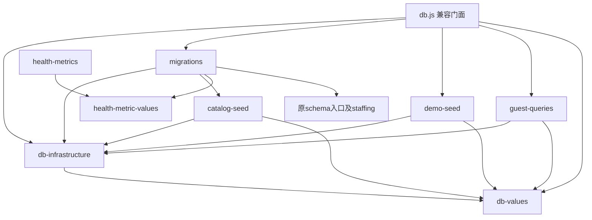

# G45数据库分层说明与验收边界

2026-10-18，worker `01a14ced-7e61-7ec1-a66e-6724ffa8ff35 / local`，基线 `54bb7d26abaf22d177f94841156ab511f3ebd13b`。Source第124轮独立验收产品与资源PASS，15件已验源码/测试/受管脚本提交 `67ede47f1f4bc356c09bc51377840901ae54cefd`，main正常合入 `9caa934df55aa4207df46530f02dc68645475bda`，逐件main blob等于冻结SHA。G45本阶段数据库分层范围完成；最终文稿/普通push及三方SHA收据见worker ignored `integration-final-packet.json`和第125轮。

## 职责和初始化

`项目源码/server/src/db.js` 从1029行缩为18行兼容门面，按原顺序执行一次连接初始化、历史迁移、可选演示种子。结果仍为原门面声明的`export let migrationResult/demoSeedResult`，保留顶层await；所有既有调用点无需更改。

| 模块 | 职责 |
| --- | --- |
| db-infrastructure.js（311行） | SQLite/MySQL连接、原方言翻译与参数适配、事务上下文及串行等待、缓存、唯一错误判别、audit log |
| db-values.js（12行） | id、业务时钟、JSON回退、同步密码兼容包装 |
| migrations.js（556行） | 两方言29版迁移、版本记录、SQLite逐版事务、MySQL原有DDL失败语义 |
| catalog-seed.js（68行） | v6目录/v7知识来源修正/v10菜品种子，仅由对应历史迁移调用 |
| demo-seed.js（44行） | DEMO_SEED=1时的基础三身份、新闻、健康记录及医嘱，已有用户即跳过 |
| guest-queries.js（42行） | publicUser、guestProfile、guestSummary查询和投影 |
| health-metric-values.js（54行） | 从health-metrics原样移出的纯常量/旧值解析，避免迁移回引业务模块和db门面 |



底层无顶层await、无回引db.js、无动态import；门面是唯一生产连接初始化调用者。数据库模块仍位于同一个src目录，`fileURLToPath(import.meta.url)`的父目录和`../data`不变，因此SQLite默认落点仍为`server/data/community-v2.sqlite`。只以合成路径验证，未打开该默认库。

## 公开导出兼容表

基线与候选均为24个导出，名称集合与函数/结果合同保持。表内是原有db.js导出，新模块的内部入口不额外暴露给门面消费者。

| 原入口导出 | 实现归属 |
| --- | --- |
| db、driver、transaction、hasActiveTransaction、inTransaction | db-infrastructure |
| escapeLikeValue、likeEscapeClause、mysqlLockSuffix、isUniqueViolation、sqliteCachedStatementCount、log | db-infrastructure |
| hashPassword、verifyPassword、id、now、json | db-values |
| migrate、runVersionedMigration | migrations |
| publicUser、guestProfile、guestSummary | guest-queries |
| demoSeed、migrationResult、demoSeedResult | db.js原声明与live binding |

健康模块仍从原入口再导出`HEALTH_METRIC_RULE_VERSION/HEALTH_DEMO_RULE/HEALTH_METRICS/legacyStructuredValue`；其余业务函数不变。显式`initializeDemoTeam`仍保留在demo-team原入口，未自动加入启动流程；纯seed模块不回引门面。原CLI、五岗位和非隔离库拒绝合同保留。

## 对照与验收

改产品前完成受管`baseline01`，改后`comparison01`使用相同探针、新的合成持久库。每次均顺序执行seed0首次/另进程重启、seed1首次/另进程重启；关闭所有数据库后才清理其受管temp。四对JSON逐字段一致：24导出、118个schema对象、表列/索引/外键、29版名称记录、11项目/8知识/5规则/15菜品/5能力设置、查询返回和可选种子结果。只规范化明确字段的生成时间与密码salt；业务日期使用探针专属固定时钟，密码另行验证。seed0无人员/新闻，seed1首次3人3新闻；显式演示团队创建4人，重启保留7人3新闻、不重种，五岗位在保存的用户行中保持。

新增4项`database-layers.test.js`验证共享实例与结果绑定、事务加入/嵌套拒绝/await隔离/回滚、真实28→29升级及记录失败回滚、客人JSON回退/排序/停用过滤/待入住状态。旧版边界通过物理删除v29唯一新增列并删除对应记录重建；执行前断言users确实无token_version、最高版本28，保留合法样本账号；不是只删除版本记录。注入版本记录写入故障时，DDL及记录均回滚，移除故障后仅应用1版且保留账号，再迁移0版。

定向28/28，最终server全测210/210，无失败/取消/跳过；12个相关JS语法通过。静态核对9整段搬运SHA（只允许新增模块末尾冗余LF规范化）、两方言各29版元数据、全部原schema文件和115—122保护报告，完整函数体/SQL/调用顺序不变。实际90模块静态与字面量动态依赖图已保存：基线7条循环路径、候选剩6条既有领域路径，G45层可达图无循环。G46领域循环未展开修复。

首次全测`server-full01`为206通过/4失败、exit1：受管包装将2030探针时钟泄漏给全测。修正仅将BUSINESS_CLOCK_NOW移入探针子进程；产品和测试断言未改。最终`server-full02`为210/210、8523.191ms、exit0；Source124确认实际没有生成目的TAP文件，保留范围为runner的32KiB尾部。首轮原回执/资源登记保留；runner原有32KiB尾部限制使首轮早期失败明细未全部留存，不虚称具备完整首轮逐项诊断。

**Source124日志事实更正（以本段为现行依据）**：第123轮及本说明旧候选版本误称“完整全测TAP保留”，实际worker的33引用证据及审计树中没有该TAP；Source相同目的参数也未生成TAP文件。双方全测210通过汇总及exit0真实，worker和Source定向28项的完整输出存在，但不能声称拥有全测完整逐项日志，也不能从命令包含`--test-concurrency=1`推断npm全测串行已经生效；具体原因未查证，不推测。阶段合同没有必须保全量TAP，Source因此仍判产品/资源PASS，并额外直接node短定向28/28（1613.662083ms、7948字节完整输出）确认关联用例；其独立全测210/210、8378.014917ms。Source新库四探针对照已核SHA的worker改前基线一致，9搬运/58元数据/90模块及12JS/完整空白/index均通过。原123、候选封包、旧失败及Source124原件保持，不为文稿补造日志或重跑全测。

MySQL仅静态原文与配置/连接失败不回退/释放语义检查，没有连接或运行MySQL；不能宣称双库实测通过。G23原SQL翻译算法、G46阶段命名与领域循环、G42保留策略未改。未跑前端lint/build/browser（纯后端）；无私密.env、用户库、真实模型/天气、Windows、scheduler、CI、依赖安装、新worktree或内部代理。复制Cookie凭据/HTTPS等G12边界及U01/V03/V04、109未全验、NOT_FINAL_ACCEPTED、历史FAIL例外保持。

## 证据与复跑

项目cwd为`项目源码`。证据根`output/resource-audit/engineering-20261018/g45/01a14ced-7e61-7ec1-a66e-6724ffa8ff35/`，沿用原output链接。`checks.py`要求真实App ID和从未使用的attempt名称，限制OS60秒、runner45秒、lease15分钟、日志8MiB/temp512MiB；峰值外层+探针或API两Session。普通全测不继承固定时钟，LLM及环境连接显式关闭。

实际命令由各attempt JSON保存。下列为原执行形式的复跑参考；npm后的并发/报告参数是否生效未经验证，不能据此保证串行或TAP落盘。本次整合不再运行。未来获授权复跑时须用自己的真实ID/新attempt并实际核对输出：

```text
python3 scripts/g45-database-layers/checks.py --task-id <真实AppID> --name <独占attempt> -- node scripts/g45-database-layers/probe-suite.js
python3 scripts/g45-database-layers/checks.py --task-id <真实AppID> --name <独占attempt> -- node --test --test-concurrency=1 server/test/database-layers.test.js server/test/db-hardening.test.js server/test/assistant-finish-atomicity.test.js server/test/browser-session.test.js
python3 scripts/g45-database-layers/checks.py --task-id <真实AppID> --name <独占attempt> -- npm test -w server -- --test-concurrency=1 --test-reporter=tap --test-reporter-destination=<自身审计根完整TAP路径>
```

上述占位仅为复跑说明，不是运行证据。原worker的`static-contract.py`可读冻结baseline01/comparison01及保护文件作搬运复核；独验者须使用自己的新库/证据，不能覆盖worker原件。最终文件SHA/语法/空白/index和准确资源后核候选时以ignored `candidate-packet.json`、`audit02-scope.json`、`after-exit.json`为准；现行以Source `source-final-review.json`及worker `integration-final-packet.json`核已验文件、整合、保护原件和日志限制。

有限自身资源门：11实例、431事件、103去重准确身份、48组、98自身路径，含首次失败/探针/API和两次auditor，全部准确退出；句柄、guardian和标准退出缺口0。audit01首次因输出位置不在选定root内被工具拒绝exit1，保留原回执，修正root包含关系后的audit02退出0；审计自身另退出后由无新Session的audit-after核清。完整untracked空白检查首次发现提取模块EOF冗余空行，已只规范化末尾LF并保留whitespace-first原回执；没有重跑测试。没有重复全历史审计。Source124独验后本第125轮仅Git/文稿，无新Session/服务，不重跑测试/探针/依赖图；双方各一次唯一名有限只读退出后核PASS，仍合计20实例694事件167准确身份80组163自身路径全退、句柄/guardian/退出缺口0。普通push最终收据由integration-final-packet给出，Source复核后才可能另派G23，第6—10未派。
