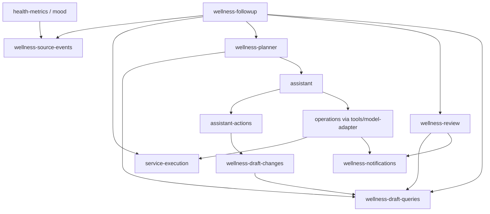

# G46当前交付：领域组织已独验并合入main

2026-10-19，Source146独立验收PASS，第147轮产品 `2f30d072e611aa9a90bb696b845f3718f0bade81` 经正常merge `6cf45203017a009cdab28110c1d3562c128d0d82` 合main。39件已验源码树字节和main blob保持Source冻结；原G46条目仅本阶段范围完成。最终六文稿与普通push/远端一致/资源实收以ignored integration-final-packet和第147轮为准。

六schema保留各自历史DDL块并按评估与初始草案/审核/助手动作/签到反馈/通知/运营职责命名；七旧stage路径仅静态兼容门面，实际生产入口无stage兼容依赖。103模块359边、六根可达72、全图SCC零；29历史迁移编号/name/顺序/条件与两方言实际up SQL保持，物理stage26表名不改。MySQL仅静态等值，未作本轮新MySQL实库/全业务验证。

Source独立Git对象/当前与worker真实改前507212B快照SHA均 `9b0010d27c377c47ad24bcda865d5f6b22d88f4cc12cf4b6e7ed28eef7ca4990`；新合成SQLite29/重复0/物理v28升级1/重启0、55表/FK保持。独立server41文件262/262（15943.429667ms），完整75176B TAP SHA `97f69f13bfdd1c33225e444932a52ef84304bdf376fd57bd016b108283c2e25d`；web70模块/8产物707ms，旧500kB chunk提示保持。worker原75192B TAP与全部旧失败原件另保留，不被新证据覆盖。

本轮整合0新Session/服务，不重测已过门；仅双方本G46有限退出后核，auditor自身原已退。U01/V03/V04/109未全验/NOT_FINAL_ACCEPTED/旧FAIL、G12复制凭据HTTPS/G23支持/G42默认关preview显式apply停写单维护进程与有界快照限制保持。9—10未派。以下145候选计划/映射/图/复跑方式完整作为历史保留；其中“候选/未关闭”是当时状态，当前以本节及146/147为准。Git整合后旧quality/static工具的基线HEAD/AGENTS保护前提不再适用，不为重跑这些旧时点门而改已验产品或历史报告。

---

# G46领域模块组织与兼容说明（候选）

2026-10-19，worker145；仅候选，待Source146独验，不关闭G46。

## 改前盘点与实施计划

从干净main `45d9af9a0a568494cf6b3e835b60ad35274ace74` 开始，实际生产图包含静态import、静态re-export与字面量动态import：93模块、339条去重边，唯一SCC有12模块：assistant-actions、assistant-booking、assistant-graph、assistant-run、assistant-session、assistant-tools、assistant、health-metrics、mood、wellness-followup、wellness-planner、wellness-review。

主要回边是 health-metrics/mood → followup → planner → assistant → health-metrics/mood，以及 assistant-actions → planner → assistant。followup另外动态加载service-execution及review。service-execution本身没有回边；notifications已是只依赖db的底层实现。不能只将五处动态import改为静态。

计划保持原函数体与SQL，按以下边界搬运：

- `wellness-source-events.js`：来源事件持久化与激活状态标记，只依赖db。health-metrics/mood/followup直接使用它，followup静态重导出原公开函数。
- `wellness-draft-queries.js`：草案解码、单草案/列表/时间线查询，只依赖db、errors、clock、environment-history；planner静态重导出原API，review/followup直接读此下层。
- `wellness-draft-changes.js`：已确认取消预约后的休息调整草案写入，只依赖下层查询、db、errors、staffing。assistant-actions直接静态调用，planner保留静态重导出。
- followup保留签到/反馈/重规划编排，静态调用service-execution、planner创建和review激活；来源写入方不再回引followup。

## Schema与运营兼容表

|旧路径|领域实现|领域公开值|
|---|---|---|
|stage21-schema.js|assessment-wellness-draft-schema.js|sqlite/mysqlAssessmentWellnessDraftSchema|
|stage22-schema.js|wellness-review-schema.js|sqlite/mysqlWellnessReviewSchema|
|stage23-schema.js|assistant-action-schema.js|sqlite/mysqlAssistantActionSchema|
|stage24-schema.js|wellness-followup-schema.js|sqlite/mysqlWellnessFollowupSchema|
|stage25-schema.js|wellness-notification-schema.js|sqlite/mysqlWellnessNotificationSchema|
|stage26-schema.js|operations-schema.js|sqlite/mysqlOperationsSchema|
|stage26-operations.js|operations.js|所有原导出（含兼容stage26Jobs）|

六份schema各保留完整历史块，只改导出标识符和导入位置。assessment与初始草案的历史v17块一起命名，明确其两项紧耦合历史职责；审核、反馈、通知分别独立，不聚合成新巨石。旧七路径只含注释和静态重导出，没有DDL、业务、动态加载或初始化。migrations、生产路由、assistant-tools、model-adapter转向领域实现。历史migration name、物理stage26表、日志/证据与文稿用词不替换。

改前已采集六schema十二导出完整值、两方言29版描述与四组实际up调用序列（recording adapter，不连接MySQL），以及11模块公开导出名。迁移函数除领域import与相应值名外保持原文；改后逐项深等值并补实际SQLite迁移/升级/重启与业务回归。原始图、快照和失败原件保留在本worker独占ignored资源根。

## 最终依赖与证据

最终实际图103模块359条去重边，全部SCC为零；从本次六个业务根可达72模块也无环。完整边列表在ignored `final-graph.json` 与 `final-static-contract.json`，原图在 `before-graph.json`。早期 `after-graph.json` 是恢复planner所需clock导入之前的中间图（358边），不作最终图。生产只剩数据库驱动合理按需动态加载；未用计算路径或注册容器替代业务边。



这里为关键职责图；完整实际图还含db各层、booking、环境、营养和助手各卫星模块，均包含在可达与全图检查中。`wellness-planner`兼容重导出changes/queries，生产调用者可直接依赖下层。新文件均在server包内；没有运行时从scripts借实现。

精确保持门包括六schema源文仅替换导出名、整个migrations源文仅替换import/值名、operations完整原文、5组搬运函数原文、followup除五调用点外原文。两方言missing/existing记录适配器分别执行197/190与291/235个调用，包含实际迁移与目录种子SQL/参数；并不模拟所有可能数据库内容。未覆盖分支仍由整个迁移函数源文保持证明，而非把记录适配器当真实MySQL。

新增结构3项、业务8项。首次定向38/40，两失败为自有fixture相同项目/日期/窗口唯一约束碰撞；仅修fixture为独立分钟窗口，补8/8；其余32项先前通过。完整server最终41文件262/262（15706.803125ms），fail/cancel/skip=0，完整TAP75192B，SHA256 `ce74c2ff5246066f5f6a0f7eebad14ca87a6eb0eb11a284e706aeaa9b29276dc`。覆盖来源事务/幂等/快照、反馈修订、实际本地recorded协调器评估、旧版本与当前激活、休息调整、天气取消回滚/通知、既有五岗服务与四域采纳/医护修订/审批回滚。未调用真实模型/天气。

SQLite持久探针：新嵌套目录初始化29/重复0，物理删除token_version和v29记录构成v28边界，重启升级1，再重启0；55表结构/索引/外键完全等值、合成旧用户保持、FK检查空、关闭后缓存0。首次探针比较因Node SQLite空原型对象与JSON对象原型差异失败，修为双方完整JSON数据比较后通过；原件保留。web Vite5.4.21生产构建70模块/8产物/725ms，envDir/outDir/cacheDir均自身受管临时根；保留原500kB chunk提示，不改拆包。产物在准确退出及句柄关闭后清理。

## Source146复跑入口

cwd为项目 `项目源码`，工具要求真实task-id和唯一name，已有同名证据拒绝覆盖。Source使用自己的实际ID；不需要checkout、worktree、复制依赖或启动MySQL。以下按顺序执行，不并发资源会话：

```sh
python3 scripts/g46-domain-modules/checks.py --task-id 01a0cbfe-a161-72d0-992d-12fad655d4ef --name source146-baseline -- node --experimental-vm-modules scripts/g46-domain-modules/snapshot.js before 45d9af9a0a568494cf6b3e835b60ad35274ace74
python3 scripts/g46-domain-modules/checks.py --task-id 01a0cbfe-a161-72d0-992d-12fad655d4ef --name source146-comparison -- node --experimental-vm-modules scripts/g46-domain-modules/snapshot.js after
python3 scripts/g46-domain-modules/static-contract.py --task-id 01a0cbfe-a161-72d0-992d-12fad655d4ef --name source146-static
python3 scripts/g46-domain-modules/checks.py --task-id 01a0cbfe-a161-72d0-992d-12fad655d4ef --name source146-migrations -- node scripts/g46-domain-modules/probes.js migrations
python3 scripts/g46-domain-modules/checks.py --task-id 01a0cbfe-a161-72d0-992d-12fad655d4ef --name source146-server -- node scripts/g46-domain-modules/suite.js
python3 scripts/g46-domain-modules/checks.py --task-id 01a0cbfe-a161-72d0-992d-12fad655d4ef --name source146-web -- node scripts/g46-domain-modules/probes.js web
python3 scripts/g46-domain-modules/checks.py --task-id 01a0cbfe-a161-72d0-992d-12fad655d4ef --name source146-quality -- python3 scripts/g46-domain-modules/quality.py
```

`snapshot before <SHA>`从Git对象读取原始schema、迁移、目录种子和公开导出，不落旧代码树；worker已将此方式与改前真实运行快照精确比较。after用本任务根的before或before-git快照。所有命令OS60秒/runner45秒/15分钟租期/8MiB日志/512MiB临时目录，嵌套探针/既有API测试与外层总峰值两Session。suite保存完整TAP及SHA；不是runner的32KiB tail。

资源审计只选各自本阶段根，先受管运行既有 `scripts/resources/audit-resource-scope.js`（完整真实task-id、executing-app-thread-id、root/out均自身本G46根），审计自身退出后直接 `audit-after.py --task-id <真实ID> --name <唯一名>`，不跑旧cleanup/全历史审计。最终逐文件SHA、所有失败/嵌套/auditor退出、句柄与自身路径结果在worker `candidate-final-packet.json` 和 `final-after-exit.json`，不循环填写报告自身SHA。

仅worker候选PASS。未暂存、提交、合并、push或关G46，不派9—10。MySQL仅静态等值；Windows/browser/scheduler/CI、用户库/私密.env、真实模型/天气均未运行。原G12复制凭据HTTPS、G23支持边界、G42默认关闭/preview/停写单进程手动维护及有界预算、U01/V03/V04/109未全验与NOT_FINAL_ACCEPTED/历史FAIL均保持。
