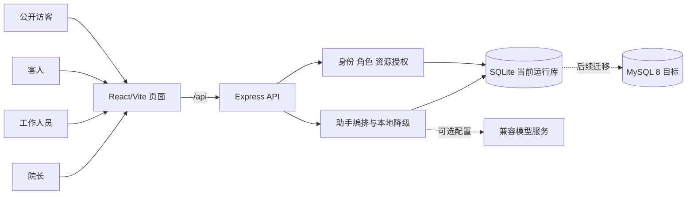

# 海屿康养社区项目工程文档

> 版本：0.1（2026-09-23）
>
> 基线：本地 `main` 的 `906284c`；此哈希只标识编写时的代码快照，阅读时应以 `git rev-parse HEAD` 核对。
>
> 用途：统一当前产品边界、设计约束、后续任务、阶段验收与开发操作。本文件是执行依据，不是“全部需求已通过”的证明。

本文件记录 `906284c` 时点的代码事实，不随之后的提交自动更新。每次交接应重新附上 `git status --short --branch` 和实际提交哈希，并单独核对远端是否包含这些变更。

## 0. 阅读顺序与证据规则

1. 先读[根 README](README.md)完成本地启动，再读[现行 API 与运行契约](docs/API运行契约.md)理解已实现接口。
2. 用[Quest Map](QuestMap.md)安排从零教学关卡；它描述学习路径，不能替代当前源码的测试报告。
3. 用[交接文档](交接文档_海屿康养社区.md)、[原始选题说明](项目依据/基于多智能体的海滨疗养智能康养服务系统.docx)、[需求跟踪矩阵](<项目依据/基于多智能体的海滨疗养智能康养服务系统_需求跟踪矩阵(1).xlsx>)、[概要设计](概要设计/海屿康养社区概要设计_详细修订版.docx)和[MySQL 数据字典](数据库设计/海屿康养社区数据库设计.xlsx)理解完整愿景。
4. 证据优先级为：**当前源码与实际运行结果 > 现行 API 契约 > 2026-09-22 交接文档 > 历史设计和 RTM**。若源码与契约冲突，先记录差异并修正文档或实现；不得把历史设计写成当前事实。
5. [首轮开发验收记录](验收记录/首轮开发验收_2026-09-23.md)和 `docs/开发基线.md`、`docs/API当前基线.md` 是旧时点记录。其中列出的四个问题已在后续本地合并中处理；该记录的“整体验收不通过”结论不能直接套用到当前 `906284c`，也不能被删除。当前验收须重新运行命令并保留结果。

本文件中的状态统一为：**已实现**（源码存在）、**本地已验**（列出实际命令和结果）、**待验**（缺少对应执行证据）、**未实现**（没有完整业务路径）、**待决策**（产品边界未冻结）。不以页面文案、表字段预留或模型提示词代替功能证据。

## PROJECT_DESIGN｜项目设计

### 1. 产品目标与边界

当前可交付对象是可在开发机运行的康养社区基础版：公开访客看社区介绍、演示天气和新闻；客人登录后查看本人资料、健康记录、医嘱并修改有限联系信息；工作人员只处理当前有效分工内的客人，可人工发布建议；院长查看员工及工作记录并提交管理意见；四类场景均有助手入口，默认不依赖真实模型服务。

“四类场景”中的 `public` 是匿名使用状态，不是可登录的第四种账号。当前 `users.role` 仅有 `guest`、`staff`、`dean`。工作人员不再细分为医护、管理员、服务人员。界面文字中的“医嘱/建议”由有权限的工作人员人工发布；助手不能直接诊断或发布。

以下属于扩展愿景，**当前不作为基础版完成项**：自助注册与入住、七日疗程、滨海项目库、潮汐和海况预约、容量管理、膳食点餐、情绪打卡、健康指标录入、医护审核队列、多领域自治智能体、正式 MySQL 应用迁移、真实模型质量评测以及云端生产部署。原始 RTM 共 109 条，需要逐条建立当前状态和证据，不能整体标记为通过。

### 2. 技术选型与架构

| 层次 | 当前实现 | 职责 | 边界 |
| --- | --- | --- | --- |
| 浏览器 | React 18、Vite 5、CSS | 公开页和三类角色工作区；显示加载/错误/空状态；调用相对路径 `/api` | 不直连 SQLite 或模型服务；不以隐藏按钮充当授权 |
| HTTP API | Node.js 22、Express 4 | JSON 路由、身份/角色/资源授权、业务校验、结构化错误 | 前端不直接拼 SQL；所有敏感读取由 API 判断客人范围 |
| 数据 | Node 内置 `node:sqlite`、本地 SQLite 文件 | 身份、分工、档案、健康、建议、新闻、审计、院长意见、助手会话和采集记录 | 当前运行库；`MySQL 8.0` SQL/字典只作迁移目标 |
| 可选模型 | OpenAI-compatible HTTP 接口 | 增强助手回复 | 未配置时安全引导；`live` 配置标志不证明外部连通；密钥只在服务端 |
| 工程入口 | npm 10 workspaces、GitHub Actions 配置 | 安装、开发、测试、构建 | 当前 GitHub 端 CI 尚无运行证明；本地质量门独立记录 |



现有代码入口为 `项目源码/web/src/main.jsx`（页面与助手组件）、`项目源码/server/src/app.js`（20 条 API）、`authorization.js`（客人资源边界）、`assistant.js`（会话与模型降级）、`db.js`（表结构/种子/事务）、`auth.js`（令牌）和 `password.js`（密码哈希）。前端目前集中在单个 JSX 文件；新增复杂功能时应按功能拆组件，但不为了“看起来分层”先做无关的大规模重构。

### 3. 权限模型

| 资源或操作 | 匿名访客 | 客人 | 工作人员 | 院长 |
| --- | --- | --- | --- | --- |
| 新闻、公开助手 | 可用 | 可用 | 可用 | 可用 |
| 本人资料修改 | 不可 | 仅电话、紧急联系人、行动能力 | 不可 | 不可 |
| 健康记录与建议 | 不可 | 仅本人 | 仅有效分工客人 | 活跃客人范围 |
| 客人列表、详情、建议发布 | 不可 | 不可 | 仅有效分工客人 | 活跃客人范围 |
| 员工日志与院长意见 | 不可 | 不可 | 不可 | 可用 |
| 助手会话历史 | 仅本匿名会话 | 仅本人会话 | 仅本人且绑定授权客人上下文 | 仅本人会话 |

鉴权使用 `Authorization: Bearer <token>`。角色限制之后还须校验客人是否活跃、分工是否生效，以及会话所有人、角色和关联客人是否一致。`GET /api/staff/guests` 不提供分工管理能力；分工管理接口属于后续任务。精确字段、错误码和 20 条路由以[现行 API 契约](docs/API运行契约.md)为准。

### 4. 数据设计与关键业务流

当前 SQLite 主要实体：`users`、`guest_profiles`、`staff_guest_assignments`、`health_records`、`medical_advice`、`news`、`audit_logs`、`staff_reviews`、`assistant_sessions`、`assistant_messages`、`health_intakes`。`assistant_sessions` 决定消息归属；`staff_guest_assignments` 决定工作人员可见范围；`health_intakes` 只是待核实采集记录，不会自动改正式档案。MySQL 数据字典和建库脚本的字段、枚举、索引为迁移输入，不代表应用已连接 MySQL。

关键流程须保持以下顺序：

1. **登录**：校验账号、密码和所选角色 → 签发短时令牌 → 受保护请求重新确认账号仍可用 → 前端按服务端身份进入工作区。
2. **员工发布建议**：校验令牌及有效分工 → 读取目标客人 → 员工手工确认标题/内容/优先级 → 写建议与审计 → 客人在本人页面读到生效建议。
3. **院长意见**：院长选择员工 → 读取该员工工作记录 → 人工提交意见 → 写意见与审计；表单草稿必须绑定所选员工，切换对象时不串稿。
4. **助手对话**：根据令牌决定 `public/guest/staff/dean` 能力 → 校验会话所有权和客人上下文 → 保存双向消息 → 可选调用模型；失败/超时返回本地引导。客人健康关键词可写入 `health_intakes.pending`，不得直接当作已核实病历。

### 5. 质量属性与取舍

- **正确性优先**：跨角色、跨客人、跨会话、分工撤销/过期、只读字段注入都是必须验证的反例；UI 隐藏控件不能代替 API 校验。
- **可复现**：锁文件采用 `项目源码/package-lock.json`；安装使用 `npm ci --ignore-scripts`。测试数据库与演示数据库分离；构建不依赖真实模型。官方 [npm ci 文档](https://docs.npmjs.com/cli/v10/commands/npm-ci/)说明它按锁文件进行干净安装且不会改写锁文件。
- **可追溯**：每个任务要有需求来源、变更范围、验证命令及退出码；更新接口时同步现行契约，更新业务范围时同步 RTM 映射。旧验收记录保留原样。
- **可退化**：外部模型未配置、失败或超时时，页面仍能完成公开浏览、登录、健康记录和人工建议流程。
- **本地交付边界**：当前完成标准是本地安装、测试、构建和四场景演示。生产密钥、备份、监控、HTTPS、正式数据库等是上线前另设的验收门，不因本地构建通过而自动满足。

## PROJECT_TASK_BREAKDOWN｜任务拆分

任务从**当前合并代码**继续，不重做已经存在的基础版。若用于课堂从零复现，则按 [Quest Map](QuestMap.md) 的 68 关顺序执行；下表只管理当前仓库的后续工程工作。每个任务有单一交付物、依赖和可检查的退出条件。实现者须在阶段结束后停止，先验收再进入下一任务。

| ID | 工作范围与交付物 | 输入/依赖 | 验收证据 | 状态 |
| --- | --- | --- | --- | --- |
| E0.1 | 建立现行 20 条 API 与 109 条 RTM 的映射表，逐条标记已实现、部分覆盖、未实现及证据路径 | 当前源码、API 契约、RTM | 映射表每条有状态；“已实现”至少有接口/页面和测试或手测证据 | 未实现 |
| E0.2 | 清理工程说明的时点冲突：标记旧文档、统一 Node 版本门槛与 npm 锁文件口径；保留历史资料 | README、`package.json`、旧 `pnpm-*` 文件 | 新人只按 README 可运行；历史快照不再被误引为现行契约 | 部分完成 |
| E1.1 | 为新闻、改密、建议发布、院长意见补独立 API 集成测试 | `node:test`、现行契约；E0.1 | `npm test` 退出码 0；新增测试含成功、非法角色、非法资源或非法输入 | 待执行 |
| E1.2 | 对公开页、客人、工作人员、院长四场景进行实际浏览器验收并保存记录 | E1.1、临时数据库 | 操作步骤、截图/日志、端口、提交哈希、通过/失败逐项记录 | 待执行 |
| E1.3 | 核对 GitHub Actions 安装/测试/构建结果 | 已授权的远程更新；E1.1 | 对应提交的 CI 运行链接与全部 job 结论 | 待验；当前不能据配置声称通过 |
| E2.1 | 冻结健康采集审核规则：审核人、确认/驳回、冲突处理和档案更新边界 | 交接文档、数据字典、产品确认 | 一页决策记录和可验收示例，明确助手不自动改正式档案 | 待决策 |
| E2.2 | 实现仅授权人员可查看、确认或驳回 `health_intakes` 的 API | E2.1、分工授权 | 临时库测试覆盖未授权、重复审核、原始记录留存、确认后的状态 | 未实现 |
| E2.3 | 在工作人员空间显示待审核采集并提供人工操作 | E2.2 | 浏览器提交确认/驳回后状态与 API 一致，无自动发布医嘱 | 未实现 |
| E3.1 | 对比 SQLite 与 MySQL 8 结构和语义，输出迁移差异清单 | E1 完成、MySQL SQL/字典 | 表、字段、枚举、索引、时间和事务差异均有结论 | 未实现 |
| E3.2 | 建立可切换的数据访问实现，保持 20 条现行 API 契约 | E3.1 | 同一套 API 测试能在 SQLite 与临时 MySQL 测试库运行 | 未实现 |
| E3.3 | 编写可重复迁移、校验和回退步骤 | E3.2 | 迁移前后行数/关联/权限样本相符；中断后可安全重试或恢复 | 未实现 |
| E4.1 | 按选定服务的官方文档固化模型接口契约，用本地 stub 测试正常、错误和超时 | E1、E2；模型供应方待选 | 无真实密钥的测试全部通过，降级模式可见 | 部分已有 stub 测试 |
| E4.2 | 评估真实模型的角色回复、上下文最小化和人工确认边界 | E4.1、明确的评测样例和测试账号 | 记录样例、预期、实际与失败处理；真实请求经授权后才运行 | 待决策 |
| E5.1 | 从 109 条 RTM 中选择下一条最小业务链并冻结范围 | E0.1、基础版验收 | 新链路的输入、非目标、接口、数据和黑盒验收经产品确认 | 待决策 |

**范围控制**：E0/E1 是当前版本的证据补齐；E2 是相邻但未闭环的业务；E3/E4 是独立技术迁移与外部依赖；E5 才进入疗程、预约、潮汐等扩展。E0.1 按 RTM 的模块分批核对并逐批验收；E3.2 按认证、公开、客人、工作人员/院长、助手五组接口逐组替换和回归。每次只执行一个任务或一个明确批次，不让后续任务从缺少前序成果的旧分支开始。任务没有负责人、估时或绝对发布日期时，不编造承诺；立项时补齐。

## MILESTONES_AND_EXECUTION_PLAN｜里程碑与执行计划

### 1. 串行里程碑

| 里程碑 | 进入条件 | 完成定义与质量门 | 下一步 |
| --- | --- | --- | --- |
| M0 本地基础版基线 | 当前 `main` 代码 | 20 条路由与三类登录存在；最近本地 `npm test` 为 10/10、`npm run build` 通过。真实模型和 GitHub CI 不列入已验 | E0/E1 |
| M1 需求追溯与可重复验收 | M0；冻结当前代码哈希 | 完成 E0.1、E0.2、E1.1、E1.2；API/页面证据可追踪，测试与构建通过；E1.3 只在远程更新获授权后验收 | M2 |
| M2 健康采集人工审核 | M1；E2.1 产品规则确认 | E2.2/E2.3 后端与界面一致；跨角色/跨客人反例通过；正式档案只在明确人工确认路径更新 | M3 |
| M3 MySQL 8 迁移可回退 | M2；独立测试库与迁移样本准备 | E3.1–E3.3：双数据库契约测试、迁移校验、重试/回退演练通过；不直接改当前演示库 | M4 |
| M4 模型服务受控接入 | M3；供应方与评测样例确定 | E4.1 stub 质量门通过；E4.2 真实服务结果单独记录，不把“已配置”当“已验收” | M5 |
| M5 下一条产品链路立项 | M4；RTM 映射可用 | E5.1 明确一条小链路及其验收，后续另立任务 | 新迭代 |

里程碑是**先后和退出门**，不是固定日期。若产品决定暂不迁移 MySQL 或暂不接真实模型，应显式改写里程碑依赖，并把被跳过项标成“延期/范围外”，不能标“通过”。课程本地演示可以停在 M1；M2–M5 不影响已经定义的基础版课堂验收。

### 2. 每阶段执行节奏

1. **准备**：确认需求来源、现有工作树、阶段边界、依赖和测试数据；记录基线提交与未提交改动。未提交文件必须保留并在隔离工作树中兼容处理。
2. **设计**：只细化本阶段的 API、数据、页面状态与反例；变更现行接口时同步契约。设计未决项由产品确认后再实现相关部分。
3. **实现**：按当前阶段范围修改；一次提交/变更集只解决同一原因的问题。涉及不同资源所有权时先完成当前阶段，再进入下一阶段。
4. **自测**：使用临时库运行相关测试、完整 `npm test`、`npm run build`；需要 UI 的任务做实际浏览器交互。记录退出码、关键输出、未运行项与原因。
5. **评审/验收**：核对范围、负例和证据；失败则回到同阶段修复。通过后保存工作树/分支/提交或差异的位置，再开始下一阶段。

若使用已约定的 Codex 协作方式，Sol 负责阶段规划和验收，Luna Max 只执行当前阶段；任意时刻仅派发一个独立 App task。每阶段完成即停止并交回验收包，不由实现任务自行推进下一阶段。当前文档工作本身不派发开发任务。

### 3. 验收包与变更控制

阶段验收包至少包含：`PASS/BLOCKED/FAIL`、修改文件及用途、运行命令及退出码、测试/构建/浏览器关键结果、未运行项及原因、`git status` 与 diff 摘要、代码所在分支/worktree/提交或未提交差异、下一阶段需继承的状态。产品考官按操作和可见结果验收；技术评审核对资源边界、数据一致性和可维护性。

任何新增范围应先写入 E0.1 的 RTM 映射与阶段任务，再决定优先级。不得因为 UI 看似完成就省略服务端授权，也不得因为构建通过就推断业务验收通过。当前用户未授权的暂存、提交、推送、PR 或生产写入不属于自动执行步骤。

## INIT_AND_CODING_GUIDELINES｜初始化与编码规范

### 1. 开发环境初始化

命令均从仓库根目录进入 `项目源码` 后运行；根目录不是 npm 工作区。项目声明 Node `>=22`、npm `>=10`，但 `node:sqlite` 在 Node 22.13.0 后才无需 `--experimental-sqlite` 标志；因此本地建议使用 **Node 22.13+ / npm 10+**，并记录实际版本。此细节应在 E0.2 同步到包声明和 README；Node 官方[版本说明](https://nodejs.org/download/release/latest-v24.x/docs/api/sqlite.html)记录了该标志变化。

```bash
cd 项目源码
node --version
npm --version
npm ci --ignore-scripts
npm run dev
```

打开 `http://localhost:5180`；API 健康检查为 `http://localhost:3020/api/health`。`npm run dev` 同时启动前端和后端；`npm start` 只启动 API。新机器首次启动会在 `项目源码/server/data/` 生成 SQLite 演示库。不要把数据库文件、WAL/SHM、`node_modules`、`web/dist` 或密钥提交到 Git。

`.env.example` 是说明文件，不会自动加载；可复制为 `项目源码/.env`。执行 `npm start` 或 `npm run dev` 时，API 启动脚本读取 `.env`，显式设置的环境变量优先；Vite 仅读取其中的 `WEB_PORT` 和 `API_PROXY_TARGET`。`DB_PATH` 的相对路径按 `server` workspace 进程工作目录解析；在 `项目源码` 执行根工作区脚本时，`DB_PATH=./data/community-v2.sqlite` 指向 `项目源码/server/data/community-v2.sqlite`。变更变量后重启 API。`LLM_BASE_URL` 与 `LLM_API_KEY` 同时有效才会尝试调用模型；本地基本验收可将 key 保持为空。

### 2. 日常命令与数据隔离

```bash
cd 项目源码
npm test
npm run build
npm run preview -w web
```

`npm test` 运行 `server/test/*.test.js`。集成测试应自行创建临时 SQLite 文件并在结束后清理；从命令行额外指定临时 `DB_PATH` 可再加一层隔离，例如 POSIX shell 下使用 `DB_PATH="$(mktemp -d)/haiyu-test.sqlite" npm test`。不要让测试、迁移演练或教学关卡直接改正在使用的演示库。Vite 构建产物在 `项目源码/web/dist`。GitHub Actions 配置位于 `.github/workflows/ci.yml`，使用 Node 22、`npm ci --ignore-scripts`、临时数据库、测试和构建；远程运行结果须另查对应提交。[GitHub 官方指南](https://docs.github.com/en/actions/tutorials/build-and-test-code/nodejs)也将固定 Node 版本、锁文件安装、测试与构建作为 Node CI 的基本步骤。

当前仓库仍保留旧 `pnpm-lock.yaml` 和 `pnpm-workspace.yaml` 文件；它们不是当前依赖真相来源。新增或更新依赖只使用 npm 并同步 `项目源码/package-lock.json`；是否删除旧文件归入 E0.2 的独立清理，不夹带在业务改动中。

### 3. 编码边界

- **前端**：以页面功能和角色组织组件；API 请求统一处理成功、加载、空数据、失败和令牌失效。账号/角色/客人切换后清理相应助手上下文；迟到响应不能覆盖新上下文。资料表单只发送 `phone`、`emergencyContact`、`mobility`，只读字段也由后端再次拒绝。
- **API**：路由先做身份与资源授权，再读取或写入业务数据；错误返回结构化 `code` 和可读说明。接口字段、状态码、权限有变化时同批更新 `docs/API运行契约.md` 与测试。不要仅通过前端条件渲染实现权限。
- **数据库**：新增表/字段要写可重复的迁移和回退说明；多表写入使用事务；种子数据只在首次初始化或受控迁移时插入，不得在每次启动时恢复已撤销分工。查询优先使用参数绑定，测试通过临时库验证重启、删除、过期和无数据场景。
- **助手**：前端传来的角色、会话 ID、`guestId` 均须由服务端核对；模型只接收必要上下文。真实服务错误和超时必须降级；模型输出不能直接成为正式病历或医嘱。
- **测试**：优先测业务边界和回归风险，不写只重复实现细节的断言。API 测试至少覆盖成功路径、无凭证、错角色、越权资源、非法输入和重启后的持久状态；UI 任务给出可执行的点击路径和可见结果。
- **命名与差异**：沿用现有英文文件/函数名与中文用户界面文案。避免无关格式化或同时重命名大量模块，使阶段 diff 可审。文档中的示例账号和密钥只作本地演示，不写入新业务日志。

### 4. Definition of Ready / Done

任务进入开发前应具备：需求来源、单一目标、明确非目标、输入依赖、预期文件范围、可操作验收步骤，以及无需猜测的测试数据。若涉及审核责任、数据库切换或真实模型供应方，先形成决策记录。

任务完成时必须同时满足：交付物存在；本阶段正反例通过；`npm test` 与 `npm run build` 通过或明确记录与本改动无关的既有失败；需要页面的任务做浏览器检查；文档与契约同步；未触碰无关用户改动；验收包能让另一人复现。任何一项未达到就保持“待验/阻塞”，不能仅凭代码已写完标记完成。

## 风险、待决策项与维护规则

| 项目 | 当前事实/风险 | 下一动作 |
| --- | --- | --- |
| 文档时点 | 旧基线与首轮验收记录仍描述合并前状态 | 以 E0.1/E0.2 建映射，保留历史并在入口标清现行版本 |
| Node 版本 | 包声明 `>=22` 比无标志使用 `node:sqlite` 的推荐下限宽 | E0.2 对齐版本说明和引擎约束 |
| 依赖锁文件 | npm 与遗留 pnpm 文件并存 | 固定 npm 为唯一工作流，单独决定旧文件处置 |
| 健康采集 | 已写待核实记录，缺人工审核 API/界面 | 先确认审核责任，再做 E2 |
| 数据库 | SQLite 当前运行；MySQL 8 只有目标设计和建库脚本 | E3 做双库契约、迁移校验和回退演练 |
| 外部模型 | 本地 stub/超时降级有测试，真实服务未验 | E4 单独评测；不得以状态位 `live` 代替真实连通证据 |
| 持续集成 | 工作流配置存在，本地测试/构建通过；远程运行未核实 | 获授权更新远端后用对应提交的 Actions 结果验收 |
| 需求范围 | 109 条 RTM 远超当前基础版 | E0.1 映射后逐条立项，不一次性并入当前迭代 |

本文件随**已验收的事实变化**更新：API 改动先改契约，任务完成后补验收证据和状态，范围变更先补决策与里程碑。绝对日期、负责人、真实模型服务和下一条扩展业务由产品负责人确认后再填写，不在工程文档中虚构。
